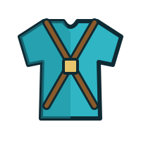

<p align="center"></p>

<h1 align="center">RuneHarness</h1>

<p align="center"><b>Armour for your changes: build, verify, ship.</b><br>
An agent harness that takes code changes from idea to merged PR or release, with a human approving every public act.</p>

<p align="center"><a href="LICENCE">ISC licence</a> · Python 3 · SQLite</p>

---

RuneHarness coordinates Claude Code agents that work on two products, overnight and across days, and publishes their
work only when you say yes.

| product | repos |
|---|---|
| **Client**: RuneLite plugins inside the official OSRS Android app | [osrs-plugins-reverse](https://github.com/AlexPerrin/osrs-plugins-reverse) |
| **Server**: the [OpenRune](https://github.com/OpenRune) test server, with contributions sent upstream | [OpenRune-Server](https://github.com/AlexPerrin/OpenRune-Server), [-Central-Server](https://github.com/AlexPerrin/OpenRune-Central-Server), [-FileStore](https://github.com/AlexPerrin/OpenRune-FileStore) |

It is neither product's code; it is the machinery that moves their changes to their live targets.

## How it works

1. **Agree what "done" means.** An evaluator agent writes the criteria before any code exists.
2. **Build.** A dev agent implements the change in its own worktree and submits a commit.
3. **Check.** Track scripts build, test and bring the stack up; an evaluator judges the result against the criteria.
4. **Approve.** Each public act (an upstream PR, a comment, a release) is shown as one card with its exact texts.
5. **Publish.** On your approval the harness publishes exactly that card, nothing else.
6. **Iterate.** Maintainer feedback becomes a new change on the same PR.

Every decision, verdict and approval is a row in one SQLite ledger. Agents' words are never evidence; only commits,
trees, files, GitHub state and processes are.

## Roles

| role | does |
|---|---|
| **driver** | your console: shows cards and questions, does what you say, nothing on its own |
| **orchestrator** | the autonomous loop: spawns runs, supervises them, restarts when drained |
| **dev** | builds a change on one track |
| **qa** | writes the criteria, then judges the head |
| **reader** | read-only lookups for a run |

## Layout

```
harness/   hd.py (the commands), store, observe, decide, act, publish, kpi, hook
tracks/    one directory per repo: build, up, down, gate, ship, measure, log, test
mcp/       osrs-mcp (cache, wiki, gamevals) and the devtools front for mobile and desktop
.claude/   agents and skills
docs/      PROBLEM, PRD, ARCHITECTURE: the source of truth
tests/     python3 -m unittest discover -s tests
```

## Quick start

```
python3 harness/hd.py                 # a pass, then the view
python3 harness/hd.py tick --dry-run  # the view, changing nothing
python3 -m unittest discover -s tests
```

Chat with the driver: `claude --agent driver`. Run the loop: `harness/orchestrator.sh`.
Public acts wait for your explicit approval, given in the driver console.

## Documentation

- [docs/PROBLEM.md](docs/PROBLEM.md): what the harness is for, the workflow, the goals
- [docs/PRD.md](docs/PRD.md): requirements
- [docs/ARCHITECTURE.md](docs/ARCHITECTURE.md): the ledger, the state machine, the modules
- [CLAUDE.md](CLAUDE.md): the rules every session runs under

## Safety

- Nothing is published upstream or released without your explicit approval of the exact texts.
- Client builds never contact Jagex or RuneScape servers; every APK goes through the telemetry patch.
- Your own RuneLite profile is never read or modified.

## Disclaimer

RuneHarness is an independent fan project. It is not affiliated with, endorsed by or sponsored by Jagex Ltd.
RuneScape and Old School RuneScape are trademarks of Jagex Ltd. The logo is original artwork.

## Licence

[ISC](LICENCE) © 2026 Alex Perrin
