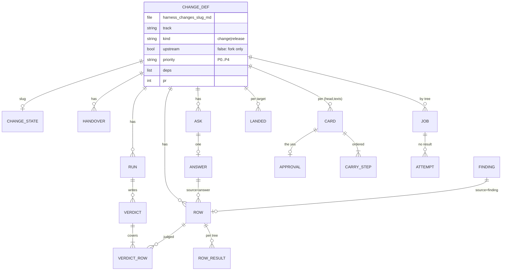
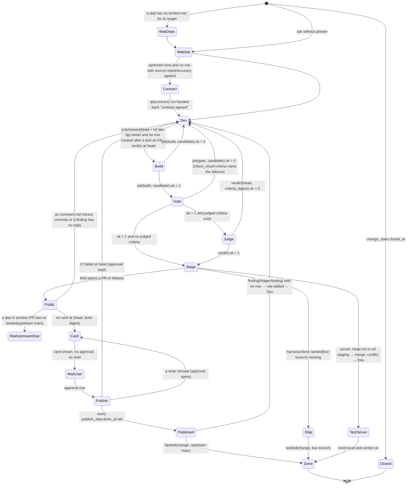
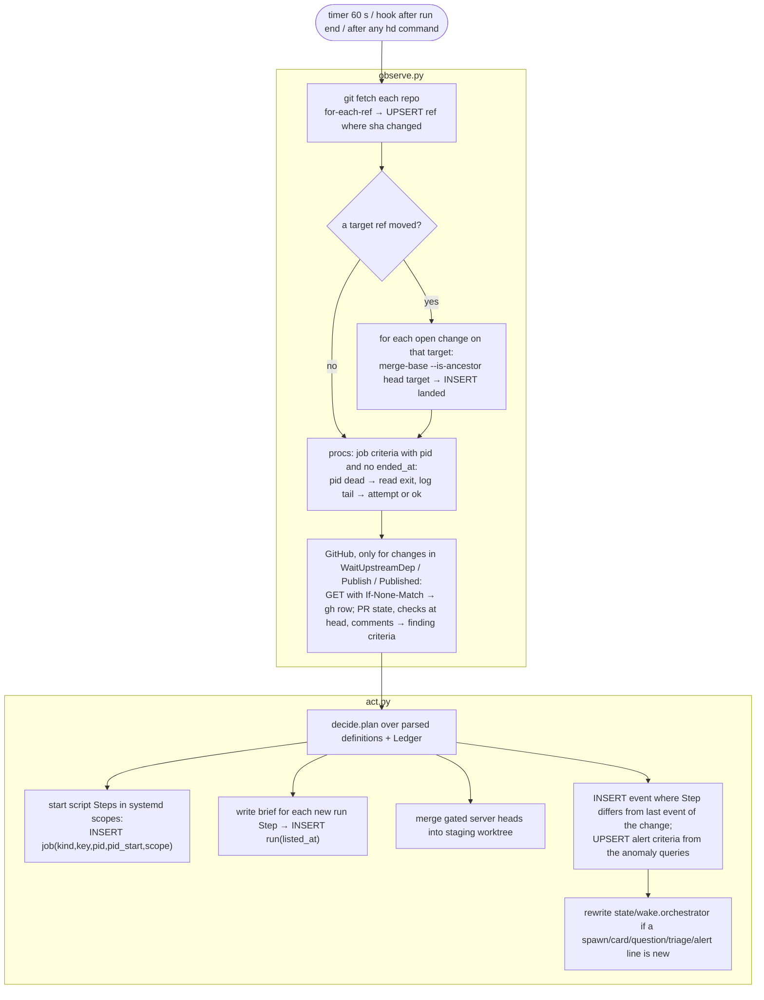
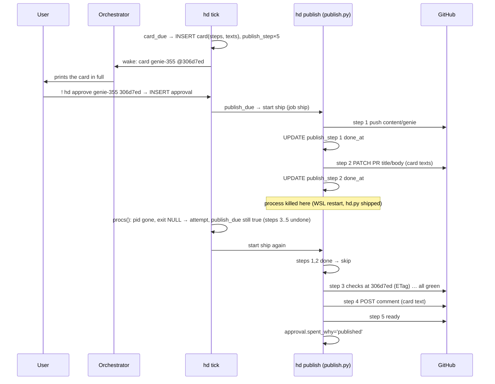
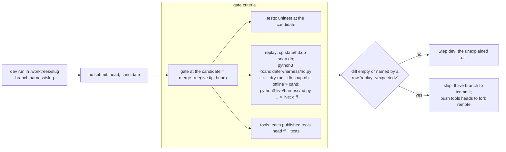
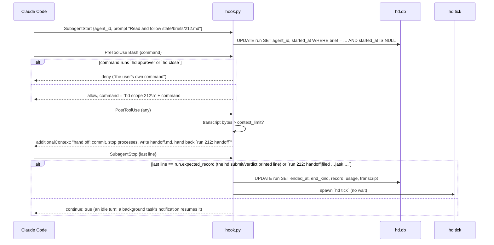
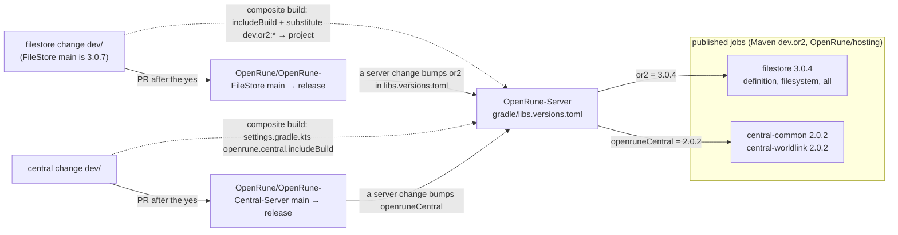

# Architecture

The solution to docs/PROBLEM.md that meets docs/PRD.md. The vocabulary is PROBLEM's: a change, its criteria
(scripted or judged), a submission, the candidate tree, a job (build, gate, deploy, publish), staging, a verdict,
a card, an approval, a publish, a question and its answer, an alert, a run, the ledger.


## 1 Files

```
harness/hd.py    argparse front: one function per command (§8), ~300 lines
harness/store.py connect(), MIGRATIONS, typed query helpers; the only module that opens hd.db, ~350
harness/observe.py world → ledger: fetch, refs, landed, gh (ETag), procs, docker, ~250
harness/decide.py ledger → Step per change, plan() for the pass; imports no subprocess, ~350
harness/act.py   start a script in a systemd scope, write a brief, compute candidate, wake the orchestrator, ~250
harness/publish.py card() builds steps+texts; ship() executes publish_step criteria, ~250
harness/hook.py  SubagentStart/Stop, PreToolUse (2 rules + scope line), PostToolUse (context limit), ~150
harness/kpi.py   the queries behind `hd kpi`, ~100
hd.yaml          repos {name, path, tools, upstream?}, agents, context_limit, hold, pins
tracks/<repo>/   one directory per repo: track.sh (build | up | down | gate | ship | measure | log | test | recipe), track.md
                 (rules, seed criteria), the repo's scripts; tracks/harness/track.sh: test | gate | ship | recipe
.claude/skills/  the judgment skills of every track (accuracy, dupes, pr-text, probe, qa-server, reverse, qa-client,
                 network-qa): in this repo, so every run spawned by the orchestrator has them natively
harness/orchestrator.sh   the supervisor (§16)
.claude/agents/  orchestrator.md (≤20 lines), dev.md, qa.md, reader.md      (no planner, no monitor: §13)
harness/goals/*.md  harness/changes/*.md     definitions, committed (format unchanged), beside the code
evidence/<slug>/    accuracy.md pr-title.txt pr-body.md pr-comment.md pr-reply-<id>.md handoff.md ...
state/hd.db         the ledger        state/<slug>/*.log   script logs      state/briefs/<run>.md
state/wake.orchestrator                 one line per new spawn/card/question/triage/alert (inotify target)
```
The product repos hold product code only. Every script and skill the harness runs lives here, under `tracks/<repo>/`
and `.claude/skills/` (v8 kept them on a tools branch in each product repo, which needed published tools heads, tools
rebases, tools conflicts and content-hashed copies so a ship would not move a running script; one repo and serial
ships need none of that: a script runs from the live checkout, and a ship waits for the scripts in flight it would
change, a fact in `job`). The scripts' content is v8's: the fork CI at `gate/<slug>`, the desktop instances,
the mobile allowlist. Two additions: `recipe <verb>` prints the recipe version string; `up`/`deploy` call `hd step`.

## 2 Schema (store.py, migration 1)

```sql
PRAGMA journal_mode = WAL;  PRAGMA foreign_keys = ON;  PRAGMA user_version = 1;

-- runtime state of a definition (the definition itself stays harness/changes/<slug>.md)
CREATE TABLE change_state (
  slug        TEXT PRIMARY KEY,
  closed_at   TEXT, closed_words TEXT,                 -- hd close (the user)
  folded_into TEXT REFERENCES change_state(slug)       -- hd fold (the orchestrator): scope moved, no runs
);

CREATE TABLE run (
  id          INTEGER PRIMARY KEY,
  change      TEXT NOT NULL,
  role        TEXT NOT NULL CHECK (role IN ('dev','qa')),
  mode        TEXT NOT NULL CHECK (mode IN ('code','contract','judge','plan')),
  input       TEXT NOT NULL,                           -- digest of what the brief holds (head, criteria, answers, verdict)
  brief       TEXT NOT NULL,                           -- state/briefs/<id>.md
  agent_id    TEXT UNIQUE,                             -- bound by the SubagentStart hook
  listed_at   TEXT NOT NULL, started_at TEXT, ended_at TEXT,
  end_kind    TEXT CHECK (end_kind IN ('handback','stop','close','console','handoff')),
  record      TEXT,                                    -- the one hand-back line
  usage_json  TEXT, transcript TEXT
);
CREATE UNIQUE INDEX run_live ON run(change) WHERE ended_at IS NULL;   -- at most one live run per change

CREATE TABLE session (                                 -- the orchestrator, lifecycled like a run (§16)
  id INTEGER PRIMARY KEY, pid INTEGER NOT NULL, pid_start INTEGER NOT NULL, session_id TEXT UNIQUE,
  definition TEXT NOT NULL,                            -- blob of orchestrator.md + .mcp.json it started on
  started_at TEXT NOT NULL,
  drain_at TEXT, drain_why TEXT,                       -- the hook (context limit) or the pass (definition moved) set it
  ended_at TEXT, end_kind TEXT CHECK (end_kind IN ('restart','exit','crash')),
  seen_event INTEGER NOT NULL DEFAULT 0                -- the last event id its `hd` view printed: the view is a delta
);
CREATE UNIQUE INDEX session_live ON session(pid) WHERE ended_at IS NULL;

CREATE TABLE submission (
  id INTEGER PRIMARY KEY, change TEXT NOT NULL, head TEXT NOT NULL,
  tree TEXT NOT NULL, tcommit TEXT NOT NULL,
  composite_json TEXT,                                 -- {central: tree, filestore: tree} built in by composite build (§14)
  run INTEGER REFERENCES run(id), at TEXT NOT NULL,
  UNIQUE (change, head)
);

CREATE TABLE criterion (
  id INTEGER PRIMARY KEY, change TEXT NOT NULL, rid TEXT NOT NULL,
  kind   TEXT NOT NULL CHECK (kind IN ('script','judge')),
  text   TEXT NOT NULL, cmd TEXT,                      -- cmd for scripted criteria, run by the gate at the candidate
  source TEXT NOT NULL CHECK (source IN ('seed','accuracy','answer','finding','user')),
  source_id INTEGER,                                   -- answer.ask or finding.comment_id
  upstream_only INTEGER NOT NULL DEFAULT 0, waived INTEGER NOT NULL DEFAULT 0,
  created_at TEXT NOT NULL,
  UNIQUE (change, rid)
);
CREATE TABLE check_result (                              -- scripted criteria, by tree
  criterion_id INTEGER REFERENCES criterion(id), tree TEXT NOT NULL, ok INTEGER NOT NULL, note TEXT, at TEXT NOT NULL,
  PRIMARY KEY (criterion_id, tree)
);
CREATE TABLE verdict (
  id INTEGER PRIMARY KEY, change TEXT NOT NULL, head TEXT NOT NULL,
  run INTEGER NOT NULL REFERENCES run(id), ok INTEGER NOT NULL,
  criteria_digest TEXT NOT NULL,                           -- sha of the judged criteria' (rid,text) it covers
  at TEXT NOT NULL
);
CREATE TABLE verdict_row (
  verdict INTEGER REFERENCES verdict(id), criterion_id INTEGER REFERENCES criterion(id),
  result TEXT NOT NULL CHECK (result IN ('pass','fail','not-judged')), note TEXT,
  PRIMARY KEY (verdict, criterion_id)
);

CREATE TABLE job (                                -- one criterion per (kind, key); ok NULL = in flight or no result
  kind TEXT NOT NULL CHECK (kind IN ('build','gate','deploy','publish','test')),
  key  TEXT NOT NULL,                                  -- "<tree>:<recipe>" ; ship: "<branch>:<tcommit>"
  change TEXT, ok INTEGER, detail TEXT,
  pid INTEGER, pid_start INTEGER, scope TEXT, log TEXT,
  started_at TEXT, ended_at TEXT, exit INTEGER,
  PRIMARY KEY (kind, key)
);
CREATE TABLE attempt (                                 -- a start that ended without a result
  id INTEGER PRIMARY KEY, kind TEXT, key TEXT, cause TEXT, exit INTEGER, at TEXT
);
CREATE TABLE step_log (                                -- resumable scripts: up, deploy, ship
  id INTEGER PRIMARY KEY, change TEXT, script TEXT, step TEXT, started_at TEXT, done_at TEXT, detail TEXT
);

CREATE TABLE ask (
  id INTEGER PRIMARY KEY, change TEXT NOT NULL, text TEXT NOT NULL,
  options_json TEXT NOT NULL,                          -- [{"id":"a","text":"...","effect":"dep server-token-auth"}, ...]
  run INTEGER REFERENCES run(id), at TEXT NOT NULL
);
CREATE TABLE answer (
  ask INTEGER PRIMARY KEY REFERENCES ask(id), option TEXT NOT NULL, words TEXT, by TEXT NOT NULL, at TEXT NOT NULL
);

CREATE TABLE card (
  id INTEGER PRIMARY KEY, change TEXT NOT NULL, head TEXT NOT NULL, pr INTEGER,
  steps_json TEXT NOT NULL, texts_json TEXT NOT NULL, digest TEXT NOT NULL, shown_at TEXT,
  UNIQUE (change, head, digest)
);
CREATE TABLE approval (
  card INTEGER PRIMARY KEY REFERENCES card(id), at TEXT NOT NULL,
  spent_at TEXT, spent_why TEXT                        -- published, or a write GitHub refused
);
CREATE TABLE publish_step (
  card INTEGER REFERENCES card(id), n INTEGER, name TEXT NOT NULL,
  done_at TEXT, result_json TEXT,
  PRIMARY KEY (card, n)
);
CREATE TABLE hold (
  id INTEGER PRIMARY KEY, change TEXT NOT NULL, head TEXT,  -- NULL head = all heads
  why TEXT, at TEXT NOT NULL, lifted_at TEXT
);

CREATE TABLE finding (                                 -- a maintainer's word on an upstream PR
  comment_id INTEGER PRIMARY KEY, repo TEXT, pr INTEGER, author TEXT, body TEXT, url TEXT, seen_at TEXT,
  triage TEXT CHECK (triage IN ('finding','ask','ack')), triaged_at TEXT,
  change TEXT, criterion_id INTEGER REFERENCES criterion(id)
);

-- observations
CREATE TABLE ref    (repo TEXT, name TEXT, sha TEXT NOT NULL, seen_at TEXT, PRIMARY KEY (repo, name));
CREATE TABLE landed (change TEXT, target TEXT, sha TEXT, at TEXT, PRIMARY KEY (change, target));
CREATE TABLE gh     (url TEXT PRIMARY KEY, etag TEXT, status INTEGER, body TEXT, at TEXT);
CREATE TABLE stack  (change TEXT PRIMARY KEY, script TEXT, containers_json TEXT, desktops_json TEXT,
                     token TEXT, modulus TEXT, started_at TEXT);          -- v8's up.json
CREATE TABLE measure (goal TEXT, tree TEXT, value REAL, report TEXT, at TEXT, PRIMARY KEY (goal, tree));

CREATE TABLE event (id INTEGER PRIMARY KEY, at TEXT NOT NULL, kind TEXT NOT NULL, change TEXT, run INTEGER, detail TEXT);
CREATE INDEX event_change ON event(change, id);

CREATE TABLE alert (                                   -- a harness anomaly, one criterion per subject (§13)
  id INTEGER PRIMARY KEY,
  kind TEXT NOT NULL CHECK (kind IN ('attempts','run-lost','runs-per-head','ask-stale','denied','fault','ci-runner','kpi','pin-conflict','quota')),
  subject TEXT NOT NULL,                               -- e.g. 'build:9ac1…:r3', 'run:212', 'change:genie-355'
  detail TEXT NOT NULL,                                -- the evidence: log path, run id, the query's criteria
  first_at TEXT NOT NULL, last_at TEXT NOT NULL, count INTEGER NOT NULL DEFAULT 1,
  disposition TEXT CHECK (disposition IN ('filed','dismissed')), change TEXT, why TEXT, by TEXT, at TEXT,
  UNIQUE (kind, subject)
);
```


`CHANGE_DEF` is the markdown definition (front matter: slug, track, kind, priority, deps, goal, units, pr, branch,
quest-mode, held). It is parsed each pass (≈400 files, <50 ms); the ledger holds only runtime criteria.

## 3 The change state machine (decide.py)



```python
# decide.py — pure: takes a Ledger (read-only view of store) and a Change (parsed definition); no subprocess, no clock
from dataclasses import dataclass

@dataclass(frozen=True)
class Step:
    kind: str            # done|wait|run|build|gate|merge|card|publish|ship|measure|alert
    why: str             # printed by `hd`; the event detail
    role: str = ""       # dev|qa for kind == run
    mode: str = ""       # code|contract|judge|plan
    input: str = ""      # digest of the brief's inputs; a run is due while no run exists with this input unended or recorded
    key: str = ""        # build/gate/deploy/ship key

def next(L: Ledger, ch: Change) -> Step:
    for guard in GUARDS:                    # ordered; first non-None wins
        step = guard(L, ch)
        if step: return step
    return Step("done", "done")

GUARDS = [
    closed,            # change_state.closed_at              → done
    folded,            # change_state.folded_into            → done
    deps_live,         # every dep: landed(dep, dep.target) or closed; else wait
    ask_open,          # ask with no answer                  → wait
    contract_due,      # upstream kind, no run(mode=contract).record == "contract agreed" → run qa/contract
    dev_due,           # no submission at ref(dev tip), or criteria created after submission.at, or last verdict at head FAIL → run dev/code
    build_due,         # job(build, key(candidate)) missing/ok NULL → build; ok 0 → run dev
    gate_due,          # job(gate, key(candidate))  missing/ok NULL → gate;  ok 0 → run dev
    judge_due,         # judged criteria and no verdict(head, digest(judged criteria)) → run qa/judge; ok 0 → run dev
    stage_due,     # server: not ancestor(head, ref staging) → merge (act does it); merge conflict recorded → run dev
    upstream_dep_wait, # dep with its own PR not landed(upstream main) → wait (held card → alert)
    texts_due,         # pr-comment.md misses commits since PR live head, or a finding row with no reply file → run dev
    card_due,          # no card(change, head, digest(texts)) → card
    approval_wait,     # card and no approval and no hold → wait user; hold → wait (hidden)
    publish_due,         # approval not spent, a publish_step undone → publish
    published_wait,      # all steps done, not landed(upstream main) → wait maintainers
    ship_due,          # harness/client: not landed(live) → ship (serial: one job(ship) in flight per track)
    measure_due,       # a goal whose target tree moved since measure.tree → measure
    plan_due,          # a goal below target with no open change naming it → run dev/plan on the goal's track (files changes, no code)
]

def plan(L: Ledger, changes: list[Change], cfg: Cfg) -> list[Action]:
    """The pass's action list: for each open change in priority order (harness, PR rounds, new content;
    each at the best tier it blocks; below cfg.hold → skip), next(); a run Step is listed only while
    live runs < cfg.agents and no run exists for (change, input);
    a script Step only while no job of its key is in flight; a card only when not shown at this digest."""
```
`priority(ch)` = min over `{ch} ∪ blocked_by(ch)` of the tier. Tiers P0–P4 as in v8; a harness change is P1 at least.

## 4 The pass


One pass holds the DB write lock only inside act (short transactions). A second `hd tick` while one runs exits at
once (`flock` on `state/tick.lock`). `hd tick --dry-run --db <copy> --offline` runs decide over a copy with observe
skipped: the replay gate (§9) and the orchestrator's read-only view.

## 5 observe.py

```python
def fetch(db, repo: Repo) -> set[str]:
    """git fetch --prune <remote>; git for-each-ref → UPSERT ref criteria; returns names whose sha changed."""

def landed(db, repo: Repo, target: str, changes: list[Change]) -> None:
    """Called only when `target` moved. For each open change of the repo without a landed row for target:
    git merge-base --is-ancestor <dev head> <target sha> → INSERT landed. A squash/rebase merge upstream is
    detected by the PR's merged_at from gh (pr_state) instead."""

def procs(db) -> None:
    """For each job with pid and no ended_at: if (pid, pid_start) is gone, read state/<change>/<kind>.rc:
    exit 0 and the script wrote its result (`hd job ok`) → nothing; else ended_at, exit, INSERT attempt(cause =
    last log line with hex runs dropped). Exit 75 = cause outside the head: ok stays NULL (re-run next pass)."""

def gh(db, url: str) -> dict | None:
    """GET with If-None-Match from gh.etag over one keep-alive connection; 304 → stored body; 200 → UPSERT;
    403 with X-RateLimit-Remaining 0 → INSERT event(kind='quota') and return None (unknown: the step holds)."""

def pr_state(db, repo: Repo, pr: int) -> PR          # state, draft, head sha, merged_at, base
def checks(db, repo: Repo, sha: str) -> list[Check]   # latest run per check name + commit statuses
def comments(db, repo: Repo, pr: int) -> None         # review + issue comments; non-bot, not ours → INSERT OR IGNORE finding
def docker(db) -> set[str]                            # running container names (stack recovery, room)
```
Polling scope: `pr_state`/`checks`/`comments` run only for changes whose last Step is `wait upstream`, `publish` or
`wait maintainers`. Everything else about GitHub is a `landed` row or the publish's own writes.

## 6 act.py and trees

```python
def candidate(repo: Repo, base: str, heads: list[str]) -> tuple[str, str]:
    """The candidate: fold `git merge-tree --write-tree` over base + each dep head (closure, deps first) + head; then
    `git commit-tree <tree> -p ...` with GIT_COMMITTER_DATE = max parent committer date → (tree, tcommit).
    Deterministic: same inputs, same tcommit, so the CI child of the candidate is the same sha and its green answers again.
    A conflict → raises Conflict(files) → Step(run dev, why=files).
    A dep in Central or FileStore adds no commit to the candidate: its own candidate is built into the server build as a Gradle
    composite (§14) and joins the key as +c<tree12> / +f<tree12>."""

def key(kind: str, tree: str, repo: Repo) -> str:
    """f"{tree}:{recipe}" where recipe = `tracks/<repo>/track.sh recipe <kind>` (a string the
    track declares; bumped by a dev when the recipe's output changes). No hashing of tools files."""

def start(db, step: Step, ch: Change) -> None:
    """systemd-run --user --scope --unit hd-<slug>-<kind>-<key12> -- tracks/<repo>/track.sh <verb> <slug> <key>;
    INSERT job(kind, key, change, pid, pid_start, scope, log=state/<slug>/<kind>-<key12>.log, started_at).
    The script writes its result with `hd job <kind> <key> ok|fail <detail>` as its last act; exit code to
    state/<slug>/<kind>.rc by the wrapper."""

def stage(db, ch: Change, head: str) -> None:
    """In <fork>/.worktrees/staging: git merge --no-ff --no-edit <head> → push fork staging;
    conflict → git merge --abort; INSERT event(kind='merge-conflict', detail=files) which dev_due reads.
    Also called when ref upstream/main moved: merge main into staging; conflict → alert (a pin's)."""

def brief(db, ch: Change, step: Step) -> str:
    """Writes state/briefs/<run id>.md: definition, criteria with their latest results (by current candidate) and verdict
    marks, answers and findings since the last submission, build/gate detail + log paths, the hand-off file if any,
    the clone/build copy/evidence paths, the exact hand-back line expected. Returns the path."""

def wake(db) -> None:
    """Rewrite state/wake.orchestrator with the head lines new since the last wake (spawn, card, question,
    triage, alert); unchanged content → no write (inotify stays quiet)."""
```
Integration branch, once: `git checkout -b staging upstream/main && for p in pins: git merge --no-ff $p`
(the user's `pins` order). A closed change: `git revert -m 1 <its merge commit>`; a conflict there is an alert.

Serial ship (harness, client): `ship_due` picks the oldest gated submission on the track; `track.sh ship` does
`git merge-tree` of live tip + head → gate at that tree if no job(gate) for it → `git push origin <tcommit>:<live>`
fast-forward; tools heads pushed to the repo's own remote (`fork`, never `origin`). One `job(ship)` in flight
per track.

## 7 Card and publish (publish.py)

```python
def card(db, ch: Change, head: str) -> Card:
    """steps: push (unless PR at head) → pr (open-draft | edit title/body that differ) → ci (if pushed or draft)
    → comment (pr-comment.md + each pr-reply-<id>.md, quoting, @author once) → ready.
    Release: build-asset → notes → publish.
    texts: {title, body, comment}; digest = sha256(steps_json + texts_json).
    INSERT OR IGNORE card; INSERT publish_step criteria (done_at NULL). `hd` prints it in full."""

def approve(db, slug: str, head: str, by_user: bool) -> None:
    """hd approve: refuses unless the card at (slug, head) is the latest and not held; INSERT approval(card)."""

def ship(db, card_id: int) -> None:
    """hd publish (started by the pass as job(kind='publish')): for each publish_step ORDER BY n with done_at NULL:
    execute with the card's texts (never re-read from evidence/); on success UPDATE done_at, result_json.
    ci: poll checks() via gh cache until every check at head concluded; a failure → event(kind='ci-failed'),
        approval kept, stop (dev_due reads it: Step dev 'CI failed at <head>').
    a GitHub write refused → approval.spent_why, stop (card_due makes a new card naming the refusal).
    a GitHub read unknown (quota) → stop with no step done; the pass restarts the ship later.
    after the last step: approval.spent_at = now, spent_why = 'published'."""
```


v8 failed exactly at "start ship again": it recomputed the texts from the live PR (now edited by step 2) and
refused the yes.

## 8 Commands (hd.py)

| command | caller | writes |
|---|---|---|
| `hd` | orchestrator | pass, then the view: `spawn` lines (`Agent(dev, "Read and follow state/briefs/17.md")`), `card`, `question`, `triage`, `alert`, runs, goals |
| `hd tick [--dry-run] [--db F] [--offline]` | timer, hook | the pass; dry-run prints plan() and writes nothing |
| `hd new <slug> --track --title --body [--deps] [--blocks <c>] [--on <c>] [--touches p…] [--pr n] [--from-alert <id>]` | orchestrator, dev (plan mode or a `--blocks` fix), user | harness/changes/<slug>.md (committed by `hd commit`); `--on` appends to an open change the filer names |
| `hd fold <a> --into <b>` | orchestrator (a duplicate filing, the user's word) | change_state.folded_into; a's text appended to b |
| `hd dismiss <alert id> <why>` | orchestrator | alert.disposition; the same subject never prints again unless it recurs after a fix landed |
| `hd fault <run> <what>` | any run | alert(kind='fault', subject=<run>, detail): a harness defect met by a run, the hand-back goes on |
| `hd show <slug>` / `hd brief <run>` | runs, orchestrator | nothing (prints the brief text) |
| `hd criterion add <slug> <rid> --kind --text [--cmd] --source [--source-id]` | qa (contract), pass (seeds, findings) | row |
| `hd submit <slug>` | dev | the dev's commitment that the dev ref's tip is done: INSERT submission(head, candidate); refuses while the ref is unpushed (product tracks) or candidate conflicts; prints the one hand-back line. The dev runs `track.sh gate <slug>` itself first; the pass gates anyway |
| `hd verdict <slug> <head> <verdict.json>` | qa | verdict + verdict_row; refuses a missing row, `pass` on an unchecked row, no live qa run |
| `hd ask <slug> <text> --option id:text:effect…` | runs | ask (one open per change) |
| `hd answer <slug> <option> [words]` | orchestrator (the user's words) | answer; applies the effect in the same transaction (dep → definition edit; waive → row.waived; accept-difference → row source=user; close → refused: the user's own) |
| `hd triage <comment_id> finding\|ask\|ack` | orchestrator | finding.triage; finding → row(source=finding) on the PR's open change (or a new change `<track>-<pr>-c<id>`); ask → also an ask row |
| `hd hold <slug> [--all] [--lift] [why]` | orchestrator | hold |
| `hd approve <slug> <head>` / `hd close <slug> <words>` | **the user only** (`!` command; hook denies agents) | approval / change_state.closed_at |
| `hd publish <card id>` | the pass | publish_step, approval.spent |
| `hd job <kind> <key> ok\|fail [detail]`, `hd step <slug> <script> <step> start\|done` | track scripts | job, step_log |
| `hd stop <run>` | orchestrator | run.ended_at/end_kind=stop; `systemctl --user stop hd-<run>.slice` |
| `hd scope <run>` | hook (first line of every Bash command of a run) | moves the shell into `hd-<run>.slice` |
| `hd regate <slug>` | orchestrator (the user's word), a harness dev | DELETE job(gate) and check_result for the change's current candidate |
| `hd kpi` | anyone | nothing (queries) |
| `hd commit <paths> -m` | orchestrator | pathspec commit as Alex Perrin + co-author line, push live branch |
| `hd restart` | orchestrator (when `hd` prints `drain` and no run of it is live) | session.ended_at, end_kind='restart'; exits the claude process; orchestrator.sh starts the next (§16) |

Sample `hd` output:
```
spawn  Agent(dev, "Read and follow state/briefs/212.md")            genie-355  P2  dev: CI failed at 306d7ed (Formatting)
spawn  Agent(qa,  "Read and follow state/briefs/213.md")            cannon-354 P2  judge: 11 criteria at 8c6d967
card   goblin-367 @def7f2c  PR OpenRune/OpenRune-Server#367 (update)
       1 push dev/goblin-367 → content/goblin-diplomacy (3 commits: a1b2c3d fix: …, …)
       2 edit body (differs)            ── text ──  <full body>
       3 CI at def7f2c
       4 comment                        ── text ──  <push summary> <reply to #r1734 quoting it, @maintainer>
       5 ready
       verdict PASS (run 201)  evidence/goblin-367/
       yes: ! python3 ~/osrs-harness/harness/hd.py approve goblin-367 def7f2c   no: hd hold goblin-367 "<why>"   close: ! … close goblin-367 "<why>"
question hunter-408  "Row dupes-3 needs the shop sell path: (a) add dep server-shop-sell  (b) waive dupes-3  (c) accept-difference 'shop sell not in scope'"
triage   #448 comment 2201 by <maintainer>: "Could you also update the FileStore side?"
runs     7/7 live: 210 dev genie-355 (41 turns) …
goals    client-api 71% @4f0c…   server-content 38% @staging 9ac1…
```

## 9 Harness changes and the replay gate


Harness seed criteria: `tests` and `replay`, both scripted criteria. `hd new` on the harness track
takes no mechanism; a dev's out-of-scope limit is `hd new … --blocks <own slug>`; duplicates are the orchestrator's
`hd fold`.

## 10 Tests

```
tests/
  fixtures/ledger-<n>.db        snapshots taken with `hd snapshot` (sqlite3 backup API) at known moments of the live loop
  fixtures/defs-<n>/            the harness/changes/ tree at that moment
  test_decide.py                R1–R8 classes: plan(fixture) == expected actions; a mutation (INSERT submission, answer…) moves exactly one change's Step
  test_store.py                 every migration upgrades every older fixture; FK and CHECK violations refused
  test_observe.py               fetch/landed/procs/gh against a throwaway git repo and a recorded HTTP transcript
  test_publish.py                 ship() over a fake GitHub transport: kill after step n → rerun completes n+1..5 with the card's texts
  test_hook.py                  the hook's JSON in/out: bind, end, denied approve, scope line, context limit
```
No fakes of git for decide.py: it takes a Ledger and never calls a subprocess.

## 11 The hook (hook.py)


That is the whole hook: bind, end, two denials, the scope line, the context limit. No text rules on git verbs,
kill, pgrep, timeout, loops or desktop ports (the slice and the devtools bearer token enforce those facts).

## 12 Roles

`.claude/agents/orchestrator.md`, complete:
```
---
name: orchestrator
description: Drives the harness loop and is the user's chat. Spawns and stops runs. Writes no code.
---
`hd` is `python3 ~/osrs-harness/harness/hd.py`. You hold no state: the ledger holds every card shown, question asked and alert disposed.
1. Arm the watch (Monitor, timeout 1800000): `inotifywait -qm -e close_write --format %f ~/osrs-harness/state | grep --line-buffered -x wake.orchestrator | while read f; do cat ~/osrs-harness/state/$f; done`. Re-arm before every idle.
2. On a wake, a hand-back, the user's words or the watch's expiry: run `hd` and do what each section says:
   spawn → call Agent exactly as printed, in the background; card → show it whole; question → ask in your reply;
   triage → `hd triage <id> finding|ask|ack` by your own judgment (unsure → finding);
   alert → dispose of it now, no investigation: `hd new --track harness --from-alert <id> --title "…"` (a harness
   defect: a dev run investigates) or `hd dismiss <id> "<why>"` (noise, or the user's business: tell them in one line).
3. A hand-back is one line: TaskStop that agent. Any other notification: leave it.
4. The user's words: a change → `hd new`; an answer → `hd answer <slug> <option> "<words>"`; wait/no → `hd hold`;
   an instruction to a live run → SendMessage. Their yes and close are theirs (`! hd approve|close`). Commit definitions with `hd commit`.
5. `hd` prints `drain` (your context is near its limit, or your definition moved): spawn nothing, go on with every other
   section, and once `hd` shows no run of yours live run `hd restart`: harness/orchestrator.sh starts your successor.
Never: approve, close, product code, EnterWorktree, AskUserQuestion, a pass in a subagent. Times US Eastern.
```
dev.md / qa.md / reader.md: v8's substance, rewritten short, one wait rule (foreground; a step still
running at 180 s is backgrounded by Claude Code and its notification resumes you; game events by `wait_for`), one
hand-back line each (`run <id>: submitted <sha>` | `run <id>: PASS|FAIL n criteria` | `run <id>: contract
agreed` | `run <id>: filed <slug>` | `run <id>: ask` | `run <id>: handoff`). The brief publishes the expected line.

Sample brief (`state/briefs/212.md`, abridged):
```
# run 212: dev genie-355 (server, P2)  step: CI failed at 306d7ed (Formatting)
clone ~/src/OpenRune-Server/.worktrees/genie-355   build copy …/genie-355-build   evidence ~/osrs-harness/evidence/genie-355
rules: ~/osrs-harness/tracks/fork/track.md   skills: accuracy, dupes, pr-text, probe, qa-server
## definition            (harness/changes/genie-355.md verbatim)
## criteria @candidate 9ac1…         evidence   check  ok | subject check ok | … | ci gate FAIL: Formatting (spotless on genie/Genie.kt:41) | claims judge pass@306d7ed | …
## since your last submission
answer 14 (the user, to "…"): option b — waive dupes-3 "the lamp cannot be sold"
finding 2201 by <maintainer>: "Could you also …"   → row finding-2201 (judge)
## hand back exactly:  run 212: submitted <sha>
```

## 13 The agent model (no planner, no monitor)

Roles are derived from the work that needs a model, not from v8's cast:

| work | who | why a model is needed |
|---|---|---|
| write product or harness code for one change | **dev** run (mode `code`) | the work itself |
| decide what changes close a goal's gap | **dev** run (mode `plan`) on the goal's track | reads the measurement report, files `hd new` changes with cross-track deps; no code; same role because it needs the track's skills and rules, not a separate persona |
| write the contract before code (server, central) | **qa** run (mode `contract`) | an evaluator proposes the criteria the generator must meet (the article's agreed sprint contract) |
| judged criteria a script cannot | **qa** run (mode `judge`) | skepticism separate from the generator |
| look something bulky up | **reader** sub-agent of a run | context economy; read-only by tool list |
| spawn, stop, show, triage, file, dismiss | **orchestrator** session | the only long-lived agent; the user's chat; holds no state |

Harness defects are not found by an agent looking for them. They are **typed facts the pass computes into the
`alert` table**, each with a dedup key `(kind, subject)` and its evidence:

| kind | subject | computed from |
|---|---|---|
| `attempts` | kind:key | 3 `attempt` criteria on one key, or on one cause, with no result |
| `run-lost` | change | two runs of a change ended `console` or `stop` without a record |
| `runs-per-head` | change | >5 runs since the last submission |
| `ask-stale` | ask id | an ask open while its change submitted twice |
| `denied` | run:rule | a hook denial (each one; the orchestrator dismisses wrong ones, and a kind dismissed 3× is an alert on the rule) |
| `fault` | run | `hd fault <run> <what>`: a run met a broken script or a harness step it could not do |
| `ci-runner` | gate key | fork CI failed at a step the head does not touch, three times |
| `kpi` | metric | a §5 metric past its target at the day's roll-up |
| `pin-conflict` | pin | upstream main no longer merges with a pin in `staging` |
| `quota` | api | GitHub refused on quota |

`hd` prints each alert without a disposition once. The orchestrator disposes of it at once, with no investigation:
`hd new --track harness --from-alert <id> …` (the alert's detail becomes the change's body and its evidence) or
`hd dismiss <id> <why>`. A harness dev run investigates and fixes at the root; the replay gate (§9) checks the fix
against the live ledger before it ships. An alert whose subject recurs after its change landed re-prints as a
regression (`count`, `last_at` > `landed.at`): this replaces the sweep's "validate that shipped changes landed".

What the v8 monitor taught, and the property that answers it:

| v8 monitor | v9 |
|---|---|
| ran continuously with an open mandate ("find harness bugs"); findings scaled with runtime | nothing runs to look; alerts are computed from the ledger, bounded by anomalies |
| read all state and transcripts while devs and qa ran; ran passes, held locks | the pass computes alerts in SQL; the orchestrator never investigates; a dev run reads only its alert's evidence |
| each finding became a filing within minutes (331 in 47 h), 38% regressions | one alert → one disposition; a filing is a human-size change with evidence attached; the replay gate blocks regressions |
| a planner role to "merge changes per mechanism" (never cleanly separable from the orchestrator) | no planner; `hd fold` by the orchestrator on a visible duplicate; goal planning is a dev run |
| validated landed changes by re-reading git each sweep | `landed` criteria and alert recurrence |
| the orchestrator restarted the sweep every session | nothing to restart |

`hd kpi` (kpi.py) is the harness's measurement: one SQL query per §5 row; the `kpi` alert is its daily roll-up.

## 14 Tracks and repos

Three loops, five repos. The server loop spans the fork and the two OpenRune libraries it depends on; each is a repo
in hd.yaml with its upstream, a track with its own `tracks/<repo>/`, base and head, and its own PRs.

| repo (hd.yaml key) | upstream | base → head | delivers | serves |
|---|---|---|---|---|
| `client` AlexPerrin/osrs-plugins-reverse | — | `main` → `client/<slug>` | RuneLite plugins in the official Android app, APK releases | goal client-api |
| `fork` AlexPerrin/OpenRune-Server | OpenRune/OpenRune-Server | upstream `main` → `dev/<slug>` | game content and behaviour; the test server | goal server-content; unblocks the client |
| `central` AlexPerrin/OpenRune-Central-Server | OpenRune/OpenRune-Central-Server | upstream `main` → `dev/<slug>` | accounts, sessions, world-link auth, `jav_config.ws`, `worldslist.ws` (`central-app`, `central-common`, `central-worldlink`) | the login path the client needs (token login, whitelist binds: `dev/central-token-login-op`, `dev/central-login-whitelist-binds` already on the fork); replaces the sidecars (below) |
| `filestore` AlexPerrin/OpenRune-FileStore | OpenRune/OpenRune-FileStore | upstream `main` → `dev/<slug>` | the cache library (`dev.or2:filestore`, `definition`, `filesystem`, `tools`, `all`): cache I/O, every config codec (`DBRowCodec`, `DBTableCodec`, …), gameval references, packing, a JS5 server | goal server-content: the inventory and packing read the cache through it; replaces `server-content.py` (below) |
| `harness` AlexPerrin/osrs-harness | — | live branch → `harness/<slug>` | this repo | — |

How the server consumes the libraries, and therefore how a change in them reaches the test server and upstream:



- **A server change that depends on a library change** names it in `deps`. Its candidate is the fork tree alone; the
  library dep's own candidate is built in by a Gradle composite build (Central: the fork's `openrune.central.includeBuild`
  property; FileStore: an init script substituting `dev.or2:filestore|definition|filesystem|tools|all` with the
  project, as v8's `central.init.gradle` does for Central), recorded in `submission.composite_json`, and joins the build
  key as `+c<tree12>` / `+f<tree12>`. The test server image publishes the composite, so a Central or FileStore change is
  live on the test server as soon as a server tree built with it deploys.
- **Upstream** each library change is its own PR on its own repo, published after the user's yes like any other. A
  server change built on a library head is not self-contained upstream until the published version holds it: it waits
  (`upstream_dep_wait`) for the library PR's merge and release, then a server change bumps the version in
  `libs.versions.toml` (`dev_due` lists it with that reason).
- **Gate and judge** per library: `gradle test` at the candidate (FileStore's tests against the fork's live cache `data/cache`),
  the text criteria, fork CI; judged criteria from the gated build and the diff (nothing comes up for FileStore; a Central
  change is judged from a server `up` built with it).
- **Central upstream hold** (the user's standing word): Central PRs stay fork-only until the login work clears, then
  the auth PRs are bundled. In v9 that is a `hold` row with `head NULL` on each Central change, lifted by the user's
  word: cards are recorded but not shown.

**FileStore replaces `harness/goals/server-content.py`.** That script (140 lines of Python) reimplements the cache:
it reads `main_file_cache.dat2`/`.idx*` sector by sector, decodes the reference table and bzip2/gzip containers,
parses dbrow definitions (config group 38) by opcode to find each row's dbtable, and reads names out of
`gamevals.dat`, to emit `server-content.json` (one unit per quest, skill, minigame and boss dbrow). Every one of
those steps is FileStore's job (`filestore` for the store, `definition/osrs` `DBRowCodec` and `DBTableCodec` for the
criteria, `tools/gameval` for the names), and a second decoder drifts from the first at every cache revision. In v9 the
inventory is a FileStore-based task under `tracks/fork/`, run by `track.sh measure` in the build
container (where Gradle already is), writing the same JSON; `server-content.py` is deleted and osrs-mcp reads the
task's dumps. The harness itself stays stdlib Python (A9): the JVM work lives in the server track's tools.

**Central replaces the sidecars.** The live stack today is the game image plus three v7 containers: `http` and
`http-desktop` (image `osrs-rsps-test:241`, data from v7's `SIDECAR_DATA`) serving `jav_config.ws` and `slr.ws` to
the mobile and the desktops, and `issuer.py` (the APK's OIDC sign-in, the game-session API `sessions`/`accounts`/
`tokens`, and the HMAC token the game's `token-login` block verifies). Central already serves `/jav_config.ws` (a
remote template with `javConfig.configProps` overrides), `/worldslist.ws`, `/worlds.js`, accounts, sessions and
world-link auth, and the fork's `dev/central-token-login-op` and `dev/central-login-whitelist-binds` publish the token
login. Two gaps remain, each a Central change (fork first, upstream when the hold lifts): a local `jav_config.ws`
template source (today `remoteUrlTemplate` fetches `client.blurite.io`; the privacy rule needs a file or the fork's
own copy), and the official client's sign-in and game-session endpoints that `issuer.py` emulates (the AppAuth
authorization and token endpoints behind params 11 and 22, `POST sessions`, `GET accounts`, `tokens`), minting the
token the game verifies. When both land the stack is game + Central + Postgres, `issuer.py`, `osrs-rsps-test:241` and
`SIDECAR_DATA` go, and docs/ISSUES.md's "sidecar data and image come from v7" entry closes. Until then the compose
keeps the sidecars beside Central, behind the same `track.sh ship`.

## 15 Devtools and MCP: what stays, what goes upstream

The game clients are driven through **OpenRune-Developer-Tools**, upstream's own plugin: the client repo builds it from
source at a pinned revision (`host/plugins/devtools/build.sh`, `REV=8304e71`, self-updater stubbed) into the dexed
Android jar and the desktop's sideloaded jar. It serves MCP over HTTP at `127.0.0.1:7780/mcp` (desktop: `7779+N` per
instance; mobile: the device's loopback, a per-process token in logcat). Around it v8 stacked three layers of ours:

| layer | what it does | verdict |
|---|---|---|
| `mcp/serve.py` (78) | hot-reloads a stdio MCP server when a file in `mcp/` changes, replaying `initialize` | **cut**. It existed because mcp/ changed daily under a long-lived session. With a thin bridge that rarely changes, an mcp/ change is `hd restart` (orchestrator.sh restarts the session anyway) |
| `mcp/devtools_bridge.py` (270) | a stdio front to the HTTP plugin: answers `initialize`/`tools/list` from a snapshot when no client runs; routes each call to the desktop named by its `port` argument; injects the bearer token of the up that owns that desktop; probes Windows `netstat` (mirrored WSL drops a connect to a closed port instead of refusing); bounds every answer; **`walk_to` over any distance** as minimap clicks of 12 tiles with camera-yaw correction; appends a "session dropped" note when `gameState` is a login screen | **split**: the transport half stays, the game half goes upstream (below) |
| mobile `tools/devtools_mcp.py` (client repo) | stdio → `adb shell nc` to the device's loopback (a Windows `adb forward` is unreachable from WSL) | **keep**, in the client repo: a transport the environment needs |
| `tools/server/DevtoolsOwner.java` (fork) | a `-javaagent` replacing the JDK `HttpServerProvider` so the plugin's endpoint answers only a request with the up's token | **replace by upstream auth** (below) |

**Why a stdio front at all (the "proxy" the user wants kept).** Claude Code connects to an MCP server once, at session
start, and an HTTP server config names one URL. Our sessions outlive clients: a desktop is `up` and `down` many times
per run, a session drives several desktops on several ports at once, and a call must reach the client that exists
*now*. A stdio process that is always alive and forwards each call to whatever client answers is the only way to get
that with the MCP Claude Code offers; it is MCP used as designed (stdio server, JSON-RPC pass-through), not a misuse.
It stays, at about 80 lines: snapshot `tools/list`, `port` routing, token header, bounded answer, the netstat probe.

**What is game logic in the wrong layer, and the PR each becomes on OpenRune-Developer-Tools:**
1. **Long-distance `walk_to`.** The plugin's `walk_to` clicks the viewport, so a far tile lands under the chatbox or a
   side panel and the walk stops; our bridge reimplements it as minimap steps on the client's behalf, reading
   `dump_interface` for the minimap centre and `cameraYaw` every step, over HTTP. In the plugin this is one method
   with direct access to the minimap widget, the camera and `find_path`. PR: `walk_to` walks any distance (minimap
   steps or path following), returns where it stopped and why.
2. **Session state in every answer.** Our bridge makes a second call (`get_client_state`) after each tool call to
   detect a dropped session, since an empty answer from a logged-out client reads like an empty scene. PR: every tool
   result publishes `gameState` (or the server refuses tool calls off `LOGGED_IN` with a typed error).
3. **Bearer-token auth.** Upstream's README calls the endpoint "an unauthenticated local control surface"; the Android
   host already mints a per-process token, the desktop plugin none, so we patch the JDK HTTP server from a javaagent.
   PR: a `token` config on both platforms, checked on every request, printed once at start; `DevtoolsOwner.java` and
   its `--add-exports` javaagent go.
4. **`wait_for` with `at_tile`/`idle` semantics** our walk relies on, if the plugin's differ after (1).

**Mechanism.** OpenRune-Developer-Tools becomes a sixth repo in hd.yaml (`devtools`, upstream
OpenRune/OpenRune-Developer-Tools, our fork's `dev/<slug>` heads), a track like central's: build = Gradle jar, gate =
its tests, judged criteria in game from a desktop running the built jar, PR after the yes. The client track's build
consumes the fork head (the `REV` pin becomes the gated head) until upstream merges, so our patches are live on every
desktop and mobile at once and upstream when accepted. The harness keeps only transport in `mcp/`: `.mcp.json` names
`osrs-mcp.sh`, the desktop bridge and the client repo's `devtools-mcp.sh` directly; `servers.json` and `serve.py` go.

## 16 The orchestrator's lifecycle

The orchestrator is a session with the same lifecycle as a run: bound by a hook when it starts, measured by the hook
as it works, drained when a fact says it must end, ended by its own exit, replaced by a supervisor. It holds no
state, so there is no hand-off file: its successor's first `hd` shows the same cards, questions and alerts.

```mermaid
stateDiagram-v2
  [*] --> Starting : harness/orchestrator.sh runs `claude --agent orchestrator`
  Starting --> Serving : SessionStart hook INSERT session(pid, definition blob)
  Serving --> Serving : wake / hand-back / user words → `hd` (delta since seen_event) → act
  Serving --> Draining : hook: transcript bytes > context_limit → drain_at\n pass: HEAD's orchestrator.md or .mcp.json blob ≠ session.definition → drain_at
  Draining --> Draining : `hd` lists no spawn; cards, questions, triage, alerts go on; live runs hand back
  Draining --> Ended : no live run bound to this session → `hd restart` → end_kind=restart, exit 0
  Serving --> Ended : user /exit → end_kind=exit (observe.procs: pid gone)
  Serving --> Ended : crash → end_kind=crash (pid gone, no restart row)
  Ended --> Starting : end_kind in (restart, crash) → orchestrator.sh loops
  Ended --> [*] : end_kind=exit → orchestrator.sh stops
```



```bash
# harness/orchestrator.sh — the supervisor, run once by the user in their terminal (the session must be visible: A2)
cd "$(dirname "$(readlink -f "$0")")/.." || exit 1
while :; do
  claude --agent orchestrator "drive"
  python3 harness/hd.py session-ended $$ || break     # exit 1 when the ended session's end_kind is 'exit' (the user's)
done
```

What each piece does:
- **Bind**: the SessionStart hook writes the `session` row with the pid and the blobs of `orchestrator.md` and
  `.mcp.json` it loaded (both are read by Claude Code once, at start). `hd` run from that session finds its row by
  the calling pid's ancestry, so the view is per session.
- **Delta view**: `hd` prints spawns, cards, questions, triage lines and alerts with `event.id > session.seen_event`
  and updates `seen_event`. A card is shown once per (head, texts) per session, so a session's context grows with
  events, not with passes. v8's orchestrator re-read the whole view every wake; this is why v8 needed 46 hand-offs
  at a 150k limit and then an 800k limit.
- **Drain**: two facts set `drain_at`: the PostToolUse hook when the transcript passes `context_limit`, and the pass
  when HEAD's definition or MCP config differs from the session's blob (a shipped harness change). While draining,
  `decide.plan` lists no spawn (runs it spawned die with it: A2), everything else proceeds, and `hd` prints `drain`
  with the reason. The user's `/exit` is also an end; the supervisor stops on it.
- **End**: the orchestrator runs `hd restart` once no run of its session is live: the command writes `end_kind`
  and exits the claude process. The supervisor asks the ledger why the session ended and loops or stops. A crash is
  seen by `observe.procs` (pid gone with no end row) and looped too. Listed, unspawned runs survive the restart as
  criteria; the successor's first `hd` spawns them.
- **No special cases kept from v8**: no definition re-read into a live session, no hand-off file, no
  `orchestrator-started`/`restarting` flag files, no supervisor detection by fd 255, no "restart alert" plumbing.
  The cost is that a definition change is a drain, which is rare because the definition says only "run `hd` and do
  what it prints" (§12).

## 17 Goals

A goal is the one thing that aligns the tracks: a number with a target, shown by `hd`, and a dev run in plan mode
when the gap is open and nothing is filed (`plan_due`). v8 wrapped it in machinery that did little (44 of 421 changes
named a goal; the server goal never measured): v9 keeps two goals and one definition shape.

| goal | track | target | measured by |
|---|---|---|---|
| `client-api` | client | 100 | the probe, a script: the share of `net.runelite.api` methods confirmed in the running app against the live test server, per-method report in evidence/ |
| `server-content` | server | 100 | a ledger query: units (rows of `harness/goals/server-content.json`, generated by the FileStore task, §14) named in `units:` of a change whose head is landed with a passing verdict, over all units |

Cut: `client-launch` (its units were steps of the `up` script: a harness KPI, now `step_log` and `hd kpi`); goal
`deps` (a goal is measured whenever its target's tree moves, never held); the `measure` verb's `PASSES` hand-off and
`server-content.py`. A goal file is `slug`, `track`, `target` and a body; a client goal names its `measure` command,
a server goal's measure is the query above. `measure` criteria are written when the target's tree moves (`measure_due`).

