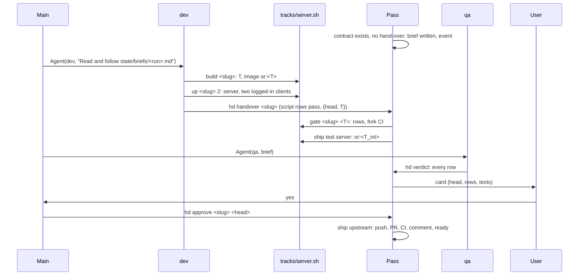

# Architecture of the harness (hd)

The solution to docs/PROBLEM.md that meets docs/PRD.md (R1–R8). One loop over five nouns: a **change** (definition and
contract), its **tree** T, the **judgments** bound to T or to the head, its **targets**, and the **runs** that worked
it. `next(change)` is the first unmet of a fixed list; everything shown or acted on is read off it.

```
hd.py             the loop: next(change), facts, records, the pass; commands below
hd.yaml           repos, paths, the agent count, the context limit, the fork's permanent pins
hook.py           SubagentStart/Stop: run start and end, then the pass started without waiting;
                  PreToolUse: a subagent may not `hd approve`; PostToolUse: hand off at the context limit
tracks/<track>.md rules and seed contract rows of the track, read by dev and qa
tracks/<track>.sh build | up | down | gate | ship | measure  <slug> [T]: block on facts, print the result
tracks/server/    Dockerfile; tracks/client/up.ps1 (the Windows side of the client bring-up)
.claude/agents/   dev.md, qa.md; .claude/skills/drive/  main's loop
mcp/              osrs-mcp (cache, wiki, gamevals); the devtools front (desktop, mobile)
harness/          goals/, changes/ (definitions, committed); state/, evidence/ at the root, git-ignored
tests/test_hd.py  one class per requirement, over fakes of git, gh, docker and the process table
```

| Command | Who | Does |
|---|---|---|
| `hd` | main | prints spawns (`Agent(<role>, "Read and follow state/briefs/<run>.md")`), cards, questions, runs, goals, change facts (R7) |
| `hd approve <slug> <head>`, `hd answer <slug> <text>` | main, after the user's word in chat | approval bound to head and the PR body digest; an answer appends a contract row |
| `hd new <slug> ...` | a planning run, the user | writes a definition |
| `hd show <slug>` | agents | the definition, contract, every verdict, gate and build result, the hand-off file |
| `hd handover <slug>` | dev | reads the pushed dev ref (no sha typed), runs every script row of the contract, refuses on any failure or a missing evidence file, records {head, T} |
| `hd verdict <slug> <head> <rows.json>` | qa | every row pass or fail, appended; refused if a row is missing |
| `hd ask <slug> <text>` | agents | refused while a question is open on the change |
| `hd tick` | the timer, the hook | one pass |

## Data

```
harness/goals/<slug>.md        slug, track, target, measure (a tracks/<track>.sh measure line)
harness/changes/<slug>.md      slug, track, kind (change|release|local), priority, deps, goal, pr, finding, network, version; body
evidence/<slug>/contract.md    rules: {AGENTS.md: <blob>, CONTRIBUTING.md: <blob>}; rows `- id | text | check: <cmd> | judge`
evidence/<slug>/               accuracy.md, pr-title.txt, pr-body.md, pr-comment.md, in-game evidence, handoff.md
state/<slug>/handover.json     {head, T}                       state/<slug>/gate.json      {T, ok, detail}
state/<slug>/verdicts.jsonl    {head, contract, rows{id: pass|fail, note}}   appended
state/<slug>/approval.json     {head, body}                    state/<slug>/ask.json       {text}
state/<goal>/measure.json      {tree, value, report}           state/live.json             {T, heads}
state/runs/<name>.json         {role, change, step, input, console_pid, console_start, agent_id, started, ended, record}
state/briefs/<run>.md          the prompt; state/events.jsonl  one line per state change
```
T = `git merge-tree --write-tree` of the base, the dependencies' heads and the head, made a commit with `commit-tree`
so a copy can check it out; the integration tree T_int is the same over every gated open server head plus the
permanent pins. Builds are artefacts named by T: a server image `or:<T>` (jar and game cache), a client APK
`evidence/<slug>/<T>.apk` with its repack log, a harness test run. The game cache is keyed by the hash of its inputs
(OpenRS2 cache id, pack configs, gamevals) in `~/src/work/cache/`. The build copy is `~/src/work/<slug>-build`, the
dev's clone `~/src/work/<slug>`; containers, volumes and client windows carry the slug or the run name.

## The loop

```
next(change):
  deps live?                        no → wait on them
  contract.md?                      no → qa run (server) | derived from the definition and seed rows (client, harness)
  handover at the dev ref's tip?    no → dev run (a hand-off file lists its successor; FAIL findings and gate details in the brief)
  T                                 conflict → dev
  build(T)                          not built → tracks/<track>.sh build; failed → dev
  gate(T)                           not run → tracks/<track>.sh gate (script rows, fork CI on gate/<slug> at T, probe, tests); failed → dev
  verdict(head, contract)           none → qa run; FAIL with a code row → dev; text-only rows: qa fixes the text, re-marks
  server: live.json ⊇ head?         no → ship test server (T_int built once, deployed; a pin conflict → the younger change's dev)
  public (upstream, release)?       approval at head? no → card
  ship                              upstream: push, PR, CI green, comment naming head, ready, review requested; release: gh release; else merge and push
  wait                              upstream merged; a maintainer finding files a new change on the pr with deps [this], contract inherited plus the finding
  done
```
A contract's rule rows carry the upstream rule files' blob shas; when a sha moves, only those rows are re-judged. A
hand-over at the same head after a verdict re-marks only the failed rows. A goal's `measure` is a step of the goal:
unmet when its target's tree (client: master and the live T_int) is not the tree of `measure.json`; below target,
a planning dev run files changes.

**The pass** (`hd tick`, a systemd user timer and after every run end): fetch each remote once; for every change
compute `next`; start the script step of each change whose process is not alive (pid with start time), one ship at a
time; write an event only when `next` differs from the last event; end the runs whose console is gone and remove what
they own; repair what is observed broken, once. **Main** (skill `drive`): a Monitor on `state/events.jsonl` wakes it;
it runs `hd`, spawns each listed run by path, shows each card, records the user's word, and returns to the user.
**Runs**: the brief holds the definition, contract, prior verdicts and hand-off; the role file holds the nevers; the
track file holds the rules. A dev run commits in its clone, builds with `tracks/<track>.sh build <slug>` (the working
copy snapshotted to an anonymous commit, T computed, the build copy checked out at T, built incrementally), brings
the result up with `up <slug> [N]` (server from `or:<T>` on the change's ports, accounts seeded, N clients started and
logged in by widget actions, blocks until every devtools endpoint answers), and hands over. The hook tells a run past
the context limit to write `handoff.md` and hand back; the successor is listed with it.

**Authority**: the pass runs as Unix user `hd` holding the full GitHub token; main and every agent run as the user
with a fine-grained token limited to AlexPerrin/*, so no command of theirs can act on OpenRune. The one hook rule:
`hd approve` is denied inside a subagent.

| | Client | Server | Harness |
|---|---|---|---|
| Base, head | `origin/main`, `origin/client/<slug>` | upstream `main`, fork `dev/<slug>` | `main`, `harness/<slug>` |
| build(T) | host build, ninja, repack with `OPENRUNE=1 LOCAL_AUTH=1`; APK and log | Gradle in container `build-<slug>`, cache by inputs; image `or:<T>` | the test suite at T |
| gate(T) | repack log lines (checked again at install), probe report at T, network QA when `network` | script rows (gameval ids unique across T_int, dupe tests per item-moving module, evidence files, trailers), fork CI on `gate/<slug>` | tests; `hd tick --dry-run` plans no upstream action main's pass does not |
| judge | release only | every contract row | none |
| ship | merge `master`, push; release after the yes | test server: deploy `or:<T_int>`; upstream after the yes | merge `main`, push |



| Requirement | Mechanism |
|---|---|
| R1 Goals | the goal's `measure` step keyed by the target's tree; live.json unblocks client deps; the planning run |
| R2 Flow | `next`, the pass, the briefs, the Monitor wake |
| R3 Contract | contract.md, `hd handover` and `hd verdict` refusals, records bound to T or head and contract, rule-row shas |
| R4 Authority | the two credentials, the `hd` user, the one hook rule, ship after approval at head |
| R5 Recovery | the timer, rerunnable steps, pids with start times, repairs on observed effect, one ask per change |
| R6 Economy | artefacts keyed by T, verdicts keyed by head and contract, the agent count, events on edges, the hook's context limit, the track scripts |
| R7 Visibility | `hd` prints facts; `hd show` |
| R8 Trees | merge-tree, the build copy, cache by input hash, names by slug or run |
