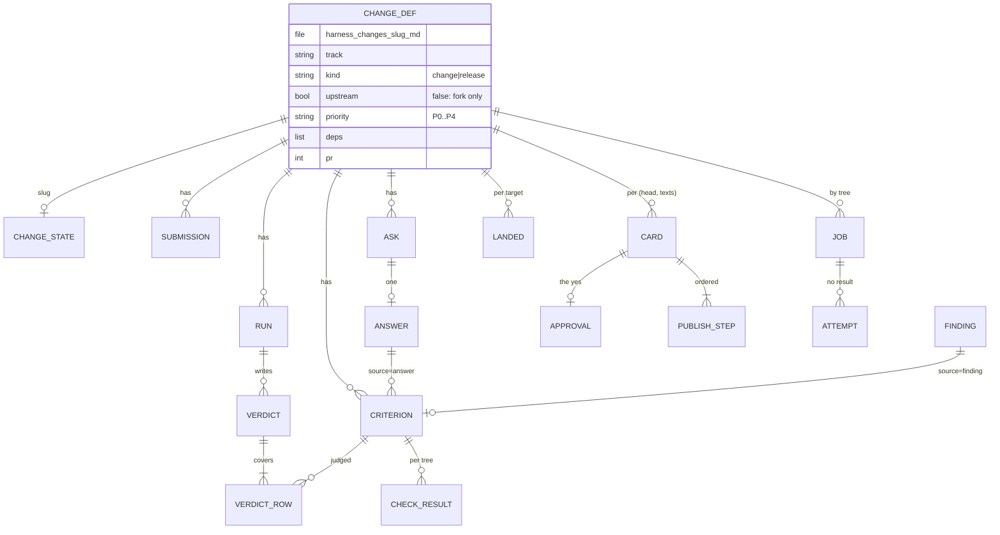
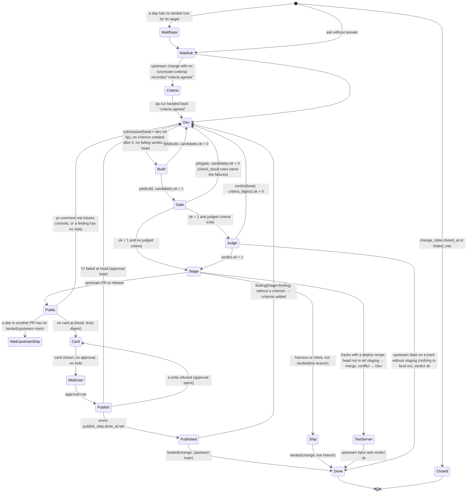
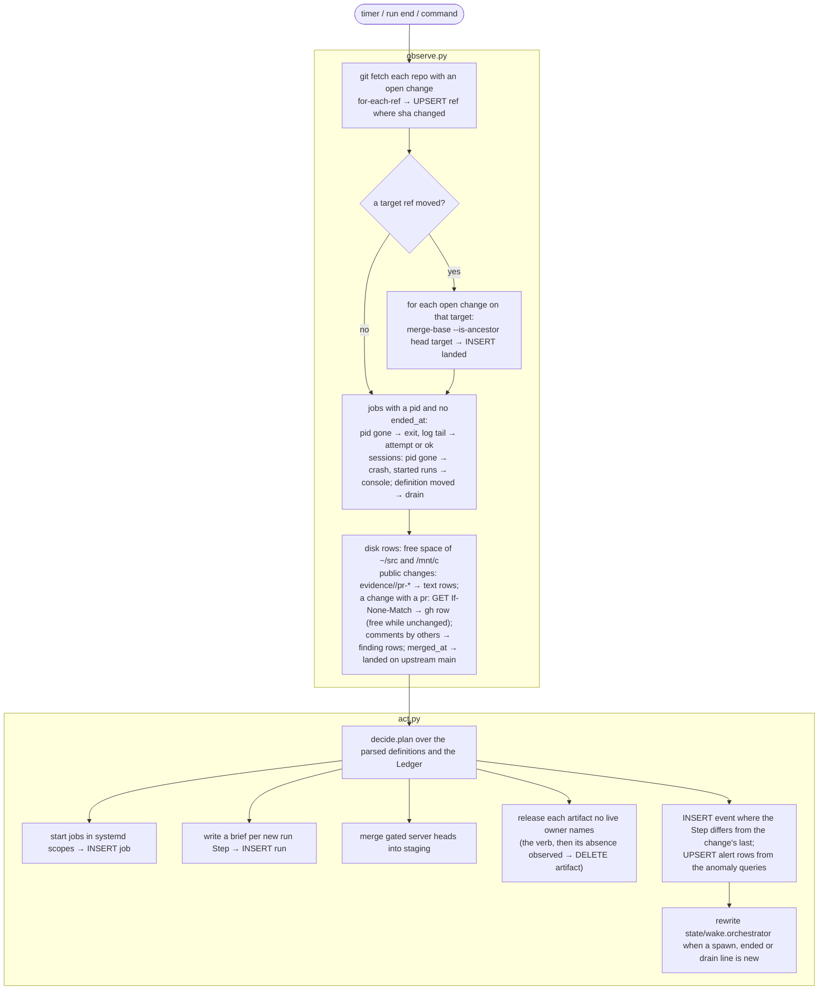
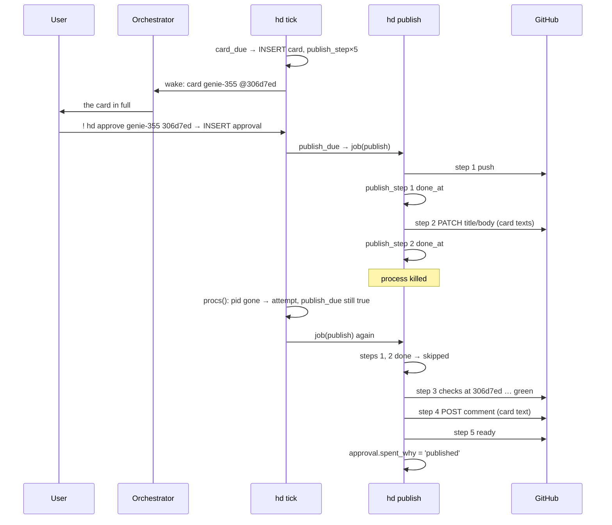
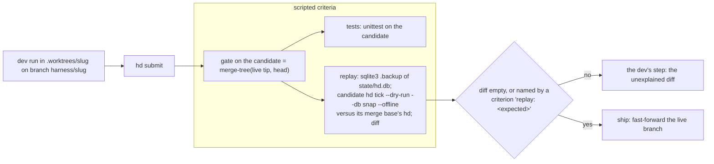
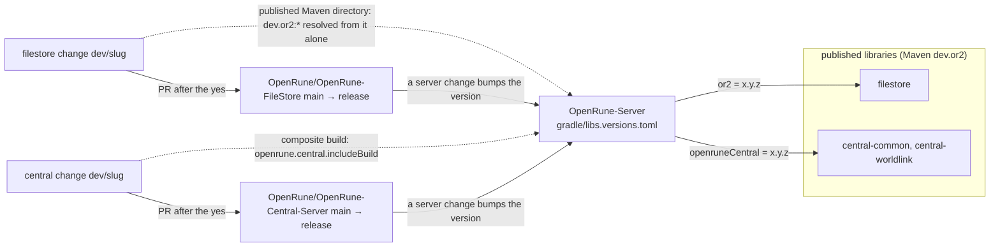

# Architecture

The solution to docs/PROBLEM.md that meets docs/PRD.md. Vocabulary: a **change** (a committed definition) has
**criteria** (scripted or judged); a dev **submits** a head; its **candidate** is base + dependencies + head, built
once; **jobs** (build, gate, deploy, ship, publish) are keyed by the tree they run on; the test server runs
**staging**; qa records a **verdict**; a public act is a **card** the user turns into an **approval**, which the
harness **publishes**; a client or harness change **ships** by fast-forward; a run **asks** and the user **answers**;
the pass raises **alerts**; everything is a row in the **ledger**.

## 1 Files

```
harness/hd.py          the commands (§8); argparse, one function each
harness/store.py       the ledger: schema, migrations, the Ledger read view; the only module that opens state/hd.db
harness/observe.py     world → ledger: fetch, refs, landed, GitHub (ETag), processes, docker, alerts
harness/decide.py      ledger → Step: next(change) over ordered guards, plan() for the pass; no subprocess, no clock
harness/act.py         Step → world: candidates, keys, jobs in systemd scopes, staging merges, briefs, the wake
harness/publish.py     the card (recorded acts and texts) and the publish (logged steps, resume)
harness/kpi.py         hd kpi: one query per harness goal metric
harness/hook.py        SessionStart/End (the orchestrator's session), PreToolUse/PostToolUse (bind a run on its brief, two
                       denials, the scope line, the context limit), SubagentStop (the hand-back line)
harness/orchestrator.sh  the supervisor (§13)
hd.yaml                repos {name, path, base, prefix?, upstream?, remote?, pins? (branch or {branch: superseding slug})}, builds, free, agents, context_limit, hold
tracks/<repo>/         track.sh (recipe | build | up | down | gate | ship | measure | log | test), track.md (rules, seed
                       criteria), the repo's scripts (the harness: replay.sh); the product repos hold product code only
.claude/agents/        driver.md, orchestrator.md, dev.md, qa.md, reader.md
.claude/skills/        the judgment skills of every track, loaded natively by every run spawned here
harness/goals/*.md  harness/changes/*.md   definitions, committed
evidence/<slug>/       accuracy.md, pr-title.txt, pr-body.md, pr-comment.md, pr-reply-<id>.md, handoff.md, in-game proof
state/hd.db  state/<slug>/*.log  state/briefs/<run>.md  state/wake.orchestrator   (git-ignored)
```

A change definition's front matter: `slug`, `track` (client | fork | central | filestore | harness), `kind` (change |
release), `upstream` (false: fork only), `priority` (P0–P4), `deps`, `goal`, `units`, `pr`, `public` (the PR branch on
the fork), `branch`; other keys are the track script's. Definitions are parsed each pass; the ledger holds runtime rows
only. hd.yaml's repos carry `base` (the full ref a candidate starts from), `prefix` (dev branches) and `remote` (where
dev refs are pushed; in the product clones `origin` is upstream and `fork` the fork; none: the dev ref stays local).

## 2 Schema (store.py, migration 1)

```sql
PRAGMA journal_mode = WAL;  PRAGMA foreign_keys = ON;  PRAGMA user_version = 1;

CREATE TABLE change_state (                            -- runtime state of a definition
  slug        TEXT PRIMARY KEY,
  closed_at   TEXT, closed_words TEXT,                 -- hd close (the user)
  folded_into TEXT REFERENCES change_state(slug)       -- hd fold (the orchestrator): scope moved, no runs
);

CREATE TABLE run (
  id          INTEGER PRIMARY KEY,
  change      TEXT NOT NULL,
  role        TEXT NOT NULL CHECK (role IN ('dev','qa')),
  mode        TEXT NOT NULL CHECK (mode IN ('code','criteria','judge','plan')),
  input       TEXT NOT NULL,                           -- digest of what the brief holds (head, criteria, answers, verdict)
  brief       TEXT NOT NULL,                           -- state/briefs/<id>.md
  agent_id    TEXT UNIQUE,                             -- bound by the SubagentStart hook
  listed_at   TEXT NOT NULL, started_at TEXT, ended_at TEXT,
  end_kind    TEXT CHECK (end_kind IN ('handback','stop','close','console','handoff')),
  record      TEXT,                                    -- the one hand-back line
  usage_json  TEXT, transcript TEXT
);
CREATE UNIQUE INDEX run_live ON run(change) WHERE ended_at IS NULL;   -- one live run per change

CREATE TABLE session (                                 -- the orchestrator (§13)
  id INTEGER PRIMARY KEY, pid INTEGER NOT NULL, pid_start INTEGER NOT NULL, session_id TEXT UNIQUE,
  definition TEXT NOT NULL,                            -- blob of orchestrator.md + .mcp.json it started on
  started_at TEXT NOT NULL,
  role TEXT NOT NULL DEFAULT 'orchestrator' CHECK (role IN ('orchestrator','driver')),   -- migration 5: the user's chat
  drain_at TEXT, drain_why TEXT,                       -- the hook (context limit) or the pass (definition moved)
  ended_at TEXT, end_kind TEXT CHECK (end_kind IN ('restart','exit','crash')),
  seen_event INTEGER NOT NULL DEFAULT 0                -- the last event id its view printed
);
CREATE UNIQUE INDEX session_live ON session(pid) WHERE ended_at IS NULL;

CREATE TABLE submission (
  id INTEGER PRIMARY KEY, change TEXT NOT NULL, head TEXT NOT NULL,
  tree TEXT NOT NULL, tcommit TEXT NOT NULL,
  composite_json TEXT,                                 -- {central: tree, filestore: tree} built in (§11)
  run INTEGER REFERENCES run(id), at TEXT NOT NULL,
  UNIQUE (change, head)
);

CREATE TABLE criterion (
  id INTEGER PRIMARY KEY, change TEXT NOT NULL, rid TEXT NOT NULL,
  kind   TEXT NOT NULL CHECK (kind IN ('script','judge')),
  text   TEXT NOT NULL, cmd TEXT,                      -- cmd: a scripted criterion, run by the gate on the candidate
  source TEXT NOT NULL CHECK (source IN ('seed','accuracy','answer','finding','user')),
  source_id INTEGER,                                   -- answer.ask or finding.comment_id
  upstream_only INTEGER NOT NULL DEFAULT 0, waived INTEGER NOT NULL DEFAULT 0,
  created_at TEXT NOT NULL,
  UNIQUE (change, rid)
);
CREATE TABLE check_result (                            -- a scripted criterion's result, by tree
  criterion_id INTEGER REFERENCES criterion(id), tree TEXT NOT NULL, ok INTEGER NOT NULL, note TEXT, at TEXT NOT NULL,
  PRIMARY KEY (criterion_id, tree)
);
CREATE TABLE verdict (
  id INTEGER PRIMARY KEY, change TEXT NOT NULL, head TEXT NOT NULL,
  run INTEGER NOT NULL REFERENCES run(id), ok INTEGER NOT NULL,
  criteria_digest TEXT NOT NULL,                       -- sha of the judged criteria (rid, text) it covers
  at TEXT NOT NULL
);
CREATE TABLE verdict_row (
  verdict INTEGER REFERENCES verdict(id), criterion_id INTEGER REFERENCES criterion(id),
  result TEXT NOT NULL CHECK (result IN ('pass','fail','not-judged')), note TEXT,
  PRIMARY KEY (verdict, criterion_id)
);

CREATE TABLE job (                                     -- one row per (kind, key); ok NULL = in flight or no result
  kind TEXT NOT NULL CHECK (kind IN ('build','gate','deploy','ship','publish','test','measure')),   -- measure: migration 4
  key  TEXT NOT NULL,                                  -- "<tree>:<recipe>"; ship "<branch>:<tcommit>"; publish "<card id>"
  change TEXT, ok INTEGER, detail TEXT,
  pid INTEGER, pid_start INTEGER, scope TEXT, log TEXT,
  started_at TEXT, ended_at TEXT, exit INTEGER,
  PRIMARY KEY (kind, key)
);
CREATE TABLE attempt (                                 -- a start that ended without a result
  id INTEGER PRIMARY KEY, kind TEXT, key TEXT, cause TEXT, exit INTEGER, at TEXT
);
CREATE TABLE step_log (                                -- resumable scripts: up, deploy, ship
  id INTEGER PRIMARY KEY, change TEXT, script TEXT, step TEXT, started_at TEXT, done_at TEXT, detail TEXT
);

CREATE TABLE ask (
  id INTEGER PRIMARY KEY, change TEXT NOT NULL, text TEXT NOT NULL,
  options_json TEXT NOT NULL,                          -- [{"id":"a","text":"…","effect":"dep <slug>"}, …]
  run INTEGER REFERENCES run(id), at TEXT NOT NULL
);
CREATE TABLE answer (
  ask INTEGER PRIMARY KEY REFERENCES ask(id), option TEXT NOT NULL, words TEXT, by TEXT NOT NULL, at TEXT NOT NULL
);

CREATE TABLE card (
  id INTEGER PRIMARY KEY, change TEXT NOT NULL, head TEXT NOT NULL, pr INTEGER,
  steps_json TEXT NOT NULL, texts_json TEXT NOT NULL, digest TEXT NOT NULL, shown_at TEXT,
  UNIQUE (change, head, digest)
);
CREATE TABLE approval (
  card INTEGER PRIMARY KEY REFERENCES card(id), at TEXT NOT NULL,
  spent_at TEXT, spent_why TEXT                        -- published, or a write GitHub refused
);
CREATE TABLE publish_step (
  card INTEGER REFERENCES card(id), n INTEGER, name TEXT NOT NULL, done_at TEXT, result_json TEXT,
  PRIMARY KEY (card, n)
);
CREATE TABLE hold (
  id INTEGER PRIMARY KEY, change TEXT NOT NULL, head TEXT,  -- NULL head: every head
  why TEXT, at TEXT NOT NULL, lifted_at TEXT
);

CREATE TABLE finding (                                 -- a maintainer's word on an upstream PR
  comment_id INTEGER PRIMARY KEY, repo TEXT, pr INTEGER, author TEXT, body TEXT, url TEXT, seen_at TEXT,
  triage TEXT CHECK (triage IN ('finding','ask','ack')), triaged_at TEXT,
  change TEXT, criterion_id INTEGER REFERENCES criterion(id)
);

-- observations
CREATE TABLE ref    (repo TEXT, name TEXT, sha TEXT NOT NULL, seen_at TEXT, tree TEXT, PRIMARY KEY (repo, name));  -- tree: migration 2
CREATE TABLE text   (change TEXT, name TEXT, sha TEXT NOT NULL, body TEXT NOT NULL, at TEXT, PRIMARY KEY (change, name));  -- migration 3: evidence/<slug>/pr-*
CREATE TABLE landed (change TEXT, target TEXT, sha TEXT, at TEXT, PRIMARY KEY (change, target));
CREATE TABLE gh     (url TEXT PRIMARY KEY, etag TEXT, status INTEGER, body TEXT, at TEXT);
CREATE TABLE stack  (change TEXT PRIMARY KEY, script TEXT, containers_json TEXT, desktops_json TEXT,
                     token TEXT, modulus TEXT, started_at TEXT);          -- a change's running server and clients
CREATE TABLE measure (goal TEXT, tree TEXT, value REAL, report TEXT, at TEXT, PRIMARY KEY (goal, tree));

CREATE TABLE event (id INTEGER PRIMARY KEY, at TEXT NOT NULL, kind TEXT NOT NULL, change TEXT, run INTEGER, detail TEXT);
CREATE INDEX event_change ON event(change, id);

CREATE TABLE alert (                                   -- a harness anomaly, one row per subject (§12)
  id INTEGER PRIMARY KEY,
  kind TEXT NOT NULL CHECK (kind IN ('attempts','run-lost','runs-per-head','ask-stale','denied','fault','ci-runner','kpi','pin-conflict','quota','disk')),
  subject TEXT NOT NULL, detail TEXT NOT NULL,
  first_at TEXT NOT NULL, last_at TEXT NOT NULL, count INTEGER NOT NULL DEFAULT 1,
  disposition TEXT CHECK (disposition IN ('filed','dismissed')), change TEXT, why TEXT, by TEXT, at TEXT,
  UNIQUE (kind, subject)
);

CREATE TABLE artifact (                                -- migration 6: a build artifact and its owners (PRD H7)
  kind  TEXT NOT NULL CHECK (kind IN ('image','volume','container','worktree','dir')),
  key   TEXT NOT NULL,    -- the docker name, or an absolute path under a .worktrees/ (a dir: or state/) directory
  owner TEXT NOT NULL,    -- <slug> | <slug>@<T> | job:<kind>:<key> | run:<id>
  at    TEXT NOT NULL,
  PRIMARY KEY (kind, key, owner));
CREATE TABLE disk (path TEXT PRIMARY KEY, free INTEGER NOT NULL, at TEXT NOT NULL);   -- bytes free on a build disk, each pass
```



## 3 The change state machine (decide.py)



```python
@dataclass(frozen=True)
class Step:
    kind: str            # done|wait|run|build|gate|merge|card|publish|ship|measure
    why: str             # printed by `hd`; the event detail
    role: str = ""       # dev|qa for kind == run
    mode: str = ""       # code|criteria|judge|plan
    input: str = ""      # digest of the brief's inputs; a run is due while no run exists with this input
    key: str = ""        # the job's key

def next(C: Ctx, ch: Change) -> Step:     # Ctx = (Ledger, Cfg, every definition by slug)
    for guard in GUARDS:                    # ordered; first non-None wins
        if step := guard(C, ch): return step
    return DONE

GUARDS = [
    closed,            # change_state.closed_at or folded_into → done
    deps_live,         # a dep with no submission (not landed, not closed) → wait; a submitted same-track dep joins the candidate;
                       # a dep on another track (a harness fix, a library) must land or close; a client change's server dep
                       # must be live (landed 'live': the test server runs it, the only server a mobile reaches)
    ask_open,          # an ask with no answer → wait (the question)
    criteria_due,      # upstream change, no run(mode=criteria) with record "criteria agreed" → run qa/criteria
    dev_due,           # no submission at the dev ref's tip, or a criterion created after it, or a failing verdict at head,
                       # or a build/gate/ship job ok 0 at the candidate, or a merge conflict / CI failure / missing text
                       # → run dev/code; the input digests the tip, the reasons, the answers since the submission and the
                       # deps that have landed (a blocker filed by the dev lands → the dev runs again); a FAIL verdict older than a dep's landing goes to judge_due first
    build_due,         # tracks whose recipe has build: job(build, key) missing → build; running → wait; 3 attempts → wait
    gate_due,          # job(gate, key) missing → gate; running → wait; 3 starts without a result → wait (alert)
    judge_due,         # judged criteria and no verdict(head, digest) → run qa/judge
    stage_due,         # tracks with a deploy recipe: no landed(change, staging) → merge (act.stage); a recorded conflict is dev_due's
    upstream_dep_wait, # a dep not landed where it is done (upstream main, the live branch) → wait: no card, no ship before it
    texts_due,         # text rows missing: title and body (a new PR), the comment, a reply per finding → run dev
    card_due,          # no card at the head, or its approval spent by a refusal, or texts observed since it was shown → card
    approval_wait,     # card and no approval → wait (the user); a hold → wait (hidden)
    publish_due,       # approval not spent and a publish_step undone, no ci-failed event at the head → publish (a job: hd publish)
    published_wait,    # every step done, not landed(upstream main) → wait (maintainers)
    ship_due,          # harness/client: not landed(base) → ship (one job(ship) in flight per branch); shipped → wait landed
    measure_due,       # a goal whose target tree moved since measure.tree → measure
    plan_due,          # a goal below target with no open change naming it → run dev/plan on its track
]

def plan(L: Ledger, changes: list[Change], cfg: Cfg) -> list[Action]:
    """next() per open change in priority order (harness, then PR rounds, then new content; each at the best
    tier of the changes it blocks; below cfg.hold skipped). A run Step is listed only while live runs < cfg.agents
    and no run with that input parks it (one that ended by stop or hand-back does: a new fact makes a new input; one
    that died with its console or handed off gets a successor); a job Step only while no job of its key (a ship: of its branch) is in flight; a card
    only when not shown at its digest. A harness change is P1 at least. Besides the changes, one deploy per staging
    tree of each server track whose script has a deploy recipe (Action change "<track>:staging"). Below hd.yaml
    `free` on a disk row, a build or gate waits and no deploy is listed. Last, one release per artifact none of whose
    owners is live (Action change "release", key "<kind>:<key>"): owner_live() holds for a job running, a run not
    ended, an open change not done (<slug>), and for <slug>@<T> while a job of T runs, a run of the change is live, or
    T is the built tree of its current head or of its latest card's head; staging@<T> while staging's tree is T.
    A change closed, merged (done) or withdrawn (its definition gone) owns nothing."""
```

## 4 The pass (`hd tick`: a 60 s timer, after every run end, after every command)


Writes happen in short transactions inside act. A pass that raises (a definition it cannot read, an act that fails)
records a `fault` alert (`pass`, `act:<slug>`) and goes on: the pass never dies silently. A second tick while one runs exits at once (`flock state/tick.lock`);
a dry run takes no lock. `hd tick --dry-run --db <copy> --offline` runs decide over a copy with observe skipped: the
replay check (§9). Every writing command and every run end starts a pass without waiting for it (`act.tick_later`).

## 5 observe.py

```python
def fetch(db, T) -> set[str]:           # git fetch --all --prune; for-each-ref → UPSERT ref; returns names whose sha changed
def landed(db, T, target, changes):     # only when target moved: merge-base --is-ancestor per open change → INSERT landed
def procs(db):                          # a job whose (pid, pid_start) is gone: a result recorded → ended_at; else ended_at,
                                        # pid NULL and an attempt row (the log's last line, hex runs dropped) so the pass
                                        # starts it again, up to three attempts (alert 'attempts')
def runs(db)                            # a live run whose transcript ends with its agent's interruption → ended console (nothing else fires)
def sessions(db, definition):           # a live session whose pid is gone → crash, its started runs → console; a live
                                        # session whose definition digest differs from HEAD's → drain_at
def texts(db, slug)                     # evidence/<slug>/pr-title.txt, pr-body.md, pr-comment.md, pr-reply-<id>.md → text rows by sha
def transport(method, url, data, headers)  # one `gh api -i` call → (status, headers, body); tests replace it
def gh(db, url) -> dict | list | None:  # GET with If-None-Match from the stored ETag; 304 → stored body (no quota);
                                        # 200 → UPSERT; quota refused → alert('quota'); None when unknown (the step holds)
def pr(db, T, ch, ours)                 # the PR's gh row (Ledger.pr reads state, draft, head, title, body, merged_at); issue and
                                        # review comments not by a bot or us → INSERT OR IGNORE finding (+ a triage event);
                                        # merged_at → landed(change, upstream main) (a squash or rebase merge is seen only here)
def checks(db, upstream, sha) -> list   # the latest check run per name at sha plus commit statuses; None when unknown
def stacks(db, tracks)                  # a stack row (mirrored from up.json by `hd stack`) with no live run → `track.sh down`
                                        # in the scope hd-down-<slug>, once at a time: a run's end releases its containers
def disk(db, free_gb)                   # statvfs of ~/src and /mnt/c → disk rows; below hd.yaml `free` → alert('disk')
                                        # naming the compaction (wsl --shutdown, Optimize-VHD -Mode Full: the user's)
def alerts(db)                          # UPSERT alert rows from the anomaly queries (§12); dedup on (kind, subject)
```
GitHub is read each pass only for public changes with a PR, conditionally (a 304 costs no quota); checks only by a publish.

## 6 act.py: candidates, keys, jobs, staging, briefs

```python
def candidate(repo, base, heads) -> (tree, tcommit):
    """Fold `git merge-tree --write-tree` over base, each dependency head (closure, deps first) and the head; then
    `git commit-tree` with GIT_COMMITTER_DATE = the newest parent's date, so the same inputs give the same commit
    and the fork CI's child commit keeps its result. A conflict raises Conflict(files): the dev's step.
    A Central or FileStore dependency adds no commit: its candidate is built in (§11) and
    joins the key as _c<tree12> / _f<tree12> (decide.built: the T of the jobs and the image or:<T>)."""

def key(C, ch, kind, submission) -> str:
    """f"{tree}:{recipe}", recipe = the version `tracks/<repo>/track.sh recipe` prints for that verb (one line per verb:
    `gate harness-1`), read once per pass into Track.recipes; a dev bumps it when the verb's output changes. A track
    without a `build` line has no build step. A fixed checker re-runs by `hd regate`, never by a moved key."""

def start(db, step, ch, T):
    """systemd-run --user --scope --unit hd-<slug>-<kind>-<key12> -- tracks/<repo>/track.sh <verb> <slug> <key>, with
    HD_ROOT, HD_DB, HD_SLUG, HD_KEY, HD_TREE, HD_TCOMMIT, HD_HEAD, HD_BASE, HD_REPO, HD_CLONE, HD_LOG, HD_RC in its
    environment; INSERT job(kind, key, change, pid, pid_start, scope, log). The script's last act is `hd job <kind>
    <key> ok|fail <detail>` (a gate: `hd gate <slug> <key> <dir>`, which runs every scripted criterion in the
    candidate's files and records a check_result per criterion); the wrapper writes its exit to
    state/<slug>/<kind>-<key12>.rc. Builds take one of hd.yaml `builds` slots (flock on ~/.cache/hd/build.<i>.lock, machine-wide as the gradle-<i> volume is)."""

def clone(T, ch) -> path:
    """<repo>/.worktrees/<slug> on the dev branch, created from base when missing (the brief names it)."""

def stage(db, ch, T, head):
    """In <fork>/.worktrees/staging (created at the first merge: the base, then each pin of hd.yaml; a pin that no longer
    merges is alert('pin-conflict')): a pin `{branch: slug}` of hd.yaml is the one that change supersedes, and its merge
    is reverted (git revert -m 1) before that change's head merges; git merge --no-ff <head>, push fork staging, event('merged'); a conflict →
    merge --abort and event('merge-conflict', '<head7> <files>'), which dev_due reads. The pass then lists one deploy
    job per staging tree (`track.sh deploy`, keyed `<staging tree>:<recipe>`), which the deploy script refuses without the
    live key pair in state/live/key. A closed change: git revert -m 1 of its merge commit."""

def brief(db, ch, step) -> path:
    """state/briefs/<run id>.md: the definition; the criteria with their latest results and verdict marks; answers
    and findings since the last submission; job details and log paths; the hand-off file if any; clone, build copy
    and evidence paths; the exact hand-back line expected."""

def wake(db):
    """Rewrite state/wake.orchestrator with the lines new since the last wake; unchanged → no write."""

def release(db, kind, key) -> bool:
    """The verb of an artifact no live owner names: docker rmi | docker volume rm | docker rm -f; git worktree remove
    --force (then rm -rf, worktree prune); rm -rf. Idempotent; the artifact's rows go only once `docker <kind> inspect`
    answers "no such" or the path is gone, else alert('fault', 'release:<kind>:<key>') and the next pass tries again."""
```
Artifact rows are written where the artifact is made: the clone by `brief` and `job_env` (owner the change), every other
by the track script through `hd own` before it makes it: `or:<T>`, `osrs-openrune:<T>` and the rollback tag
(`<slug>@<T>`, `staging@<T>`), the build copy and the Central and FileStore copies (the change), the cache store
`or-cache-store-<revision>` (`<slug>@<T>`), `build-<slug>` and `boot-<T>` (the job), a harness or lab candidate dir
(the job). The image context is removed as soon as its image is built, the build cache (`docker builder prune`) when
no `build-*` container is live, and every Gradle run mounts the home of its build slot, `gradle-<slot>`: bounded by `builds`, shared across slugs, one writer
each (Gradle's file locks do not reach across containers).
Staging is created once: `git checkout -b staging upstream/main`, then each pin of hd.yaml merged in order; a pin leaves
it only by the revert of the change that supersedes it.
A ship (harness, client): `track.sh ship` recomputes the candidate on the live tip (`hd candidate`); a tree other
than the gated one is gated there and then; the live branch fast-forwards to it and is pushed. A head that no longer
merges records `ship fail`, the dev's step. The harness ship and `hd commit` both hold `state/ship.lock`: no commit moves
the live tip between a ship's candidate and its push (the engineer's commits go through `hd commit`).

## 7 publish.py: the card and the publish

```python
def card(db, ch, T, head, pr, texts) -> card id:
    """steps from the observed PR and the text rows: push (unless the PR is at head) → pr (open a draft) | edit (a title
    or body that differs) → ci (if pushed, new or draft) → comment (pr-comment.md, then each pr-reply-<id>.md) → ready
    (if new or draft). A release: build-asset → notes → publish. texts: {title, body, comment}; digest = sha256(steps +
    texts). INSERT OR IGNORE card; INSERT publish_step rows with done_at NULL; event('card', the rendered card)."""

def approve(db, slug, head):
    """hd approve (the user only): refuses unless the latest card of the change is at head, not held, not yet approved;
    INSERT approval."""

def publish(db, card_id, T, path):
    """hd publish (a job of kind publish, key = the card id): each publish_step with done_at NULL, in order, executed
    with the card's texts, never anything re-read from the PR or evidence/; success → done_at, result_json.
    ci: observe.checks() until every check at head concluded; a failure → event('ci-failed'), approval kept, stop
    (the dev's step). A GitHub write refused → approval.spent_why, stop (a new card names it). A read unknown
    (quota) → stop with no step done; the pass starts it again. After the last step: approval.spent_why = 'published'."""
```



## 8 Commands (hd.py)

| command | caller | writes |
|---|---|---|
| `hd` | orchestrator, driver | a pass, then the session's view, only lines newer than its `seen_event`: the orchestrator's `drain` or `spawn` (`Agent(dev, "Read and follow state/briefs/17.md")`), `ended`, runs; the driver's `card`, `question`, `triage`, `alert`, `state`, `landed`, `attempt`, `ended`, runs, goals |
| `hd tick [--dry-run] [--db F] [--offline] [--defs D]` | timer, hook | the pass; `--dry-run` prints plan() and writes nothing; `--defs` reads another tree's `changes/` and `goals/` (the replay, the fixtures) |
| `hd new <slug> --track --title --body [--deps] [--blocks <c>] [--on <c>] [--touches p…] [--pr n] [--from-alert <id>]` | orchestrator, dev, user | harness/changes/<slug>.md; `--on` appends to an open change; `--from-alert` carries the alert's evidence |
| `hd fold <a> --into <b>` | orchestrator | change_state.folded_into; a's text appended to b |
| `hd show <slug>` | runs, orchestrator | nothing: prints the brief text |
| `hd criterion add <slug> <rid> --kind script\|judge --text [--cmd] --source [--source-id]` | qa (criteria), the pass (seeds, findings) | criterion |
| `hd submit <slug>` | dev | submission(head, candidate): the dev ref's tip is done; refuses an unpushed ref (product tracks) or a conflicting candidate; the same head with a new candidate (a dep's head moved) replaces it; prints the hand-back line |
| `hd verdict <slug> <head> <verdict.json>` | qa | verdict, verdict_row; refuses a missing criterion, `pass` on an unchecked one, no live qa run |
| `hd ask <slug> <text> --option id:text:effect…` | runs | ask (one open per change) |
| `hd answer <slug> <option> [words]` | orchestrator (the user's words) | answer, and the option's effect in the same transaction: dep (definition edit), waive (criterion.waived), accept-difference (criterion source=user), move-repo, close (refused: the user's own) |
| `hd triage <comment_id> finding\|ask\|ack` | orchestrator | finding.triage; finding → a judged criterion `finding-<id>` (skill pr-text) on the PR's open change, or on a new change `<track>-<pr>-c<id>` when that change is done; ask → an ask whose option `r` (effect `reply <id>`) makes the user's words `pr-reply-<id>.md` |
| `hd hold <slug> [--all] [--lift] [why]` | orchestrator | hold |
| `hd approve <slug> <head>`, `hd close <slug> <words>` | **the user only** (a `!` command, or the user's "approve" / "close" in a remote session's chat, run by the driver; the hook denies runs) | approval; change_state.closed_at |
| `hd publish <card id>` | the pass (a job) | publish_step, approval.spent, job(publish) |
| `hd stack <slug> <up.json>\|--clear` | track scripts (`up`, `down`) | the stack row: the change's running containers, desktops, token, modulus |
| `hd own <kind> <key> <owner>` | track scripts | artifact: refuses a path outside a .worktrees/ or state/ directory |
| `hd job <kind> <key> ok\|fail [detail]`, `hd step <slug> <script> <step> start\|done` | track scripts | job; step_log; a deploy ok marks every change then on staging landed `live` |
| `hd gate <slug> <key> <dir>` | track scripts (`track.sh gate`, a ship on a new tree) | check_result per scripted criterion at the key's tree, then job(gate) |
| `hd candidate <slug> [--base sha]` | track scripts (`track.sh ship`), anyone | nothing: prints `<tree> <tcommit>` of the head on base |
| `hd fault <run> <what>` | any run | alert(kind='fault') |
| `hd dismiss <alert id> <why>` | orchestrator | alert.disposition |
| `hd stop <run>` | orchestrator | run.ended_at, end_kind=stop; `systemctl --user stop hd-<run>.slice` |
| `hd scope <run>` | the hook, before every Bash command of a run | moves the calling shell into `hd-run-<id>.scope` (created with a placeholder sleep); silent when the user manager refuses |
| `hd regate <slug>` | driver, a harness dev | deletes job(build), job(gate) and check_result at the current candidate: a fixed tool re-runs them at the same tree |
| `hd kpi` | anyone | nothing: the harness goal's metrics |
| `hd commit <paths> -m` | orchestrator | a pathspec commit as Alex Perrin with the co-author line; pushes the live branch |
| `hd restart` | orchestrator, once `hd` prints `drain` and no run of it is live | session.ended_at, end_kind=restart; exits the claude process |
| `hd session-ended` | orchestrator.sh | ends a dead session; exit 1 when the last session ended by the user's exit |

Sample view:
```
spawn    Agent(dev, "Read and follow state/briefs/212.md")   genie-355  P2  dev: CI failed at 306d7ed (Formatting)
spawn    Agent(qa,  "Read and follow state/briefs/213.md")   cannon-354 P2  judge: 11 criteria at 8c6d967
card     goblin-367 @def7f2c  PR OpenRune/OpenRune-Server#367 (update)
         1 push dev/goblin-367 → content/goblin-diplomacy (3 commits: a1b2c3d fix: …, …)
         2 edit body                     ── text ──  <full body>
         3 CI at def7f2c
         4 comment                       ── text ──  <push summary> <reply to #r1734 quoting it, @maintainer>
         5 ready
         verdict PASS (run 201)   evidence/goblin-367/
         yes: ! python3 ~/osrs-harness/harness/hd.py approve goblin-367 def7f2c   no: hd hold goblin-367 "<why>"   close: ! … close goblin-367 "<why>"
question hunter-408  "dupes-3 needs the shop sell path: (a) dep server-shop-sell  (b) waive dupes-3  (c) accept-difference 'shop sell out of scope'"
triage   #448 comment 2201 by <maintainer>: "Could you also update the FileStore side?"
alert    attempts build:9ac1…:r3 ×3 "cannot allocate memory" state/genie-355/build-9ac1.log   → hd new --from-alert 7 | hd dismiss 7 "<why>"
runs     7/7 live: 210 dev genie-355 (41 turns) …
goals    client-api 71% @4f0c…   server-content 38% @staging 9ac1…
```

## 9 Harness changes: the replay check


The harness track's seed criteria are `tests`, `replay` (`tracks/harness/replay.sh`, run with the candidate's files as
cwd: the candidate's plan against its merge base's, both over the live definitions (`--defs`), so only the change's own
effect shows), `fork-tools` and `client-tools` (the track scripts' suites, which drop the gate's `HD_*` environment). A candidate that must plan differently
writes `evidence/<slug>/replay.md`, read from the live checkout, saying what differs and why. A dev's out-of-scope limit is `hd new … --blocks <own slug>`; a duplicate is folded by the orchestrator.

## 10 Tests

```
tests/fixtures/ledger-<n>.db   snapshots of the live ledger at known moments (sqlite3 .backup); defs-<n>/ the definitions then
tests/fixtures/ledger-<n>.plan the plan over that ledger with those definitions (`hd tick --dry-run --offline --db --defs`)
tests/test_decide.py           one class per PRD group (T, G, H, A): a hand-built ledger, one inserted row moves one Step;
                               snapshots of the live ledger join as fixtures once it holds every kind of row
tests/test_store.py            every migration upgrades every older fixture; CHECK, FK and UNIQUE violations refused
tests/test_observe.py          fetch, landed, candidate (linear, merged, conflicting), procs over a throwaway git repo
tests/test_publish.py          publish() over a fake GitHub transport: killed after step n → resumes at n+1 with the card's texts
tests/test_act.py             the pass acts on every Step kind it lists (a brief, a job start, a merge, a card) over a temporary ledger
tests/test_hook.py             the hook's JSON in and out: bind, the denials, the scope line, the hand-back and its refusal
```
decide.py takes a Ledger and never runs a subprocess, so it is tested over real snapshots, not fakes.

## 11 Tracks and repos

| hd.yaml key | upstream | base → head | delivers |
|---|---|---|---|
| `client` AlexPerrin/osrs-plugins-reverse | — | `main` → `client/<slug>` | RuneLite plugins in the official Android app; APK releases |
| `fork` AlexPerrin/OpenRune-Server | OpenRune/OpenRune-Server | upstream `main` → `dev/<slug>` | game content and behaviour; the test server |
| `central` AlexPerrin/OpenRune-Central-Server | OpenRune/OpenRune-Central-Server | upstream `main` → `dev/<slug>` | accounts, sessions, world-link auth, `jav_config.ws`, `worldslist.ws` |
| `filestore` AlexPerrin/OpenRune-FileStore | OpenRune/OpenRune-FileStore | upstream `main` → `dev/<slug>` | the cache library: I/O, every config codec, gameval references, packing |
| `devtools` AlexPerrin/OpenRune-Developer-Tools | OpenRune/OpenRune-Developer-Tools | upstream `main` → `dev/<slug>` | the in-client MCP plugin both game clients are driven through |
| `harness` AlexPerrin/osrs-harness | — | live branch → `harness/<slug>` | this repo |
| `lab` AlexPerrin/pr-lab | itself | `main` → `dev/<slug>` | the PR lab: a repo of our own as its own upstream, so every GitHub path of the loop (a PR, CI, comments, a merge landing) runs without a maintainer; its CI fails on a root file named `FAIL` |



- The fork consumes Central and FileStore as published Maven artefacts pinned in `libs.versions.toml`; the game
  server runs Central in-process (`central.same-instance`). A server change that depends on a library change names
  it in `deps`; `hd submit` records the library head and tree in `submission.composite_json`, the job env carries
  `CENTRAL=<clone>:<head>` / `FILESTORE=<clone>:<head>`, the fork build includes that tree (Central through
  `build/central.init.gradle`, substituting the three artefacts explicitly; FileStore through
  `build/filestore.init.gradle`: the head is not included (its Gradle 7 build and its `filestore` project clash with the
  fork's type-safe accessors) but published by `tracks/filestore/track.sh publish` to a Maven directory, from which alone
  every `dev.or2` module it holds resolves, the `all` POM included), and the key, the jobs' `T` and the image carry `_c<tree12>` / `_f<tree12>`. The test server image carries
  the composite, so a library change is live on the test server with the first server tree built on it.
- `tracks/central/track.sh` and `tracks/filestore/track.sh`: `build` (gradle assemble in a container, the shared
  Gradle home; `bash ./gradlew`, upstream commits it 100644), `test`, `publish` (FileStore: the head to its Maven directory), `gate` (`hd gate`), `up` (the fork's base built with the head as its Central or FileStore,
  then the fork's `up`), `down`, `log`. Their seeds (track.md): judged claims, no-deferral, one-change, style and one
  in-game criterion (login; serves); scripted tests, evidence, subject, texts.
- Upstream, a library change is its own PR on its own repo. A server change built on a library head waits
  (`upstream_dep_wait`) until the library PR is merged and released, then a server change bumps the version.
- Library gates: `gradle test` on the candidate (FileStore's against the fork's live cache), the text criteria, fork
  CI. Judged criteria: from the gated build and the diff; a Central change from a server `up` built with it.
- Central PRs are held from upstream until the user lifts the hold (a `hold` row with `head NULL` per change).
- The fork track's seed criteria (tracks/fork/track.md): eleven judged (each naming its skill), seven scripted; those
  marked `upstream` seed only a change that opens a PR. A dev pushes `dev/<slug>` to the fork before `hd submit`, which
  refuses a local branch ahead of the pushed ref.
- The server-content inventory is `harness/goals/server-content.json`, a committed definition (one row per content unit
  of the cache: unit, source); the pass measures the goal by query (§14). The harness itself stays standard-library Python.
- The live stack is the game image, Central and Postgres. Until two Central changes land (a local `jav_config.ws`
  template source; the official client's sign-in and game-session endpoints that mint the token the game
  verifies), the compose also runs the sidecars that serve `jav_config.ws`, the world list and the token issuer.
- The game clients are driven through OpenRune-Developer-Tools, built from our fork's gated head into the Android
  jar and the desktop's sideloaded jar. `mcp/` holds transport only: `.mcp.json` names `osrs-mcp.sh`, the desktop
  bridge (a stdio front of about 80 lines: `tools/list` snapshot when no client runs, routing by `port`, the bearer
  token, a bounded answer, the Windows `netstat` probe) and the client repo's mobile bridge (stdio over `adb shell nc`).
  Long-distance `walk_to`, session state in every answer, and token auth on both platforms are `devtools` changes,
  not bridge code.
- Every JVM of a test desktop carries `tracks/fork/server/DevtoolsOwner.java` as its `-javaagent`: the devtools
  endpoint answers its up's token alone, and no URL reaches the OS (`java.awt.Desktop`'s browse, open and mail, and any
  non-java command holding a URL, are refused, each a `[osrs-test] refused URL` line of `state/<slug>/refused-urls.log`).

## 12 Roles and alerts

| work | who | why a model |
|---|---|---|
| code for one change | **dev**, mode `code` | the work itself |
| the changes that close a goal's gap | **dev**, mode `plan`, on the goal's track | needs the track's skills; files `hd new`, no code |
| the criteria before code (server tracks) | **qa**, mode `criteria` | the evaluator states what the generator must meet |
| judged criteria | **qa**, mode `judge` | skepticism separate from the generator |
| a bulky lookup | **reader**, a run's sub-agent | context economy; read-only by its tool list |
| spawn, stop, restart | **orchestrator** | the autonomous loop's hands: one visible session that spawns exactly what `hd` lists; holds no state |
| the user's console: cards, questions, triage, alerts; the user's words; one-off changes the user directs | **driver** | manual: acts only on the user's word; `claude --agent driver` in the checkout, beside the orchestrator's pane |

A run is bound by the hook on its first Read or Bash naming `state/briefs/<id>.md` (or, failing that, on the run id
of its hand-back line), its transcript path recorded; from then on every Bash command of the run is prefixed with `hd scope
<id>`. An agent interrupted in its console (the transcript's last line) ends its run as a console death and its successor
is listed. An agent whose run
ended by close or stop is denied every tool (the run's `ended` line tells the orchestrator to TaskStop it). The run ends
on its record: a `SubagentHandback` call whose message is the line (a wrong line is denied with the reason), or a
last message whose last line is the line at SubagentStop. An agent that stops without it while a background task is
pending is left alone (its notification resumes it); an idle one is asked once, and a second idle stop ends the run
without a record. `.claude/agents/orchestrator.md` is the whole definition: arm the inotify watch on `state/wake.orchestrator`; on a
wake, a hand-back or the watch's expiry run `hd` and do what each line says: spawn as printed, TaskStop an agent at its
one-line hand-back or its run's `ended` line; SendMessage a run printed `silent` (no transcript write for a whole watch period, the only clock the view reads: a step that never ends sends no notification); on `drain` spawn nothing and run `hd restart` once no run of yours is live.
It never approves, closes, writes code, chats or waits on the user. `.claude/agents/driver.md` is the user's console
(`claude --agent driver` in the checkout, the pane beside the orchestrator's): it shows each card, question, triage line
and alert as `hd` prints it, records the user's words (`hd new`, `hd answer`, `hd hold`, `hd triage`, `hd dismiss`,
`hd commit`) and makes the one-off changes the user directs. It acts on nothing by itself and spawns nothing. dev.md, qa.md and reader.md hold each role's steps, one wait rule (a step runs in the foreground; one still
running at 180 s is backgrounded by Claude Code and its notification resumes the run; game events by `wait_for`), and
the one hand-back line: `run <id>: submitted <sha>` | `run <id>: PASS` | `run <id>: FAIL <n> criteria` |
`run <id>: criteria agreed` | `run <id>: filed <slug>` | `run <id>: ask` | `run <id>: handoff`.

Sample brief (`state/briefs/212.md`):
```
# run 212: dev genie-355 (fork, P2)   step: CI failed at 306d7ed (Formatting)
clone ~/src/OpenRune-Server/.worktrees/genie-355   build copy …/genie-355-build   evidence ~/osrs-harness/evidence/genie-355
rules tracks/fork/track.md   skills accuracy, dupes, pr-text, probe, qa-server
## definition               (harness/changes/genie-355.md verbatim)
## criteria @candidate 9ac1…   (id  kind  result)
tests     scripted  ok
subject   scripted  ok
ci        scripted  FAIL: Formatting (spotless on genie/Genie.kt:41)
claims    judged    pass @306d7ed
dupes-3   judged    not judged
## since your last submission
answer 14 (the user): option b, waive dupes-3 "the lamp cannot be sold"
finding 2201 by <maintainer>: "Could you also …"  → criterion finding-2201 (judged)
## hand back exactly:  run 212: submitted <sha>
```

Harness defects are facts the pass computes into `alert` rows, one per `(kind, subject)`, with their evidence:

| kind | subject | computed from |
|---|---|---|
| `attempts` | kind:key | three `attempt` rows on one key or one cause with no result |
| `run-lost` | change | two runs of a change ended `console` or `stop` without a record |
| `runs-per-head` | change | more than five runs since the last submission |
| `ask-stale` | ask id | an ask still open after its change submitted twice |
| `denied` | run:rule | a hook denial (`hd approve`/`hd close` from an agent); the event names the command |
| `fault` | run | `hd fault`: a run met a broken script or a step it could not do |
| `ci-runner` | gate key | fork CI failed three times at a step the head does not touch |
| `kpi` | metric | a metric past its target at the day's roll-up |
| `pin-conflict` | pin | upstream main no longer merges with staging |
| `quota` | api | GitHub refused on quota |
| `disk` | path | free space on a build disk below hd.yaml `free`: no build starts; the detail names the compaction |

`hd` prints an alert without a disposition once, to the driver; the user disposes of it once: a one-off fix by the
driver, then `hd dismiss <id> <why>` naming it; a harness change, `hd new --track harness --from-alert <id>` (carrying
the evidence, fixed by a dev run and checked by the replay); or a dismissal. An alert whose subject recurs after its
fix landed reprints as a regression. `hd kpi` is one query per metric of the harness goal (docs/PROBLEM.md §6); the `kpi` alert is its daily
roll-up.

## 13 The orchestrator's lifecycle

```mermaid
stateDiagram-v2
  [*] --> Starting : harness/orchestrator.sh runs `claude --agent orchestrator`
  Starting --> Serving : SessionStart hook → INSERT session(claude pid, definition digest)
  Serving --> Serving : wake / hand-back / user words → `hd` (delta since seen_event) → act
  Serving --> Draining : hook: transcript past context_limit → drain_at\n pass: HEAD's orchestrator.md or .mcp.json ≠ session.definition → drain_at
  Draining --> Draining : `hd` lists no spawn; cards, questions, triage, alerts go on; live runs hand back
  Draining --> Ended : no live run of this session → `hd restart` → end_kind=restart, exit 0
  Serving --> Ended : user /exit → end_kind=exit
  Serving --> Ended : crash → end_kind=crash (pid gone, no end row)
  Ended --> Starting : restart or crash → orchestrator.sh loops
  Ended --> [*] : exit → orchestrator.sh stops
```



```bash
# harness/orchestrator.sh — run once by the user in their terminal, so the session and its agents are visible
cd "$(dirname "$(readlink -f "$0")")/.." || exit 1
systemctl --user is-active -q hd-loop.timer || systemd-run --user --unit hd-loop --on-calendar='*:*:00' python3 "$PWD/harness/hd.py" tick
n=0
while :; do
  n=$((n + 1)); unit=hd-orchestrator-$$-$n
  systemd-run --user --scope --quiet --collect --unit "$unit" -- claude --agent orchestrator "drive"
  systemctl --user stop "$unit.scope"      # what the session left behind (MCP servers, a watch) ends with it
  python3 harness/hd.py session-ended || break
done
```

- **Two panes**: the user's terminal holds the orchestrator's pane (`harness/orchestrator.sh`), whose agent panel opens the
  transcript of every run it spawned and shows it coordinating, and the driver's pane (`claude --agent driver`), the one the
  user types in. Nothing else runs a session.
- **Bind**: the SessionStart hook writes the `session` row with the claude pid, the role (agent_type `orchestrator`;
  any other top-level session in the checkout is the `driver`) and the digest of `orchestrator.md` and `.mcp.json` it
  loaded (Claude Code reads both once, at start). `hd` finds its session by the calling pid's ancestry. A driver is
  never drained for a moved definition. The supervisor runs the session in a user scope so that a run's shell can be moved into
  the run's own scope, and starts the minute timer `hd-loop.timer` once.
- **Delta view**: `hd` prints only lines with `event.id > session.seen_event` and advances it; a card is shown once
  per (head, texts) per session. A session's context grows with events, not with passes.
- **Drain**: set by the PostToolUse hook when the transcript passes `context_limit`, or by the pass when HEAD's
  definition or MCP config differs from the session's blob. While draining, `plan` lists no spawn (runs die with
  their session), everything else proceeds, `hd` prints `drain` with the reason.
- **End**: `hd restart` once no run of the session is live writes `end_kind` and terminates the claude process; the
  SessionEnd hook writes `exit` for the user's own /exit. The supervisor asks the ledger why and loops or stops. A crash is seen by `procs` (pid gone, no end row) and looped. Listed,
  unspawned runs survive as rows; the successor's first `hd` spawns them. There is no hand-off file: the ledger holds
  every card shown, question asked and alert disposed.

## 14 Goals

| goal | track | target | measured by |
|---|---|---|---|
| `client-api` | client | 100 | `track.sh measure`: the probe's share of `net.runelite.api` methods confirmed in the running app against the live test server |
| `server-content` | fork | 100 | a ledger query: inventory units (`harness/goals/server-content.json`) named in `units:` of a change landed with a passing verdict, over all units |

A goal file is `slug`, `track`, `target`, `measure` (`script`: a job `track.sh measure <goal>` whose last act is `hd
measure <goal> <tree> <value> <report>`; `query`: the pass computes it) and a body. A goal is measured on its track's
live tree (the base branch; staging for a server track): one `measure` row per tree (`measure_due`, keyed
`<tree>:<recipe>`); a goal below target with no open change naming it (`goal:`) lists one dev run in plan mode
(`plan_due`, Action change `goal:<slug>`), whose brief is the goal's body and whose hand-back is `filed <slug>`;
`hd new --goal <goal> --units …` names the goal a change serves. `hd` prints each goal's latest measure.
