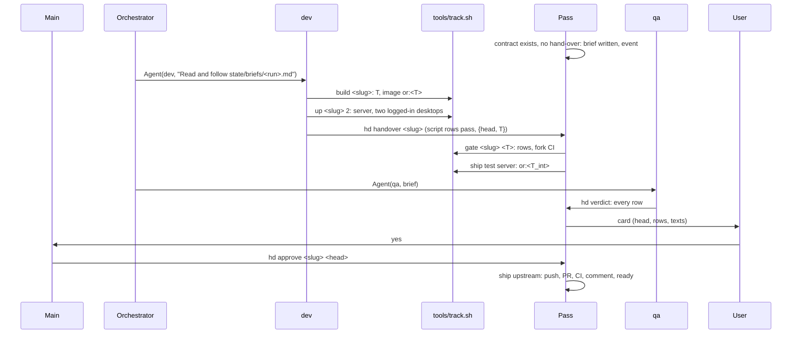

# Architecture of the harness (hd)

The solution to docs/PROBLEM.md that meets docs/PRD.md (R1–R8). One loop over five nouns: a **change** (definition and
contract), its **tree** T, the **judgments** bound to T or to the head, its **targets**, and the **runs** that worked
it. `next(change)` is the first unmet of a fixed list; everything shown or acted on is read off it.

```
hd.py             the loop: next(change), facts, records, the pass; commands below
hd.yaml           repos (each fork with its upstream), paths, the agent count, the context limit, the fork's permanent pins
hook.py           SubagentStart/Stop: run start (the run named by the brief path in the agent's own transcript,
                  <session>/subagents/agent-<id>.jsonl; else its first tool call binds it) and end, then the pass
                  started without waiting; a stop fires at each idle turn and leaves the run live (usage, last line),
                  refused (decision block) while a background command or monitor the agent started has no task
                  notification yet; the stop after its SubagentHandback ends it; its record is newer than its start and the change's
                  last answer;
                  PreToolUse: a subagent or the orchestrator may not `hd approve` or `hd close`; a run's SubagentHandback is
                  denied while a background command, monitor or subagent it started has no task notification, TaskStop
                  result or 'No task found' yet (a run cannot TaskStop its subagent: it asks it with SendMessage to return), and each subagent's hand-back is
                  kept as evidence/<slug>/subagent-<id>.md; PostToolUse: hand off at the context limit (a run, or main); else
                  a run whose change's up.json lists desktops, after IDLE_CALLS tool calls with no desktop devtools call since
                  that up or its last devtools call, is told once to `down` until it next plays
tools/track.sh    the harness track's script; tools/track.md its rules and seed rows. Each product repo holds its own
                  track the same way (the fork's on branch local/harness): build | up | down | gate | ship | measure | log
                  <slug> [T], blocking on facts; its judgment skills under its .claude/skills/
hd-public         the one program run as user `hd` with the full token (sudoers-limited): upstream acts and releases
.claude/agents/   orchestrator.md (the driver session), dev.md, qa.md, planner.md (cross-track planning and monitoring);
                  .claude/skills/head/  main's relay
mcp/              osrs-mcp (cache, wiki, gamevals); the devtools front (desktop: POST to a desktop's devtools port, each call in its own thread so the runs sharing it never queue behind one another, a tool's `port` picks it, and walk_to walks any distance in minimap clicks of 12 tiles until the player stands on the tile or a click moves it no closer, and every answer names a session that dropped to the login screen; mobile: the client repo's bridge), answering with none running from a cache or the snapshot
harness/          goals/, changes/ (definitions, committed); state/, evidence/ at the root, git-ignored
tests/test_hd.py  one class per requirement, over fakes of git, gh, docker and the process table
```

| Command | Who | Does |
|---|---|---|
| `hd` | the orchestrator, main | prints spawns (`Agent(<role>, "Read and follow state/briefs/<run>.md")`), cards, questions, messages, runs, goals, change facts (R7) |
| `hd approve <slug> <head>`, `hd answer <slug> [--waive <row>] <text>` | main, after the user's word in chat | approval bound to head and the PR body digest; an answer appends a contract row; `--waive` names a script row the hand-over and gate then skip |
| `hd close <slug> <text>` | main, after the user's word in chat | the answer row, and `closed: answer-<n>: <text>` in the definition (the orchestrator commits it): the change is done, its runs end, it leaves T_int and holds no dependent |
| `hd stop <run>` | the orchestrator, with TaskStop (which fires no SubagentStop) | ends the run's record, so it frees its agent slot |
| `hd tell <text>` | main, with the user's message | appends it to `state/inbox.jsonl`; `hd` lists it under `message` |
| `hd heard <n>` | the orchestrator, once it acted on the message | messages up to n leave the view |
| `hd new <slug> ... [--blocks <change>]` | a planner, the orchestrator, a dev, the user | writes a definition; `--blocks` adds it to that change's deps (a dev's fix outside its track) |
| `hd show <slug>` | the orchestrator, main | the definition, contract, every verdict, the build and gate lines, the hand-off file (a run reads its brief instead) |
| `hd handover <slug>` | dev | reads the dev ref (pushed; a harness one local, never pushed; no sha typed), runs every `check:` row of the contract (a `tools/` script, a unittest run or `true`; anything else runs as `false`), refuses on any failure, a conflict or an empty evidence dir, records {head, T} |
| `hd verdict <slug> <head> <rows.json>` | qa | every row pass, fail or not-judged, appended; refused if a row is missing, or not judged with none failing |
| `hd tree <slug> <commit>` | a track script | the T commit and tree of a working-copy snapshot, so a dev builds T |
| `hd rows <slug> <T commit> <build copy>` | a track script's gate | every `check:` and `gate:` row at the track root with `BUILD` set; exit 1 names the failures |
| `hd ask <slug> <text>` | agents | refused while a question is open on the change |
| `hd tick` | the timer, the hook | one pass, deciding on the state it reads under the state lock |

## Data

```
harness/goals/<slug>.md        slug, track, target (a number: a goal without one is skipped as a bad definition), deps; measured by the track's `tools/track.sh measure`; server-content.json, regenerated by server-content.py, is its inventory
harness/changes/<slug>.md      slug, track, kind (change|release|local), priority, deps, goal, units, pr, finding (comment ids carried), network, version, closed; body
evidence/<slug>/contract.md    rules: {AGENTS.md: <blob>, CONTRIBUTING.md: <blob>}; rows `- id | text | check: <cmd> | judge`
evidence/<slug>/               accuracy.md, pr-title.txt, pr-body.md, pr-comment.md, in-game evidence, handoff.md
state/<slug>/handover.json     {head, T, tools}                state/<slug>/gate.json      {T, ok, detail}
state/<slug>/verdicts.jsonl    {head, contract, rows{id: pass | fail: note | not-judged}, rules{file: blob}, run}   appended
state/<slug>/approval.json     {head, body}                    state/<slug>/ask.json       {text}
state/<goal>/measure.json      {tree, value, report}           state/live/tree.json        {tree, commit, heads, names}
state/runs/<name>.json         {role, change, step, input, brief, console_pid, console_start, agent_id, transcript, started, ended, record, last, usage, handoff_told}; runs/by-agent/<id> → name
state/inbox.jsonl              {ts, text} the user's messages; inbox.read  the last n heard
state/briefs/<run>.md          the prompt; state/events.jsonl  one line per state change (rotated at 20 MB); state/wake  its size
state/<slug>/proc-<script>.json {pid, start, args, attempts} (attempts count on the same args since the last result or the script's last change); repair-<name>.json {attempts}: a script or repair in flight
fork local/merge/<a>-<b>       a recorded resolution of heads a and b (b may be the base), used by T_int while both are current
```
T = `git merge-tree --write-tree` of the base, the dependencies' heads and the head, made a commit with `commit-tree`, dated the newest of its parents' committer dates (the same inputs give the same commit),
so a copy can check it out; the integration tree T_int is the same over every gated open server head plus the
permanent pins. Build and gate are keyed by T's tree joined with `-<tip12>` of the track's tools branch when it has one (a tools fix re-builds and re-gates; T_int admits a gate whose key starts with the hand-over's T). A server change with central dependencies carries `-c<central12>` in its T: the Central tree, Central's base and those changes' heads merged, which its build includes (`CENTRAL=<Central clone>:<commit>`; `hd tree` prints it third); T_int carries the one of its heads' central dependencies. Builds are artefacts named by that key: a server image `or:<T>` (jar and game cache), a client APK
`evidence/<slug>/<T>.apk` with its repack log, a harness test run (keyed by T's tree without `harness/`, so a definition
commit on the live branch re-builds, re-gates and blocks the ship of nothing; ship fast-forwards to the current T). The game cache is keyed by the hash of its inputs
(OpenRS2 cache id, pack configs, gamevals) in a named docker volume, which the build makes its own uid's before it runs (docker creates a volume root-owned). The build copy is `<repo>/.worktrees/<slug>-build`, the
dev's clone `<repo>/.worktrees/<slug>`, worktrees of the product repo; a track's `tools/` sit on its repo's `tools` branch
(hd.yaml) in `<repo>/.worktrees/<the branch's last segment>`, made by the pass when missing. A harness change carries
a fix to a tools branch on branch `harness/<slug>` of that repo: the hand-over records each such head (refused unless
it descends from the tools branch; once handed over, a head the branch moved past is rebased onto it by the pass in
`<repo>/.worktrees/<slug>`, recorded in the hand-over and re-gated, a conflict being the dev's step), the head joins T's key (`<tree>+<head12>`), the gate runs the repo's
`tools/**/test_*.py` at it in `<repo>/.worktrees/<slug>-build`, ship fast-forwards the tools branch to it, and the change
is live once the live branch and every such branch hold their heads. A done or closed change leaves nothing behind: the pass
ends its runs (a started one with its record and an `ended` event, freeing its slot), then removes, in each repo, its clone, its build copy and any worktree on its local branches (`harness/<slug>`, `client/<slug>`,
`dev/<slug>`; one whose status shows only untracked symlinks holds no edits and goes forced, one with edits stays), then those branches, the dev ref last; a branch goes once the base, the repo's tools branch or the change's
head holds its tip, or the change is closed; `swept.json` keeps the head the dev ref held; remote branches are public and stay; a script that cannot start is an alert; containers, volumes, mobiles and desktops carry the slug or the run name.

## The loop

```
next(change):
  closed by the user?               yes → done
  deps live or closed?              no → wait on them
  question open (hd ask)?           yes → wait for the answer: no run, gate, ship or upstream step
  contract.md?                      no → qa run (server, central) | derived from the definition and seed rows (client, harness)
  handover at the dev ref's tip?    no → dev run (a hand-off file lists its successor; FAIL findings and gate details in the brief)
  carried tools head behind branch? rebase it in the pass, record it in the hand-over; conflict → dev
  T                                 conflict → dev
  build(T)                          not built → tools/track.sh build; failed → dev
  gate(T)                           not run → tools/track.sh gate (script rows, fork CI on gate/<slug> at T, probe, tests); failed → dev
  verdict(head, contract)           none → qa run; FAIL with a code row → dev; text-only rows: qa fixes the text, re-marks
  live? (central: its gate at T)    server: live.json ⊇ head? no → ship test server (T_int built once, deployed); a conflict → the later-merged change's dev
                                    (a pin's: the oldest one at this step): against a change, resolve in its own branch; against a
                                    permanent pin, the base or a union, push local/merge/<a>-<b>; every conflicting head is left out
                                    and the rest merged on (pins first, then heads by priority, then creation), so one dev step lists them all with the merge
                                    order; only a pin's conflict holds the deploy, the tree without a conflicting head deploys
  public (upstream, release)?       approval at head? no → card
  ship                              upstream: push, PR, CI green, comment naming head, ready, review requested; release: gh release; else merge and push
  wait                              upstream merged; each maintainer inline review comment on the pr (no reply, no bot) that no
                                    definition's `finding` carries files a P1 change on the pr with deps [the pr's root changes],
                                    their contract unagreed plus a judged `finding` row
  done
```
A head counts as live or done only as the change's own work: handed over, or off its base's first-parent line (merged in); a fresh dev ref cut at a base commit is neither. A contract's rule rows carry the upstream rule files' blob shas; when a sha moves, only those rows are re-judged. A reviewer is listed only where the contract has `judge:` rows (client changes have none; releases do). A
hand-over at the same head after a verdict re-marks only the failed rows. A goal's `measure` is a step of the goal, held by its deps as a change is:
unmet when its target's tree (client: master and the live T_int; plus the digest of the passing units) is not the tree
of `measure.json`. A passing unit is one a change of the goal names in `units` while it is live at a head whose last
verdict passes every row; the script gets them as PASSES. Below target, the planner files changes.

**The pass** (`hd tick`, a systemd user timer and after every run end): fetch each remote once; for every change, in
order (harness changes; then changes on a PR, off the upstream tracks or blocking another; then new content: an upstream change
without a PR; each at the best priority of the open changes it blocks, by a dep or by the conflict a change's last state names
as holding its test server deploy), compute `next`; start the script step of each change whose process is not alive (pid with start time), one ship at a
time; write an event only when `next` differs from the last event; end the runs whose console is gone and remove what
they own; drop a listed, unspawned run once its change's `next` is no longer that run's step; repair what is observed broken, once (a missing tools worktree, a repo without the noreply git identity). **The orchestrator** (`.claude/agents/orchestrator.md`) is a top-level session
the user starts with `cd ~/osrs-harness && claude --agent orchestrator`, so it and every agent it spawns show in the
user's console with their transcripts (a subagent cannot spawn; a headless session's agents are not shown). A watch
on `state/wake` wakes it; it runs `hd`, spawns each listed run by path, TaskStops each at its hand-back, files a
harness change for a fault a hand-back reports, acts on each `message` and marks it `hd heard`, commits definitions,
re-arms the watch (an expiry is a wake too). Its runs bind to its process as their console. `hd` alerts
`user: no orchestrator session` while no `claude --agent orchestrator` process exists. **Main** (skill `head`) is
the chat interface: woken by the same watch, it shows cards, questions and alerts, records the user's word (`hd
approve`, `hd answer`, `hd close`) and relays every other message with `hd tell`; it spawns nothing. **The planner** is a run
listed on significant facts only (an alert, a gate failure, a goal below target with nothing open; never time or an event count;
a line an open change's body carries, or a planner hand-back answered, is left out until it changes (a gate failure at a new T, an alert with a new count); a gate failure is its dev's until a dev run handed back on that T with no run of the change alive;
an alert for the user lists none), outside the agent count (one at most); a planning request from the user with a measurable target reaches it as a goal, any other as a change. It
files the changes that close a goal's gap with dependencies across tracks, and turns an issue it observes in
operation (a run ended without its record twice, a harness-made gate failure, a needless question) into a harness
change that a harness dev run remediates. Its hand-back is its record, filed or not. It writes no product code.
**Runs**: the brief is a run's one read of its change: the definition, the contract with the user's answers, the last
verdict, the build and gate lines (each its verdict and key, the log in the `state/<slug>/<name>.log` it names) and the
hand-off, each once; `hd show` is not read again. The role file holds the nevers; the
track file holds the rules. A dev run commits in its clone, builds with `tools/track.sh build <slug>` (the working
copy snapshotted to an anonymous commit, T computed, the build copy checked out at T, built incrementally), brings
the result up with `up <slug> [N]` (server from `or:<T>` on the change's ports, accounts seeded, N desktops started, each
loading the devtools jar of the client track's build of slug `live` (the client's main), and logged in by widget actions, blocks until every devtools endpoint answers; a server change's quest requirements in the mode its front matter `quest-mode` names, `respect-progress` unless `assume-completed`; `restart <slug>` keeps that mode and the database; a server up's database is fresh, or with `RESUME=1` the accounts as the change's last `down` saved them, down waiting until the server has saved every character; its realm live's, `dev_mode` off and xp at 1x, each account a member at rank 0, or with `STAFF=<N>` the Nth desktop's an administrator, the rights read back after the logins; a login that made an account but its own, a lost key, logged out and in again), runs a server change's tests with `test <slug> [module...]` (each touched module's tests and spotlessCheck on the build copy, the log in its evidence dir), and hands over. A harness dev runs the
unit tests in its worktree; the harness track's `build` refuses without the loop's T and TCOMMIT. The hook tells a run past
the context limit (set below the bound with room for a clean hand-off, measured under 11000 tokens) to start no new work,
then in order: commit its work in progress on the dev ref (pushed off the harness track), record what it judged (a judge:
`hd verdict` when a row failed, else the judged rows in `handoff.md`), collect its subagents and stop its processes, write
`handoff.md` and hand back; the successor is listed with it, its brief naming that commit. Three runs of a change past the limit since its
last handover are an alert (the change too large for one run, or its brief spending context on reading). Main, which holds nothing beyond files, is
told once per session past the same limit to start nothing new, give the user docs/HANDOFF.md's start prompt for a
fresh session and end its turn.

**Authority**: main, the orchestrator, the pass and every agent run as the user with a fine-grained token limited to AlexPerrin/*, so
no command of theirs can act on OpenRune or publish. The ship step of a public act runs `sudo -u hd hd-public <slug>
<head>`, the one program sudoers allows, which holds the full token and acts only when `approval.json` names that
head. The one hook rule: `hd approve` and `hd close` (the user's word, recorded by main) are denied inside a subagent or the
orchestrator session (a hook input with an agent id or type) when a command runs them (hd at a command's start); a command that only quotes them (grep, echo, a heredoc body) runs.

| | Client | Server | Central | Harness |
|---|---|---|---|---|
| Base, head | `origin/main`, `origin/client/<slug>` | upstream `main`, fork `dev/<slug>` | upstream `main` of OpenRune-Central-Server, its fork's `dev/<slug>` | the live checkout's branch (`HEAD`), `harness/<slug>` (and `harness/<slug>` of each product repo whose tools it changes) |
| build(T) | host build, ninja, repack with `OPENRUNE=1 LOCAL_AUTH=1`; APK and log | Gradle in container `build-<slug>`, cache by inputs; image `or:<T>`; with a Central dependency `CENTRAL` names the Central tree, built in by the init script `central.init.gradle`, which substitutes every Central module (`openrune-central` by `:central-app`) | Gradle `assemble` in container `build-<slug>` | the test suite at T |
| gate(T) | repack log lines (checked again at install), probe report at T, network QA when `network`; `log` reads logcat by pattern since a marker | script rows (gameval ids unique across T_int, a dupe test (src/test or src/integration) per item-moving module, evidence files, commit subjects and trailers after an existing PR's live head), fork CI on `gate/<slug>` | `gradle test`, evidence files, commit subjects | tests; `hd tick --dry-run` plans no upstream action main's pass does not; each carried tools head's tests |
| judge | release only | every contract row | every contract row, from `up`: the server's base built with this Central (the server track's build and up), `down` stops it | none |
| ship | merge `master`, push; release after the yes | test server: deploy `or:<T_int>`, its sidecars serving `tools/server/jav_config.ws.template` (`javcheck.py` after `up` and `ship`: local hosts only); upstream after the yes | live at its gate (dependent server builds include it); upstream to Central after the yes | fast-forward each carried tools branch and push it to the remote of its repo's `name` (never upstream), then the live branch to T, push; any of them moved past its gated base: nothing moves, re-gate |



## Run and test

```
~/.config/systemd/user/hd-tick.service   [Service] Type=oneshot  ExecStart=/usr/bin/python3 %h/osrs-harness/hd.py tick
~/.config/systemd/user/hd-tick.timer     [Timer] OnBootSec=1min  OnUnitActiveSec=1min   [Install] WantedBy=timers.target
loginctl enable-linger alex && systemctl --user enable --now hd-tick.timer
/etc/sudoers.d/hd-public                 alex ALL=(hd) NOPASSWD: /home/alex/osrs-harness/hd-public   (user hd holds the full token)
python3 hd.py                            # a pass, then the view
python3 hd.py tick --dry-run             # the view, nothing started or recorded
python3 -m unittest discover -s tests    # one class per requirement over fakes; Tools runs the harness track script for real
fork .worktrees/harness: python3 -m unittest tools/server/test_tools.py   client .worktrees/harness-v8: python3 -m unittest tools/test_track.py
each tools branch ignores __pycache__/; no compiled cache is committed
```

| Requirement | Mechanism |
|---|---|
| R1 Goals | the goal's `measure` step keyed by the target's tree; the live tree unblocks client deps; the planner plans |
| R2 Flow | `nxt`, the pass, the briefs, the hook's bind and end, the wake file, the orchestrator session, `hd tell` and `hd heard` |
| R3 Contract | contract.md, `hd handover` and `hd verdict` refusals, records bound to T or head and contract, rule-row shas |
| R4 Authority | the two credentials, `hd-public` under sudoers, the one hook rule, ship after approval at head |
| R5 Recovery | the timer, rerunnable steps, pids with start times, repairs on observed effect, one ask per change |
| R6 Economy | artefacts keyed by T, verdicts keyed by head and contract, the agent count, events on edges, the hook's context limit, the track scripts |
| R7 Visibility | `hd` prints facts; `hd show` |
| R8 Trees | merge-tree, `local/merge/*` refs, the build copy, cache by input hash, names by slug or run |
