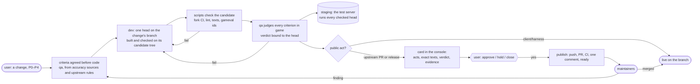

# The problem

What the harness is for, derived from what the work is and what the v7 and v8 runs show. docs/PRD.md turns this into
requirements; docs/ARCHITECTURE.md is the one solution built to them.

## 1. The work

Two products, worked on by Claude Code agents overnight and across days, with the user absent most of the time.

| product | repos | what "done" means |
|---|---|---|
| **client**: RuneLite plugins inside the official OSRS Android app | AlexPerrin/osrs-plugins-reverse | the change is on `main`; a release is a tagged APK the user approved |
| **server**: the OpenRune test server the client plays against, and contributions to OpenRune | the fork AlexPerrin/OpenRune-Server and the libraries it depends on, AlexPerrin/OpenRune-Central-Server (accounts, login, world link) and AlexPerrin/OpenRune-FileStore (the cache); each has an upstream under OpenRune/ | live on the test server as soon as it is checked; done when upstream `main` holds it |
| **harness**: this repo | AlexPerrin/osrs-harness | live on the branch the loop runs from |

Each product is a **track**: a lane with its own base branch, its own scripts (build, bring-up, check, deploy,
publish) and its own skills (how to reverse the app, how to research accuracy, how to write a PR OpenRune accepts).

The actors:
- **the user**: defines work, decides scope and accuracy questions, approves every public act, reads everything in
  the console. Scarce: 12 approvals, 9 holds, 46 closes and 148 answers in v8's 47 hours, most answers spent
  unblocking agents from the harness itself.
- **maintainers** of OpenRune: review our PRs on their own schedule, ask for changes, merge. One change per PR, no
  stacking, no deferral, few tests, rules revised at any time. We have no write access to their repos.
- **agents**: Claude Code sessions. A **dev** builds a change (the generator); a **qa** writes what "done" means
  before the code and judges the result after (the evaluator); a **reader** looks things up for them; the
  **orchestrator** is the one long-lived session the user chats with, and the only thing that can spawn the others.
- **scripts**: build, bring the server and clients up, deploy, check, publish. They block on facts and return results.
- **the world**: git remotes, GitHub, docker, an Android emulator and RuneLite desktops on Windows, reached from WSL.

## 2. What the runs show

v7 (6 days, 132 runs) and v8 (47 hours, 844 runs, 11,800 events) were measured from their own records
(docs/V8-BRIEF.md, docs/V9-BRIEF.md). The findings that shape the problem:

- **A change's life is mostly waiting.** v7: 30% waiting on maintainers, 30% waiting for someone to spawn the next
  run, 21% queued behind other changes, 10% waiting on the user, 5% an agent working. v8 cut the spawn wait from a
  median 11 minutes to 0.5 by giving the orchestrator a watch and a one-line spawn.
- **Agents re-derive what nobody wrote down as a script.** v7 devs spent 52–148 tool calls bringing a server and
  clients up before the first edit, 12% of all calls polling; one run read 205M tokens. v8's track scripts cut
  calls-to-first-edit to 15 and polling to 7%.
- **Agents cannot judge their own work.** Of 108 v7 review findings, 68 repeated an earlier round's rule; the dev
  fixed a defect where it was named, not as a rule across the diff. v8's contract, agreed before the code, made the
  first verdict PASS on 19 of 29 judged changes; the one change without a usable contract (Hunter, #408) failed ten
  rounds. The evaluator run is the costliest thing in the system: median 121 turns and 12M tokens.
- **Agents' words are not evidence.** A dev's "handed over at sha" was refused 29 of 98 times in v7 because the ref
  was not there. Everything that counts is a commit on a ref, a tree, a file, GitHub state, a container, a process.
- **Decisions re-derived from the live world break when the world moves.** v8 compared the user's approval against
  texts recomputed from the live PR; after the carry edited the PR, its own approval no longer matched and a stopped
  carry could never resume (goblin-367, finished by hand). Keys that hashed the checker's code re-ran 150 of 275
  gates on unchanged trees and withdrew approved cards five times.
- **The harness eats itself when its own repair loop is unbounded.** v8's monitor agent, running continuously with
  an open mandate, filed 331 harness changes in 47 hours; 38% of its findings were regressions of an earlier harness
  ship; the harness took 55% of all runs and 38% of all tokens, and interfered with dev and qa work. Nearly half of
  the user's 148 answers were about the harness.
- **State without a schema rots.** v8 kept ~40 kinds of JSON files: answers without their question, kinds read from
  text prefixes, strikes counted from file times, two writers ending one run twice. Half the monitor's findings traced
  to this.
- **A session can vanish at any moment** (usage limit, WSL restart, compaction, a closed terminal) and its agents die
  with it. Nothing may depend on a session staying alive, and a headless session is invisible to the user, who
  watches every session.

## 3. What a harness is for

Agents are stateless, fallible workers with finite context that act only inside a turn. The world is slow, shared
and stateful. The user is scarce and holds authority. The harness stands between them with four jobs:

1. **Memory.** Hold what agents cannot keep across runs: what is wanted (the change), what "done" means (the
   criteria), what was decided (the user's decisions, maintainers' findings), what was verified (results bound to
   the exact tree or commit they checked), what exists (clones, builds, servers, clients). Every run starts where the
   last ended, and nothing is re-derived from the world once it has been decided.
2. **Hands.** Do by script what agents do badly by hand: build a tree, bring a server and clients up, deploy, run the
   checks, publish a PR or release. Know-how is encoded once and blocks on facts; agents read rules and results.
3. **Gate.** Verify what agents cannot judge about their own work, cheapest first and each check once: scripts, then
   an independent evaluator, then the user for the two acts that are public. Each verdict binds to the artefact it
   judged and is void when that moves.
4. **Tempo.** Notice that a fact changed and start the next step at once, with no person watching: a dev done →
   check it; a check passed → review it; a review passed → show the user; a yes → publish; a maintainer wrote →
   a new criterion → a dev. The user's attention is spent only where authority or taste is needed.

Everything in docs/ARCHITECTURE.md serves one of these four. A mechanism that serves none is removed.

## 4. The workflow

A **change** is one unit of work on one track, defined by the user or by a planning run, with a priority and the
changes it depends on. Its **criteria** are agreed before code: scripted ones a check runs, judged ones the evaluator
checks in game. A dev **submits** one head; its **candidate** tree is base plus dependencies plus head, built once.
The scripts check the candidate; qa judges the head; the test server runs **staging**, every checked server head
merged into one branch. A change that is public upstream or a release becomes a **card**; the user's **approval**
is the only thing that lets the harness **publish**, and it publishes exactly the card. A maintainer's word becomes
a criterion on the PR's open change, and the loop runs again from the dev.

## 5. Constraints of the world

- Only two acts are public or irreversible: a write to an OpenRune repo and a client release. The user alone
  authorizes each, as one complete PR or release they can read. Everything else is the user's own and reversible.
- A build is a function of a tree. The machine bounds how many agents, builds and clients run at once. The live test
  server and the user's own mobile exist once.
- Elapsed time says nothing about what happened; only facts do.
- Python 3.12 standard library and PyYAML; git; `gh`; WSL2 with systemd and mirrored networking; Docker Desktop and
  the Android emulator run on Windows and are started by hand.
- No mobile or desktop ever contacts Jagex. The user's own RuneLite and the tester account are never touched.
- Claude Code: a top-level session spawns agents at a turn boundary and they die with it; MCP servers and agent
  definitions load at session start; a session's context is finite; a watch can wake it.

## 6. Goals

| track | goal | measured by |
|---|---|---|
| client | 100% of the RuneLite API interface methods working in the app | the probe against the live test server, per method |
| server | 100% of the content inventory 1:1 with the official game; the client never blocked on the server | units of the cache inventory covered by a landed change with a passing verdict |
| harness | the same outcomes with less: per upstream change ≤5 runs; the harness <15% of runs and tokens; <20 harness changes a day and falling; one build and one gate per tree; no approved publish lost; a pass that costs under a second when nothing moved; an agent's first edit within 10 tool calls; peak context ≤200k | `hd kpi`, queries over the ledger |
