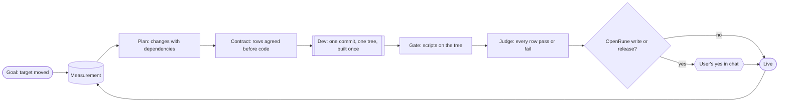

# Problem

The first principles the harness is derived from: the facts of the world we cannot change (axioms), what follows from
them (principles), and what the user wants (goals). docs/PRD.md turns the principles into constraints on any solution;
docs/ARCHITECTURE.md is the one solution we build.

## Axioms

| Id | Fact |
|---|---|
| A1 | The user wants outcomes in two products, reached with nobody watching, overnight and across days. |
| A2 | Claude Code agents do the work. Only the user's own chat session (main) can spawn them, at a turn boundary; it can vanish at any moment (usage limit, WSL restart, compaction, closed terminal) and its agents die with it. Its context is finite and shared with the user's conversation. |
| A3 | Agents are fallible and their words are not evidence. Evidence is a commit on a ref, a tree, a file on disk, GitHub state, docker state, the process table. An agent repeats work it cannot see was done, re-derives know-how written as prose, cannot see its own context size, and fixes a defect where it is named rather than as a rule across a diff. |
| A4 | Two actions are public or irreversible: a write to OpenRune/OpenRune-Server and a client release. The user alone authorizes them, in chat. Everything else is the user's own and reversible. |
| A5 | Upstream is maintained by others: one change per PR, no stacking, no deferral, no tests unless asked or the change moves items (a dupe test per such flow), a defect reported at any time, rules revised at any time. The fork's CI on a merge with current upstream `main` is the same fact as upstream's PR CI. |
| A6 | A change is live when its target contains it: client `master`, the tree the test server runs, harness `main`. A server change is done when upstream `main` contains it; every other change is done when live. |
| A7 | A build is a function of a tree; the game cache is a function of its inputs. The machine bounds how many agents, builds and clients run at once; the live server and the Android device exist once. |
| A8 | Elapsed time says nothing about what happened. |
| A9 | Python 3.12 standard library and PyYAML; git ≥ 2.38; WSL2 with systemd and mirrored networking; Docker Desktop and the Android emulator run on Windows and are started by hand; GitHub is reached with `gh`. |
| A10 | No client contacts Jagex; the user's own RuneLite and the tester account are never touched. |

## Principles

| Id | Principle | From |
|---|---|---|
| P1 | **Facts decide.** Every decision reads git, GitHub, docker, the process table, or a record bound to the tree or commit it covers. An unknown fact stops the step; it is never read as false. | A3 A8 |
| P2 | **Store only what cannot be derived**: definitions (what the user wants, the contract), judgments (a hand-over, a gate, a verdict, an approval, a measurement, an answer) and run starts and ends. A judgment is bound to what it covers and void when that moves. Everything else is derived on each read. | A2 A3 |
| P3 | **Every step is rerunnable.** A step is "done when this fact holds" plus "do this"; any process may die anywhere and the next pass continues from facts. Nothing waits on a process or a session; nothing is decided from elapsed time. | A2 A8 |
| P4 | **One authority, by credential.** Only the harness holds the credential that can write to OpenRune or publish a release; agents hold one that cannot, whatever they run. A public act happens only at the commit the user approved. | A4 |
| P5 | **Cheapest check first, each check once.** A script before an agent, an agent before the user; a check keyed by its input never runs twice for that input; a question that needs no decision of the user is not asked. | A1 A3 |
| P6 | **One tree, one build.** A change is gated, judged and deployed from one tree (its base, its dependencies, its head), built at most once, in a copy nobody commits from. | A7 A3 |
| P7 | **The contract before the code.** What "done" means for a change is a list of rows written before coding and judged once, every row pass or fail; a finding or an answer becomes a row, never a free-text round. | A3 A5 |
| P8 | **Know-how is a script, judgment is a rule.** Bring-up, builds, in-game scenarios and lookups are scripts that block on facts and return results; an agent reads rules and results, never procedures. | A3 A1 |
| P9 | **Scarce things are counted**, and every artefact is named after the change or run that owns it. | A7 |
| P10 | **The user sees derived facts only**: what runs, what waits for them, each goal's number, what happened. | A1 A3 |

## Goals

A **goal** belongs to one track and has a command that prints one number and a target. Changes of every track serve it;
a goal is measured whenever its target moves and stays measured once met.

| Track | Delivers | Goal |
|---|---|---|
| Client | RuneLite plugins in the official OSRS Android app (AlexPerrin/osrs-plugins-reverse); a release is a tagged APK | 100% of the RuneLite API interface methods working in the app, proven by the probe against the live test server |
| Server | the behaviour the client needs, on the test server at once and contributed to OpenRune | 100% of the content inventory 1:1 with the official game: each unit (from the cache) checked against RSProx recordings and the wiki, a pass flag per unit; the client never blocked on the server |
| Harness | the machinery that moves both and itself (this repo) | simpler and faster each iteration: per upstream change at most 5 runs and 1 build per tree; an agent's first edit within 10 tool calls; peak context at most 200k tokens; a due spawn waits one turn of main |

## Process

Every **change** has one shape on every track: defined, given a contract, built by a dev agent into one commit against
a tree built once, gated by scripts, judged once by a reviewer against the contract, and shipped. A server change
reaches two targets independently: the test server as soon as it is gated, upstream after the user's yes. The user is
asked only for that yes and for decisions of scope or accuracy; a maintainer's finding files a new change on the same
PR with the finding as a contract row. Each goal is measured when its target moves, and a planning run files the
changes that close the gap, with dependencies across tracks. Main, the user's chat, is woken by the harness only to
spawn an agent or show a card.

