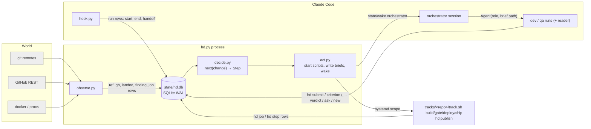

# V9 proposal

A rebuild of the harness. v8 (hd.py 3,781 lines, hook.py 727, 40 kinds of JSON state, 331 harness filings in 47 h,
the harness 55% of all runs) is context only. The three source documents are docs/PROBLEM.md, docs/PRD.md and docs/ARCHITECTURE.md. This file keeps what is about
the change from v8: 1 what v8 had that v9 does not, 2 KPI targets, 3 build and proof plan, 4 the inheritance audit,
5 default decisions.

**The design in one sentence:** the world is sampled into one SQLite ledger by observers; every decision is a pure
function of the ledger; every commitment (submission, verdict, answer, approval with its texts, publish step done) is a
row written once by the actor that made it; the pass is `observe → decide → act` and costs five `git fetch` and some
SQL when nothing moved.

---

## 1. What v8 has that v9 does not

| v8 | v9 | measured reason |
|---|---|---|
| ~40 kinds of JSON/JSONL under state/, events typed by key set | one SQLite ledger (ARCHITECTURE §2), migrations, CHECK/FK/UNIQUE | half the sweep 66–89 findings |
| approval = digest compared to texts recomputed from the live PR | approval = the card row; `publish_step` log | goblin-367 unresumable; 2 of 12 publishes interrupted |
| build/gate/row keys hashing tools files and gate.sh function bodies | key = tree + recipe string; `hd regate` explicit | 150/275 gate keys re-ran unchanged trees |
| T_int recomputed each pass, 45 pins ordered, `local/merge/*` refs | the fork branch `staging`, merged into once per head | conflicts become git merges resolved once |
| batch ships, prefix gates, bisection | serial fast-forward, one in flight per track | <20 harness changes/day |
| mechanisms, auto-joins, limit-of, supersedes | `--blocks`, `--on`, `hd fold` | 98 joins + 55 limit filings in a day |
| the pass ends runs whose step moved → successors | a run ends only by its own hand-back, stop, close, console | 49 successor runs |
| 14 hook text rules | 2 denials + scope line + context limit | ≥7 of 122 denials wrong |
| orchestrator blob reread, restart alerts, hand-off file, flag files, 72-line definition | a `session` row lifecycled like a run: bind, delta view, drain, `hd restart`, a 5-line supervisor (ARCHITECTURE §13) | definition stops changing; the ledger is the hand-off |
| always-on monitor sweep agent (open mandate, read everything, ran passes), planner role | typed `alert` rows computed by the pass, disposed by the orchestrator once, fixed by a harness dev, regressions by recurrence (ARCHITECTURE §12) | interfered with dev/qa; 331 filings, 38% regressions; findings scaled with runtime |
| 116 `gh api` + 91 `merge-base` per pass | `ref`/`landed`/`gh` rows written on change only | 15–44 s CPU per pass |
| 5,123 lines of tests over fakes | decide over ledger snapshots; small observer tests | fakes hid the stale-ref bug |
| `server-content.py`: a Python reimplementation of cache reading, dbrow decoding and gameval names | a FileStore task under `tracks/fork/` (ARCHITECTURE §11) | a second decoder drifts at every cache revision |
| three v7 sidecars (`http`, `http-desktop`, `issuer.py`) beside the game | Central serves `jav_config.ws`, the world list, accounts and sessions; two Central changes close the gap | the fork's token-login work already targets Central |
| `mcp/serve.py` hot reload; `walk_to`, session detection and token auth in the stdio bridge | an 80-line transport bridge; the game logic as `devtools` repo changes upstream | game logic in the wrong layer; the bridge changed daily |
| goals with `units`/`PASSES` plumbing, `client-launch`, goal `deps` | two goals: a script and a ledger query (ARCHITECTURE §14) | 44 of 421 changes named a goal; the server goal never measured |

Kept: spawn by path; events on edges; criteria before code; deterministic candidate commits; one-line hand-backs; the track
scripts (fork CI at `gate/<slug>` on a child of the candidate, game-data asset, CI step classifier, live key pair/modulus,
desktop instances + bearer token, mobile allowlist, network QA), now under `tracks/`; the publish
over REST; `hd triage`; the context hand-off; definitions/evidence as files; the repos' skills (client: reverse,
qa-client, network-qa; server: accuracy, dupes, pr-text, probe, qa-server). Seed criteria of all tracks move into
`criterion` with their ids; the client's are all scripted, the server's eleven judged ones stay the evaluator's.

---

## 2. KPI targets (`hd kpi`)

| metric | query sketch | v8 | v9 |
|---|---|---|---|
| runs per upstream change (median) | `count(run) group by change` for kind=change, track in (server, central, filestore) | 5 | ≤5; PR round ≤10 |
| runs ended without own record | `end_kind != 'handback'` / all | 14% | <5% |
| successor runs | runs listed with the same input after a non-handback end | 49 | 0 |
| dev runs that resubmitted the same head | dev runs with a `submitted` record and no `submitted` event of their own | — | 0 |
| harness share of runs / tokens | track=harness / all | 55% / 38% | <15% / <15% |
| harness changes filed per day | `event kind='new' and track=harness` | 331 / 47 h | <20 |
| harness changes shipped twice | `job kind='ship'` per change > 1 | 20 of 221 | ~0 |
| builds / gates per tree | `count(job) / count(distinct tree)` | 1.12 / 2.2 | 1.0 / 1.0 |
| cards withdrawn on an unchanged tree | cards per (change, tree) > 1 | 5 | 0 |
| publishes not resumed | approval with undone publish_step and no live publish job | 2 of 12 | 0 |
| pass CPU, nothing moved | `event kind='tick'` detail cpu | 3–44 s | <1 s |
| wrong hook denials | `event kind='denied'` dismissed by the orchestrator as wrong | ≥7 | 0 |
| tool calls to first edit | transcript scan, dev code runs (median) | 15 | ≤10 |
| peak context p90 | run.usage_json | 157–196k | ≤200k |
| loop code | wc -l | 4,508 | ≤1,950 |

---

## 3. Build and proof plan (each phase ends on an observed fact)

1. **Ledger + loop, harness track only.** store, observe, decide, act, hook, orchestrator.md, tracks/harness/track.sh
   (test/gate/ship/recipe), test_decide over a first snapshot. Proof: v9 ships a harness change to itself through
   its own loop; `hd kpi` reads 1 run, 1 build, 1 gate, 1 ship for it.
2. **Server track.** criteria → dev → build → gate (criteria + fork CI) → judge → staging merge + deploy → card →
   approve → publish → finding → criterion → dev → qa → card → publish. Proof: one open P2 change published to a ready PR after
   the user's yes; one maintainer finding on an existing PR answered through the criterion path; a publish killed by hand
   after its push step resumes and finishes with the approved texts.
3. **Client track.** change → build → gate (probe, network QA) → serial ship to master; a release card (published
   only on the yes). Proof: one client change live on master; the probe measured on master's tree.
4. **Alerts + KPIs.** `hd kpi` complete; the alert table fed by the pass. Proof: one alert raised from a measured
   fact (an `attempt` count of 3) is filed by the orchestrator with `--from-alert`, fixed by a harness dev run through
   the replay gate, and does not recur; one goal gap lists a dev plan-mode run that files changes with no user step.

Cutover: branch `v9` from `v8`; an empty ledger; definitions re-read from `harness/changes/`; runtime rebuilt by
observation (`hd submit` records each open change's existing dev tip, since it checks nothing);
verdicts not migrated (one re-judge per open server change); approvals none. The user actions the migration and the
merge into `main`; v8's timer stops at the cutover yes.

---

## 4. Inheritance audit

Every concept in ARCHITECTURE, with the axiom or fact that requires it. A concept whose only justification was "v8 had it" is
cut here and above.

| concept | required by | verdict |
|---|---|---|
| a change as a committed markdown file with slug, track, priority, deps | A1 (the user defines work and reads it), A5 (one change per PR, deps across repos) | keep |
| criteria agreed before code; `judge` criteria for an evaluator | A3 (agents' words are not evidence), A5 (maintainer findings) | keep; **`check` vs `gate` kinds cut**: one `script` kind, run by the gate at the candidate; the dev runs the gate script itself before `hd submit`, which only records |
| submission as a recorded commitment | A3 (a ref tip is not "done": agents push WIP) | keep; **`Limits:` section cut** (a hook text rule; an out-of-scope limit is `hd new --blocks`) |
| verdict bound to (head, criteria) | A3 | keep |
| card, approval as a copy, publish step log | A4 | keep |
| ask with typed options | A4 (scope decisions are the user's) | keep |
| triage of maintainer words by the orchestrator | A5 (an ack must not become a comment) | keep: one line of judgment beats a dev run per ack |
| candidate by merge-tree, deterministic commit | A7 (a build is a function of a tree), the CI-at-the-same-sha fact | keep |
| key = tree + recipe | A7 | keep (new in v9) |
| `staging` branch | A6/A7 (one test server, many changes) | keep (replaces v8's recomputed T_int) |
| serial fast-forward ships | nothing requires batching at <20/day | keep |
| scripts for build/up/gate/ship/measure | P6 (know-how is a script) | keep; **their home moves into this repo** (`tracks/<repo>/`): the tools branches in product repos, carried tools heads, tools rebases and conflicts, content-hashed copies, `TOOLS_ROOT` are cut; skills in `.claude/skills/` here, where spawned runs load them natively |
| orchestrator as a visible `claude --agent` session in a terminal loop | A2 (visible session spawns agents; the user chats) | keep, lifecycled (ARCHITECTURE §13) |
| wake file + inotify | A2 (a watch can wake a session) | keep |
| the hook: bind, end, two denials, scope line, context limit | A2, A4 | keep |
| systemd scope per run | A2 (agents die, processes leak), the user's "only stop what you started" | keep (one line) |
| `hd room` admission by MemTotal/nproc | A7 (the machine bounds) | **cut to a build semaphore**: N slots by `flock` on `state/build.<i>.lock`, N in hd.yaml; the room table, records and pidfd waits go |
| briefs as files | the spawn prompt names a path the hook binds on | keep |
| evidence/<slug>/ | the user's rule | keep |
| P0–P4 tiers, held band, agent count | the user's vocabulary; A7 | keep |
| pins | the fork's 45 branches the test server must carry | read once to create `staging`, then history |
| docfmt one-fact-per-line docs | v8's parallel batch ships | **cut**: docs merge like code; a conflict is the dev's |
| `kind: local` | — | **cut**: `upstream: false` on a change |
| alerts as ledger facts | A3, the monitor's failure | keep (new in v9) |
| goals as a measure command or a ledger query | A1 (outcomes), R1 | keep, reduced (ARCHITECTURE §14) |
| `.mcp.json` stdio bridges | Claude Code connects once at session start; clients come and go | keep as transport (ARCHITECTURE §11) |

---

## 5. Default decisions (overturn in feedback)

1. Keys drop tools hashing; a fixed checker re-runs by `hd regate`.
2. The evaluator is per-criterion: client and harness changes are script-judged unless given judged criteria.
3. A real `staging` branch replaces the recomputed T_int; a closed change is reverted out.
4. The pass never ends a live run; a run finishes and the next pass judges its submission against the current criteria.
5. No sweep agent and no planner role: alerts are typed ledger facts, the orchestrator files or dismisses each once, a harness dev fixes (ARCHITECTURE §13).
6. Serial ships for harness and client.
7. Joins only by `--on`; duplicates by the orchestrator's `hd fold`; no mechanism list.
8. Three hook rules; the reader role is enforced by its tool list and brief.
9. The shared GitHub token stays.
10. Cutover with an empty ledger; `hd submit` records each existing dev tip.
11. Scripts and skills live in this repo under `tracks/<repo>/` and `.claude/skills/`; the product repos' tools branches are retired after the cutover copies their content in.
12. Criterion kinds are `script` and `judge`; `hd submit` records, it does not check.
13. Builds are bounded by an N-slot flock semaphore, not by reading MemTotal.
