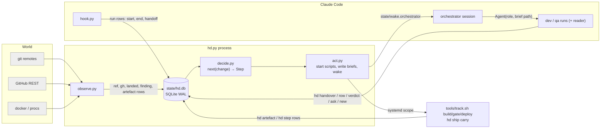
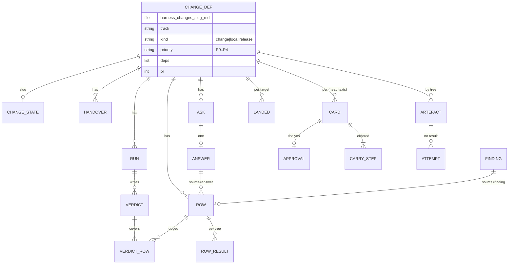
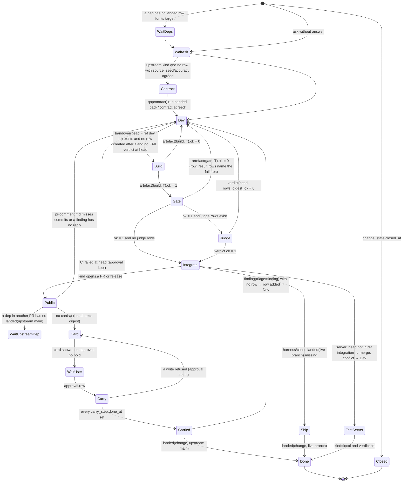
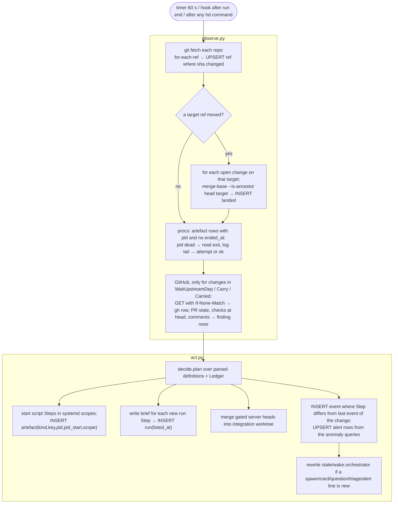
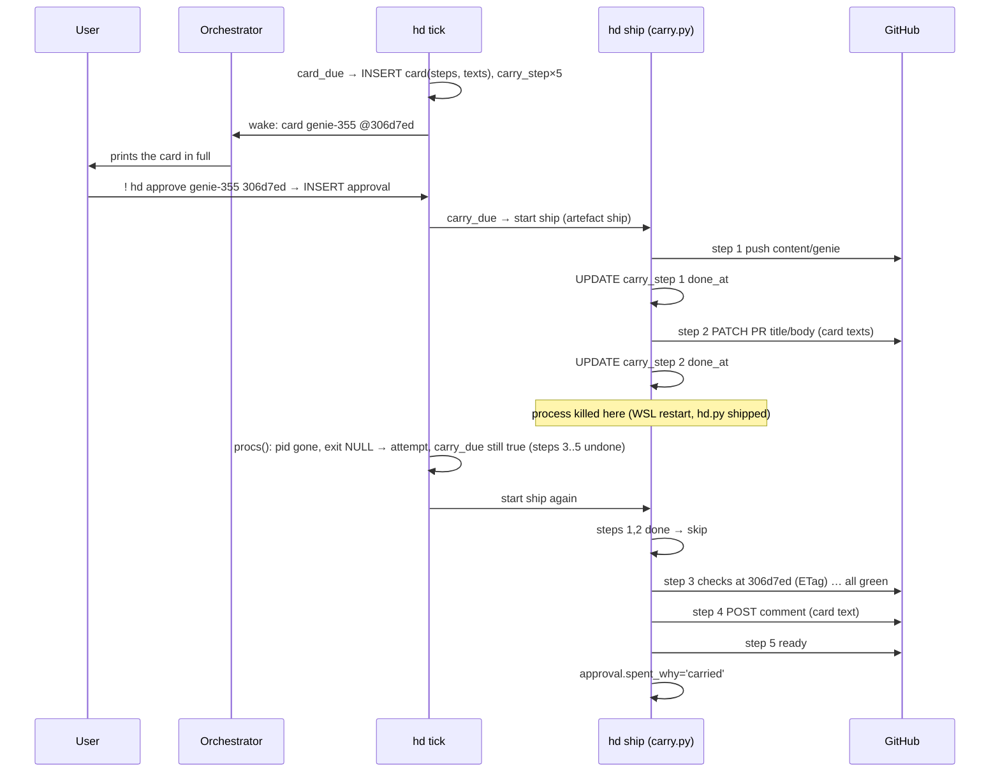
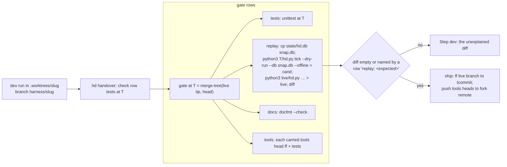
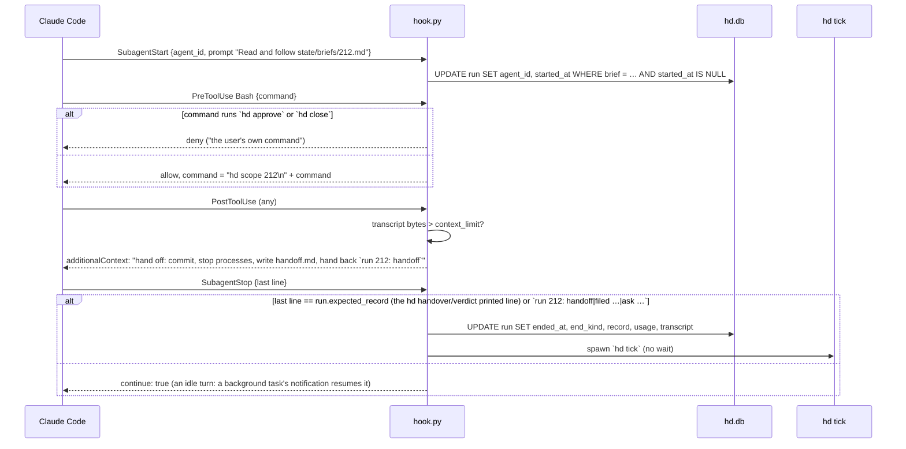
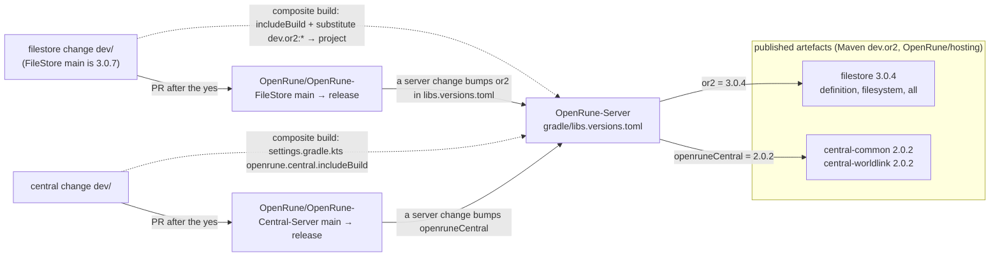

# V9 proposal

A rebuild of the harness. v8 (hd.py 3,781 lines, hook.py 727, 40 kinds of JSON state, 331 harness filings in 47 h,
the harness 55% of all runs) is context only. Sections: 1 PROBLEM, 2 PRD, 3 ARCHITECTURE (the bulk: components,
schema, state machine, modules, sequences, the hook, the roles), 4 what v8 had that v9 does not, 5 KPI targets,
6 build and proof plan, 7 default decisions.

**The design in one sentence:** the world is sampled into one SQLite ledger by observers; every decision is a pure
function of the ledger; every commitment (hand-over, verdict, answer, approval with its texts, carry step done) is a
row written once by the actor that made it; the pass is `observe → decide → act` and costs five `git fetch` and some
SQL when nothing moved.



---

## 1. PROBLEM

Axioms A1–A10 of docs/PROBLEM.md hold unchanged (agents do the work from a visible session that can die at any time;
agents' words are not evidence; only OpenRune writes and client releases are public and need the user; upstream is
maintained by others; a build is a function of a tree; elapsed time says nothing; stdlib + PyYAML + git + gh + docker).

Principles, reduced to seven:

| id | principle | v8 failure it answers |
|---|---|---|
| P1 | **Facts decide; commitments are recorded.** A decision reads the ledger. Observations are bound to what they observed (sha, etag, comment id). Commitments are written once and never recomputed. | the approval re-derived from the live PR (goblin-367 carry lost); 22 double run ends; strikes from mtimes |
| P2 | **One step, one owner, one record.** A step is "done when this row exists". A run ends only by its own hand-back, the user's stop, its change's close or its console's death. | 49 successor runs after the pass ended runs whose step moved |
| P3 | **A result belongs to the tree it checked.** Build, gate, deploy keyed by tree (+ an explicit recipe version). The checker's code is not an input. | 150 of 275 gate keys re-ran unchanged trees; 5 cards withdrawn on the same tree |
| P4 | **One authority, at the approved commit.** The carry executes the recorded approval's steps and texts, nothing else. | — |
| P5 | **Cheapest check first, each once.** Script before agent, agent before user. The evaluator is listed only where a row cannot be scripted. | qa runs on changes with only script rows |
| P6 | **Know-how is a script.** Bring-up, build, deploy, gate, measure, carry are scripts blocking on facts, logging their steps. | hung `up` and deploys with no named step |
| P7 | **Ship only what replays clean.** A harness change's pass is run against a snapshot of the live ledger before it ships. A filing joins nothing by label. | 38% of sweep findings were regressions of harness ships; 98 joins/day |

Goals: unchanged (client probe 100%; server inventory 100%, client never blocked; harness measured by `hd kpi`, §5).

Process in its simplest terms: agents build a complete PR → the user reads it as text in the console and says yes →
it is carried upstream → maintainer feedback becomes rows on the PR's one open change. Three loops run it: client, server
(three repos: the fork, Central, FileStore, §3.14) and harness.

---

## 2. PRD (R1–R8)

| R | requirement | mechanism (§3) |
|---|---|---|
| R1 Goals | a goal is measured when its target's tree moves, recorded with that tree; below target with nothing open → one dev run in plan mode on the goal (files changes, no code); a server change takes the best priority of the client changes it blocks | `measure` table, `decide.priority()` |
| R2 Flow | a defined change reaches its target with no person once its deps are live; closed → no step, leaves integration, worktrees removed; the orchestrator spawns and stops every run, never waits on the user; a run ends only by hand-back / stop / close / console death | state machine §3.3, `run.end_kind` |
| R3 Contract | typed rows written before code (`check`, `gate`, `judge`; sources seed/accuracy/answer/finding/user); hand-over passes every check row; gate = check rows then gate rows; the evaluator judges every judge row once per (head, rows), never `pass` on a row it did not check; a verdict binds to (head, rows digest); a late row lists the dev | `row`, `row_result`, `verdict`, `verdict_row` |
| R4 Authority | a complete PR is one card (ordered steps, exact texts, verdict, evidence, the three commands); `hd approve` copies the card into `approval`; the carry executes `carry_step` rows, resuming at the first undone; a new head or text = new card; maintainer words triaged `finding\|ask\|ack`; one comment per carried head; CI never re-runs at a head but by the user's word | `card`, `approval`, `carry_step`, `finding` |
| R5 Recovery | every failure repaired by the next pass from the ledger; a cause outside the head records no result and re-runs; the same cause 3× → one alert; nothing from elapsed time | `attempt`, `artefact.ok IS NULL` |
| R6 Economy | nothing checked twice per tree; one agent count; P0–P4 with a held band; harness first, PR rounds before new content; one dev + one qa per head move; events on edges; context-limit hand-off lists a successor at once | `decide.plan()`, `event` |
| R7 Visibility | `hd` prints spawns, cards, questions, triage, runs, goals; `hd kpi` prints the harness numbers; every run is an agent of the visible session | `hd.view()` |
| R8 Trees | T = merge-tree(base, deps closure, head), one deterministic commit, built once, Central and FileStore deps built in as a composite (§3.14); the fork branch `integration` is the test server's tree, gated heads merged in by the pass; harness and client ship serially by fast-forward; an upstream PR is self-contained (`no-stack` gate row) | `tree.py` in act, §3.6 |

Acceptance: docs/ACCEPTANCE.json, one test class per R over recorded ledger snapshots (§3.10).

---

## 3. ARCHITECTURE

### 3.1 Files

```
hd.py            argparse front: one function per command (§3.8), ~300 lines
store.py         connect(), MIGRATIONS, typed query helpers; the only module that opens hd.db, ~350
observe.py       world → ledger: fetch, refs, landed, gh (ETag), procs, docker, ~250
decide.py        ledger → Step per change, plan() for the pass; imports no subprocess, ~350
act.py           start a script in a systemd scope, write a brief, compute T, wake the orchestrator, ~250
carry.py         card() builds steps+texts; ship() executes carry_step rows, ~250
hook.py          SubagentStart/Stop, PreToolUse (2 rules + scope line), PostToolUse (context limit), ~150
kpi.py           the queries behind `hd kpi`, ~100
hd.yaml          repos {name, path, tools, upstream?}, agents, context_limit, hold, pins
tools/track.sh   the harness track: test | gate | ship | recipe
tools/track.md   the harness track's rules and seed rows
.claude/agents/  orchestrator.md (≤20 lines), dev.md, qa.md, reader.md      (no planner, no monitor: §3.13)
harness/goals/*.md  harness/changes/*.md     definitions, committed (format unchanged)
evidence/<slug>/    accuracy.md pr-title.txt pr-body.md pr-comment.md pr-reply-<id>.md handoff.md ...
state/hd.db         the ledger        state/<slug>/*.log   script logs      state/briefs/<run>.md
state/wake.orchestrator                 one line per new spawn/card/question/triage/alert (inotify target)
```
Product repos keep `tools/track.sh build|up|down|gate|ship|measure|log|test|recipe`, `tools/track.md`,
`.claude/skills/` on their tools branch (client `client/harness`, fork `local/harness`), run from a content-hashed
copy as in v8. Two additions: `recipe <verb>` prints the recipe version string; `up`/`deploy` call `hd step` per step.

### 3.2 Schema (store.py, migration 1)

```sql
PRAGMA journal_mode = WAL;  PRAGMA foreign_keys = ON;  PRAGMA user_version = 1;

-- runtime state of a definition (the definition itself stays harness/changes/<slug>.md)
CREATE TABLE change_state (
  slug        TEXT PRIMARY KEY,
  closed_at   TEXT, closed_words TEXT,                 -- hd close (the user)
  folded_into TEXT REFERENCES change_state(slug)       -- hd fold (the orchestrator): scope moved, no runs
);

CREATE TABLE run (
  id          INTEGER PRIMARY KEY,
  change      TEXT NOT NULL,
  role        TEXT NOT NULL CHECK (role IN ('dev','qa')),
  mode        TEXT NOT NULL CHECK (mode IN ('code','contract','judge','plan')),
  input       TEXT NOT NULL,                           -- digest of what the brief holds (head, rows, answers, verdict)
  brief       TEXT NOT NULL,                           -- state/briefs/<id>.md
  agent_id    TEXT UNIQUE,                             -- bound by the SubagentStart hook
  listed_at   TEXT NOT NULL, started_at TEXT, ended_at TEXT,
  end_kind    TEXT CHECK (end_kind IN ('handback','stop','close','console','handoff')),
  record      TEXT,                                    -- the one hand-back line
  usage_json  TEXT, transcript TEXT
);
CREATE UNIQUE INDEX run_live ON run(change) WHERE ended_at IS NULL;   -- at most one live run per change

CREATE TABLE handover (
  id INTEGER PRIMARY KEY, change TEXT NOT NULL, head TEXT NOT NULL,
  tree TEXT NOT NULL, tcommit TEXT NOT NULL,
  composite_json TEXT,                                 -- {central: tree, filestore: tree} built in by composite build (§3.14)
  tools_json TEXT,                                     -- {repo: head} carried tools heads
  limits_json TEXT NOT NULL, run INTEGER REFERENCES run(id), at TEXT NOT NULL,
  UNIQUE (change, head)
);

CREATE TABLE row (
  id INTEGER PRIMARY KEY, change TEXT NOT NULL, rid TEXT NOT NULL,
  kind   TEXT NOT NULL CHECK (kind IN ('check','gate','judge')),
  text   TEXT NOT NULL, cmd TEXT,                      -- cmd for check/gate rows
  source TEXT NOT NULL CHECK (source IN ('seed','accuracy','answer','finding','user')),
  source_id INTEGER,                                   -- answer.ask or finding.comment_id
  upstream_only INTEGER NOT NULL DEFAULT 0, waived INTEGER NOT NULL DEFAULT 0,
  created_at TEXT NOT NULL,
  UNIQUE (change, rid)
);
CREATE TABLE row_result (                              -- script rows, by tree
  row_id INTEGER REFERENCES row(id), tree TEXT NOT NULL, ok INTEGER NOT NULL, note TEXT, at TEXT NOT NULL,
  PRIMARY KEY (row_id, tree)
);
CREATE TABLE verdict (
  id INTEGER PRIMARY KEY, change TEXT NOT NULL, head TEXT NOT NULL,
  run INTEGER NOT NULL REFERENCES run(id), ok INTEGER NOT NULL,
  rows_digest TEXT NOT NULL,                           -- sha of the judge rows' (rid,text) it covers
  at TEXT NOT NULL
);
CREATE TABLE verdict_row (
  verdict INTEGER REFERENCES verdict(id), row_id INTEGER REFERENCES row(id),
  result TEXT NOT NULL CHECK (result IN ('pass','fail','not-judged')), note TEXT,
  PRIMARY KEY (verdict, row_id)
);

CREATE TABLE artefact (                                -- one row per (kind, key); ok NULL = in flight or no result
  kind TEXT NOT NULL CHECK (kind IN ('build','gate','deploy','ship','test')),
  key  TEXT NOT NULL,                                  -- "<tree>:<recipe>" ; ship: "<branch>:<tcommit>"
  change TEXT, ok INTEGER, detail TEXT,
  pid INTEGER, pid_start INTEGER, scope TEXT, log TEXT,
  started_at TEXT, ended_at TEXT, exit INTEGER,
  PRIMARY KEY (kind, key)
);
CREATE TABLE attempt (                                 -- a start that ended without a result
  id INTEGER PRIMARY KEY, kind TEXT, key TEXT, cause TEXT, exit INTEGER, at TEXT
);
CREATE TABLE step_log (                                -- resumable scripts: up, deploy, ship
  id INTEGER PRIMARY KEY, change TEXT, script TEXT, step TEXT, started_at TEXT, done_at TEXT, detail TEXT
);

CREATE TABLE ask (
  id INTEGER PRIMARY KEY, change TEXT NOT NULL, text TEXT NOT NULL,
  options_json TEXT NOT NULL,                          -- [{"id":"a","text":"...","effect":"dep server-token-auth"}, ...]
  run INTEGER REFERENCES run(id), at TEXT NOT NULL
);
CREATE TABLE answer (
  ask INTEGER PRIMARY KEY REFERENCES ask(id), option TEXT NOT NULL, words TEXT, by TEXT NOT NULL, at TEXT NOT NULL
);

CREATE TABLE card (
  id INTEGER PRIMARY KEY, change TEXT NOT NULL, head TEXT NOT NULL, pr INTEGER,
  steps_json TEXT NOT NULL, texts_json TEXT NOT NULL, digest TEXT NOT NULL, shown_at TEXT,
  UNIQUE (change, head, digest)
);
CREATE TABLE approval (
  card INTEGER PRIMARY KEY REFERENCES card(id), at TEXT NOT NULL,
  spent_at TEXT, spent_why TEXT                        -- carried, or a write GitHub refused
);
CREATE TABLE carry_step (
  card INTEGER REFERENCES card(id), n INTEGER, name TEXT NOT NULL,
  done_at TEXT, result_json TEXT,
  PRIMARY KEY (card, n)
);
CREATE TABLE hold (
  id INTEGER PRIMARY KEY, change TEXT NOT NULL, head TEXT,  -- NULL head = all heads
  why TEXT, at TEXT NOT NULL, lifted_at TEXT
);

CREATE TABLE finding (                                 -- a maintainer's word on an upstream PR
  comment_id INTEGER PRIMARY KEY, repo TEXT, pr INTEGER, author TEXT, body TEXT, url TEXT, seen_at TEXT,
  triage TEXT CHECK (triage IN ('finding','ask','ack')), triaged_at TEXT,
  change TEXT, row_id INTEGER REFERENCES row(id)
);

-- observations
CREATE TABLE ref    (repo TEXT, name TEXT, sha TEXT NOT NULL, seen_at TEXT, PRIMARY KEY (repo, name));
CREATE TABLE landed (change TEXT, target TEXT, sha TEXT, at TEXT, PRIMARY KEY (change, target));
CREATE TABLE gh     (url TEXT PRIMARY KEY, etag TEXT, status INTEGER, body TEXT, at TEXT);
CREATE TABLE stack  (change TEXT PRIMARY KEY, script TEXT, containers_json TEXT, desktops_json TEXT,
                     token TEXT, modulus TEXT, started_at TEXT);          -- v8's up.json
CREATE TABLE measure (goal TEXT, tree TEXT, value REAL, report TEXT, at TEXT, PRIMARY KEY (goal, tree));

CREATE TABLE event (id INTEGER PRIMARY KEY, at TEXT NOT NULL, kind TEXT NOT NULL, change TEXT, run INTEGER, detail TEXT);
CREATE INDEX event_change ON event(change, id);

CREATE TABLE alert (                                   -- a harness anomaly, one row per subject (§3.13)
  id INTEGER PRIMARY KEY,
  kind TEXT NOT NULL CHECK (kind IN ('attempts','run-lost','runs-per-head','ask-stale','denied','fault','ci-runner','kpi','pin-conflict','quota')),
  subject TEXT NOT NULL,                               -- e.g. 'build:9ac1…:r3', 'run:212', 'change:genie-355'
  detail TEXT NOT NULL,                                -- the evidence: log path, run id, the query's rows
  first_at TEXT NOT NULL, last_at TEXT NOT NULL, count INTEGER NOT NULL DEFAULT 1,
  disposition TEXT CHECK (disposition IN ('filed','dismissed')), change TEXT, why TEXT, by TEXT, at TEXT,
  UNIQUE (kind, subject)
);
```


`CHANGE_DEF` is the markdown definition (front matter: slug, track, kind, priority, deps, goal, units, pr, branch,
quest-mode, held). It is parsed each pass (≈400 files, <50 ms); the ledger holds only runtime rows.

### 3.3 The change state machine (decide.py)



```python
# decide.py — pure: takes a Ledger (read-only view of store) and a Change (parsed definition); no subprocess, no clock
from dataclasses import dataclass

@dataclass(frozen=True)
class Step:
    kind: str            # done|wait|run|build|gate|merge|card|carry|ship|measure|alert
    why: str             # printed by `hd`; the event detail
    role: str = ""       # dev|qa for kind == run
    mode: str = ""       # code|contract|judge|plan
    input: str = ""      # digest of the brief's inputs; a run is due while no run exists with this input unended or recorded
    key: str = ""        # build/gate/deploy/ship key

def next(L: Ledger, ch: Change) -> Step:
    for guard in GUARDS:                    # ordered; first non-None wins
        step = guard(L, ch)
        if step: return step
    return Step("done", "done")

GUARDS = [
    closed,            # change_state.closed_at              → done
    folded,            # change_state.folded_into            → done
    deps_live,         # every dep: landed(dep, dep.target) or closed; else wait
    ask_open,          # ask with no answer                  → wait
    contract_due,      # upstream kind, no run(mode=contract).record == "contract agreed" → run qa/contract
    dev_due,           # no handover at ref(dev tip), or rows created after handover.at, or last verdict at head FAIL → run dev/code
    build_due,         # artefact(build, key(T)) missing/ok NULL → build; ok 0 → run dev
    gate_due,          # artefact(gate, key(T))  missing/ok NULL → gate;  ok 0 → run dev
    judge_due,         # judge rows and no verdict(head, digest(judge rows)) → run qa/judge; ok 0 → run dev
    integrate_due,     # server: not ancestor(head, ref integration) → merge (act does it); merge conflict recorded → run dev
    upstream_dep_wait, # dep with its own PR not landed(upstream main) → wait (held card → alert)
    texts_due,         # pr-comment.md misses commits since PR live head, or a finding row with no reply file → run dev
    card_due,          # no card(change, head, digest(texts)) → card
    approval_wait,     # card and no approval and no hold → wait user; hold → wait (hidden)
    carry_due,         # approval not spent, a carry_step undone → carry
    carried_wait,      # all steps done, not landed(upstream main) → wait maintainers
    ship_due,          # harness/client: not landed(live) → ship (serial: one artefact(ship) in flight per track)
    measure_due,       # a goal whose target tree moved since measure.tree → measure
    plan_due,          # a goal below target with no open change naming it → run dev/plan on the goal's track (files changes, no code)
]

def plan(L: Ledger, changes: list[Change], cfg: Cfg) -> list[Action]:
    """The pass's action list: for each open change in priority order (harness, PR rounds, new content;
    each at the best tier it blocks; below cfg.hold → skip), next(); a run Step is listed only while
    live runs < cfg.agents and no run exists for (change, input);
    a script Step only while no artefact of its key is in flight; a card only when not shown at this digest."""
```
`priority(ch)` = min over `{ch} ∪ blocked_by(ch)` of the tier. Tiers P0–P4 as in v8; a harness change is P1 at least.

### 3.4 The pass


One pass holds the DB write lock only inside act (short transactions). A second `hd tick` while one runs exits at
once (`flock` on `state/tick.lock`). `hd tick --dry-run --db <copy> --offline` runs decide over a copy with observe
skipped: the replay gate (§3.9) and the orchestrator's read-only view.

### 3.5 observe.py

```python
def fetch(db, repo: Repo) -> set[str]:
    """git fetch --prune <remote>; git for-each-ref → UPSERT ref rows; returns names whose sha changed."""

def landed(db, repo: Repo, target: str, changes: list[Change]) -> None:
    """Called only when `target` moved. For each open change of the repo without a landed row for target:
    git merge-base --is-ancestor <dev head> <target sha> → INSERT landed. A squash/rebase merge upstream is
    detected by the PR's merged_at from gh (pr_state) instead."""

def procs(db) -> None:
    """For each artefact with pid and no ended_at: if (pid, pid_start) is gone, read state/<change>/<kind>.rc:
    exit 0 and the script wrote its result (`hd artefact ok`) → nothing; else ended_at, exit, INSERT attempt(cause =
    last log line with hex runs dropped). Exit 75 = cause outside the head: ok stays NULL (re-run next pass)."""

def gh(db, url: str) -> dict | None:
    """GET with If-None-Match from gh.etag over one keep-alive connection; 304 → stored body; 200 → UPSERT;
    403 with X-RateLimit-Remaining 0 → INSERT event(kind='quota') and return None (unknown: the step holds)."""

def pr_state(db, repo: Repo, pr: int) -> PR          # state, draft, head sha, merged_at, base
def checks(db, repo: Repo, sha: str) -> list[Check]   # latest run per check name + commit statuses
def comments(db, repo: Repo, pr: int) -> None         # review + issue comments; non-bot, not ours → INSERT OR IGNORE finding
def docker(db) -> set[str]                            # running container names (stack recovery, room)
```
Polling scope: `pr_state`/`checks`/`comments` run only for changes whose last Step is `wait upstream`, `carry` or
`wait maintainers`. Everything else about GitHub is a `landed` row or the carry's own writes.

### 3.6 act.py and trees

```python
def tree(repo: Repo, base: str, heads: list[str]) -> tuple[str, str]:
    """T: fold `git merge-tree --write-tree` over base + each dep head (closure, deps first) + head; then
    `git commit-tree <tree> -p ...` with GIT_COMMITTER_DATE = max parent committer date → (tree, tcommit).
    Deterministic: same inputs, same tcommit, so the CI child of T is the same sha and its green answers again.
    A conflict → raises Conflict(files) → Step(run dev, why=files).
    A dep in Central or FileStore adds no commit to T: its own T is built into the server build as a Gradle
    composite (§3.14) and joins the key as +c<tree12> / +f<tree12>."""

def key(kind: str, tree: str, repo: Repo) -> str:
    """f"{tree}:{recipe}" where recipe = `tools/track.sh recipe <kind>` of the repo's tools copy (a string the
    track declares; bumped by a dev when the recipe's output changes). No hashing of tools files."""

def start(db, step: Step, ch: Change) -> None:
    """systemd-run --user --scope --unit hd-<slug>-<kind>-<key12> -- tools/track.sh <verb> <slug> <key>;
    INSERT artefact(kind, key, change, pid, pid_start, scope, log=state/<slug>/<kind>-<key12>.log, started_at).
    The script writes its result with `hd artefact <kind> <key> ok|fail <detail>` as its last act; exit code to
    state/<slug>/<kind>.rc by the wrapper."""

def integrate(db, ch: Change, head: str) -> None:
    """In <fork>/.worktrees/integration: git merge --no-ff --no-edit <head> → push fork integration;
    conflict → git merge --abort; INSERT event(kind='merge-conflict', detail=files) which dev_due reads.
    Also called when ref upstream/main moved: merge main into integration; conflict → alert (a pin's)."""

def brief(db, ch: Change, step: Step) -> str:
    """Writes state/briefs/<run id>.md: definition, rows with their latest results (by current T) and verdict
    marks, answers and findings since the last handover, build/gate detail + log paths, the hand-off file if any,
    the clone/build copy/evidence paths, the exact hand-back line expected. Returns the path."""

def wake(db) -> None:
    """Rewrite state/wake.orchestrator with the head lines new since the last wake (spawn, card, question,
    triage, alert); unchanged content → no write (inotify stays quiet)."""
```
Integration branch, once: `git checkout -b integration upstream/main && for p in pins: git merge --no-ff $p`
(the user's `pins` order). A closed change: `git revert -m 1 <its merge commit>`; a conflict there is an alert.

Serial ship (harness, client): `ship_due` picks the oldest gated hand-over on the track; `tools/track.sh ship` does
`git merge-tree` of live tip + head → gate at that tree if no artefact(gate) for it → `git push origin <tcommit>:<live>`
fast-forward; tools heads pushed to the repo's own remote (`fork`, never `origin`). One `artefact(ship)` in flight
per track.

### 3.7 Card and carry (carry.py)

```python
def card(db, ch: Change, head: str) -> Card:
    """steps: push (unless PR at head) → pr (open-draft | edit title/body that differ) → ci (if pushed or draft)
    → comment (pr-comment.md + each pr-reply-<id>.md, quoting, @author once) → ready.
    Release: build-asset → notes → publish.
    texts: {title, body, comment}; digest = sha256(steps_json + texts_json).
    INSERT OR IGNORE card; INSERT carry_step rows (done_at NULL). `hd` prints it in full."""

def approve(db, slug: str, head: str, by_user: bool) -> None:
    """hd approve: refuses unless the card at (slug, head) is the latest and not held; INSERT approval(card)."""

def ship(db, card_id: int) -> None:
    """hd ship (started by the pass as artefact(kind='ship')): for each carry_step ORDER BY n with done_at NULL:
    execute with the card's texts (never re-read from evidence/); on success UPDATE done_at, result_json.
    ci: poll checks() via gh cache until every check at head concluded; a failure → event(kind='ci-failed'),
        approval kept, stop (dev_due reads it: Step dev 'CI failed at <head>').
    a GitHub write refused → approval.spent_why, stop (card_due makes a new card naming the refusal).
    a GitHub read unknown (quota) → stop with no step done; the pass restarts the ship later.
    after the last step: approval.spent_at = now, spent_why = 'carried'."""
```


v8 failed exactly at "start ship again": it recomputed the texts from the live PR (now edited by step 2) and
refused the yes.

### 3.8 Commands (hd.py)

| command | caller | writes |
|---|---|---|
| `hd` | orchestrator | pass, then the view: `spawn` lines (`Agent(dev, "Read and follow state/briefs/17.md")`), `card`, `question`, `triage`, `alert`, runs, goals |
| `hd tick [--dry-run] [--db F] [--offline]` | timer, hook | the pass; dry-run prints plan() and writes nothing |
| `hd new <slug> --track --title --body [--deps] [--blocks <c>] [--on <c>] [--touches p…] [--pr n] [--from-alert <id>]` | orchestrator, dev (plan mode or a `--blocks` fix), user | harness/changes/<slug>.md (committed by `hd commit`); `--on` appends to an open change the filer names |
| `hd fold <a> --into <b>` | orchestrator (a duplicate filing, the user's word) | change_state.folded_into; a's text appended to b |
| `hd dismiss <alert id> <why>` | orchestrator | alert.disposition; the same subject never prints again unless it recurs after a fix landed |
| `hd fault <run> <what>` | any run | alert(kind='fault', subject=<run>, detail): a harness defect met by a run, the hand-back goes on |
| `hd show <slug>` / `hd brief <run>` | runs, orchestrator | nothing (prints the brief text) |
| `hd row add <slug> <rid> --kind --text [--cmd] --source [--source-id]` | qa (contract), pass (seeds, findings) | row |
| `hd handover <slug> Limits: none\|limit:<slug>…` | dev | runs every check row at T (`row_result`), refuses on failure/conflict/prose; INSERT handover; prints the one hand-back line |
| `hd verdict <slug> <head> <rows.json>` | qa | verdict + verdict_row; refuses a missing row, `pass` on an unchecked row, no live qa run |
| `hd ask <slug> <text> --option id:text:effect…` | runs | ask (one open per change) |
| `hd answer <slug> <option> [words]` | orchestrator (the user's words) | answer; applies the effect in the same transaction (dep → definition edit; waive → row.waived; accept-difference → row source=user; close → refused: the user's own) |
| `hd triage <comment_id> finding\|ask\|ack` | orchestrator | finding.triage; finding → row(source=finding) on the PR's open change (or a new change `<track>-<pr>-c<id>`); ask → also an ask row |
| `hd hold <slug> [--all] [--lift] [why]` | orchestrator | hold |
| `hd approve <slug> <head>` / `hd close <slug> <words>` | **the user only** (`!` command; hook denies agents) | approval / change_state.closed_at |
| `hd ship <card id>` | the pass | carry_step, approval.spent |
| `hd artefact <kind> <key> ok\|fail [detail]`, `hd step <slug> <script> <step> start\|done` | track scripts | artefact, step_log |
| `hd stop <run>` | orchestrator | run.ended_at/end_kind=stop; `systemctl --user stop hd-<run>.slice` |
| `hd scope <run>` | hook (first line of every Bash command of a run) | moves the shell into `hd-<run>.slice` |
| `hd regate <slug>` | orchestrator (the user's word), a harness dev | DELETE artefact(gate) and row_result for the change's current T |
| `hd kpi` | anyone | nothing (queries) |
| `hd commit <paths> -m` | orchestrator | pathspec commit as Alex Perrin + co-author line, push live branch |
| `hd restart` | orchestrator | writes state/orchestrator-handoff.md, exits the session (orchestrator.sh restarts) |

Sample `hd` output:
```
spawn  Agent(dev, "Read and follow state/briefs/212.md")            genie-355  P2  dev: CI failed at 306d7ed (Formatting)
spawn  Agent(qa,  "Read and follow state/briefs/213.md")            cannon-354 P2  judge: 11 rows at 8c6d967
card   goblin-367 @def7f2c  PR OpenRune/OpenRune-Server#367 (update)
       1 push dev/goblin-367 → content/goblin-diplomacy (3 commits: a1b2c3d fix: …, …)
       2 edit body (differs)            ── text ──  <full body>
       3 CI at def7f2c
       4 comment                        ── text ──  <push summary> <reply to #r1734 quoting it, @maintainer>
       5 ready
       verdict PASS (run 201)  evidence/goblin-367/
       yes: ! python3 ~/osrs-harness/hd.py approve goblin-367 def7f2c   no: hd hold goblin-367 "<why>"   close: ! … close goblin-367 "<why>"
question hunter-408  "Row dupes-3 needs the shop sell path: (a) add dep server-shop-sell  (b) waive dupes-3  (c) accept-difference 'shop sell not in scope'"
triage   #448 comment 2201 by <maintainer>: "Could you also update the FileStore side?"
runs     7/7 live: 210 dev genie-355 (41 turns) …
goals    client-api 71% @4f0c…   server-content 38% @integration 9ac1…
```

### 3.9 Harness changes and the replay gate


Harness seed rows: `tests` (check), `replay` (gate), `docs` (gate), `tools` (gate). `hd new` on the harness track
takes no mechanism; a dev's out-of-scope limit is `hd new … --blocks <own slug>`; duplicates are the orchestrator's
`hd fold`.

### 3.10 Tests

```
tests/
  fixtures/ledger-<n>.db        snapshots taken with `hd snapshot` (sqlite3 backup API) at known moments of the live loop
  fixtures/defs-<n>/            the harness/changes/ tree at that moment
  test_decide.py                R1–R8 classes: plan(fixture) == expected actions; a mutation (INSERT handover, answer…) moves exactly one change's Step
  test_store.py                 every migration upgrades every older fixture; FK and CHECK violations refused
  test_observe.py               fetch/landed/procs/gh against a throwaway git repo and a recorded HTTP transcript
  test_carry.py                 ship() over a fake GitHub transport: kill after step n → rerun completes n+1..5 with the card's texts
  test_hook.py                  the hook's JSON in/out: bind, end, denied approve, scope line, context limit
```
No fakes of git for decide.py: it takes a Ledger and never calls a subprocess.

### 3.11 The hook (hook.py)


That is the whole hook: bind, end, two denials, the scope line, the context limit. No text rules on git verbs,
kill, pgrep, timeout, loops or desktop ports (the slice and the devtools bearer token enforce those facts).

### 3.12 Roles

`.claude/agents/orchestrator.md`, complete:
```
---
name: orchestrator
description: Drives the harness loop and is the user's chat. Spawns and stops runs. Writes no code.
---
`hd` is `python3 ~/osrs-harness/hd.py`. You hold no state.
1. Arm the watch (Monitor, timeout 1800000): `inotifywait -qm -e close_write --format %f ~/osrs-harness/state | grep --line-buffered -x wake.orchestrator | while read f; do cat ~/osrs-harness/state/$f; done`. Re-arm before every idle.
2. On a wake, a hand-back, the user's words or the watch's expiry: run `hd` and do what each section says:
   spawn → call Agent exactly as printed, in the background; card → show it whole; question → ask in your reply;
   triage → `hd triage <id> finding|ask|ack` by your own judgment (unsure → finding);
   alert → dispose of it now, no investigation: `hd new --track harness --from-alert <id> --title "…"` (a harness
   defect: a dev run investigates) or `hd dismiss <id> "<why>"` (noise, or the user's business: tell them in one line).
3. A hand-back is one line: TaskStop that agent. Any other notification: leave it.
4. The user's words: a change → `hd new`; an answer → `hd answer <slug> <option> "<words>"`; wait/no → `hd hold`;
   an instruction to a live run → SendMessage. Their yes and close are theirs (`! hd approve|close`). Commit definitions with `hd commit`.
5. `hd` prints `restart` → `hd restart` (tools/orchestrator.sh starts your successor with the hand-off).
Never: approve, close, product code, EnterWorktree, AskUserQuestion, a pass in a subagent. Times US Eastern.
```
dev.md / qa.md / reader.md: v8's substance, rewritten short, one wait rule (foreground; a step still
running at 180 s is backgrounded by Claude Code and its notification resumes you; game events by `wait_for`), one
hand-back line each (`run <id>: handed over <sha> Limits: …` | `run <id>: PASS|FAIL n rows` | `run <id>: contract
agreed` | `run <id>: filed <slug>` | `run <id>: ask` | `run <id>: handoff`). The brief carries the expected line.

Sample brief (`state/briefs/212.md`, abridged):
```
# run 212: dev genie-355 (server, P2)  step: CI failed at 306d7ed (Formatting)
clone ~/src/OpenRune-Server/.worktrees/genie-355   build copy …/genie-355-build   evidence ~/osrs-harness/evidence/genie-355
rules: ~/src/OpenRune-Server/.worktrees/harness/tools/track.md   skills: accuracy, dupes, pr-text, probe, qa-server
## definition            (harness/changes/genie-355.md verbatim)
## rows @T 9ac1…         evidence   check  ok | subject check ok | … | ci gate FAIL: Formatting (spotless on genie/Genie.kt:41) | claims judge pass@306d7ed | …
## since your last hand-over
answer 14 (the user, to "…"): option b — waive dupes-3 "the lamp cannot be sold"
finding 2201 by <maintainer>: "Could you also …"   → row finding-2201 (judge)
## hand back exactly:  run 212: handed over <sha> Limits: none
```

### 3.13 The agent model (no planner, no monitor)

Roles are derived from the work that needs a model, not from v8's cast:

| work | who | why a model is needed |
|---|---|---|
| write product or harness code for one change | **dev** run (mode `code`) | the work itself |
| decide what changes close a goal's gap | **dev** run (mode `plan`) on the goal's track | reads the measurement report, files `hd new` changes with cross-track deps; no code; same role because it needs the track's skills and rules, not a separate persona |
| write the contract before code (server, central) | **qa** run (mode `contract`) | an evaluator proposes the rows the generator must meet (the article's agreed sprint contract) |
| judge rows a script cannot | **qa** run (mode `judge`) | skepticism separate from the generator |
| look something bulky up | **reader** sub-agent of a run | context economy; read-only by tool list |
| spawn, stop, show, triage, file, dismiss | **orchestrator** session | the only long-lived agent; the user's chat; holds no state |

Harness defects are not found by an agent looking for them. They are **typed facts the pass computes into the
`alert` table**, each with a dedup key `(kind, subject)` and its evidence:

| kind | subject | computed from |
|---|---|---|
| `attempts` | kind:key | 3 `attempt` rows on one key, or on one cause, with no result |
| `run-lost` | change | two runs of a change ended `console` or `stop` without a record |
| `runs-per-head` | change | >5 runs since the last handover |
| `ask-stale` | ask id | an ask open while its change handed over twice |
| `denied` | run:rule | a hook denial (each one; the orchestrator dismisses wrong ones, and a kind dismissed 3× is an alert on the rule) |
| `fault` | run | `hd fault <run> <what>`: a run met a broken script or a harness step it could not do |
| `ci-runner` | gate key | fork CI failed at a step the head does not touch, three times |
| `kpi` | metric | a §5 metric past its target at the day's roll-up |
| `pin-conflict` | pin | upstream main no longer merges with a pin in `integration` |
| `quota` | api | GitHub refused on quota |

`hd` prints each alert without a disposition once. The orchestrator disposes of it at once, with no investigation:
`hd new --track harness --from-alert <id> …` (the alert's detail becomes the change's body and its evidence) or
`hd dismiss <id> <why>`. A harness dev run investigates and fixes at the root; the replay gate (§3.9) checks the fix
against the live ledger before it ships. An alert whose subject recurs after its change landed re-prints as a
regression (`count`, `last_at` > `landed.at`): this replaces the sweep's "validate that shipped changes landed".

What the v8 monitor taught, and the property that answers it:

| v8 monitor | v9 |
|---|---|
| ran continuously with an open mandate ("find harness bugs"); findings scaled with runtime | nothing runs to look; alerts are computed from the ledger, bounded by anomalies |
| read all state and transcripts while devs and qa ran; ran passes, held locks | the pass computes alerts in SQL; the orchestrator never investigates; a dev run reads only its alert's evidence |
| each finding became a filing within minutes (331 in 47 h), 38% regressions | one alert → one disposition; a filing is a human-size change with evidence attached; the replay gate blocks regressions |
| a planner role to "merge changes per mechanism" (never cleanly separable from the orchestrator) | no planner; `hd fold` by the orchestrator on a visible duplicate; goal planning is a dev run |
| validated landed changes by re-reading git each sweep | `landed` rows and alert recurrence |
| the orchestrator restarted the sweep every session | nothing to restart |

`hd kpi` (kpi.py) is the harness's measurement: one SQL query per §5 row; the `kpi` alert is its daily roll-up.

### 3.14 Tracks and repos

Three loops, five repos. The server loop spans the fork and the two OpenRune libraries it depends on; each is a repo
in hd.yaml with its upstream, a track with its own tools branch, base and head, and its own PRs.

| repo (hd.yaml key) | upstream | base → head | delivers | serves |
|---|---|---|---|---|
| `client` AlexPerrin/osrs-plugins-reverse | — | `main` → `client/<slug>` | RuneLite plugins in the official Android app, APK releases | goal client-api |
| `fork` AlexPerrin/OpenRune-Server | OpenRune/OpenRune-Server | upstream `main` → `dev/<slug>` | game content and behaviour; the test server | goal server-content; unblocks the client |
| `central` AlexPerrin/OpenRune-Central-Server | OpenRune/OpenRune-Central-Server | upstream `main` → `dev/<slug>` | accounts, sessions, world-link auth, `jav_config.ws`, `worldslist.ws` (`central-app`, `central-common`, `central-worldlink`) | the login path the client needs (token login, whitelist binds: `dev/central-token-login-op`, `dev/central-login-whitelist-binds` already on the fork); replaces the sidecars (below) |
| `filestore` AlexPerrin/OpenRune-FileStore | OpenRune/OpenRune-FileStore | upstream `main` → `dev/<slug>` | the cache library (`dev.or2:filestore`, `definition`, `filesystem`, `tools`, `all`): cache I/O, every config codec (`DBRowCodec`, `DBTableCodec`, …), gameval references, packing, a JS5 server | goal server-content: the inventory and packing read the cache through it; replaces `server-content.py` (below) |
| `harness` AlexPerrin/osrs-harness | — | live branch → `harness/<slug>` | this repo | — |

How the server consumes the libraries, and therefore how a change in them reaches the test server and upstream:



- **A server change that depends on a library change** names it in `deps`. Its T is the fork tree alone; the
  library dep's own T is built in by a Gradle composite build (Central: the fork's `openrune.central.includeBuild`
  property; FileStore: an init script substituting `dev.or2:filestore|definition|filesystem|tools|all` with the
  project, as v8's `central.init.gradle` does for Central), recorded in `handover.composite_json`, and joins the build
  key as `+c<tree12>` / `+f<tree12>`. The test server image carries the composite, so a Central or FileStore change is
  live on the test server as soon as a server tree built with it deploys.
- **Upstream** each library change is its own PR on its own repo, carried after the user's yes like any other. A
  server change built on a library head is not self-contained upstream until the published version holds it: it waits
  (`upstream_dep_wait`) for the library PR's merge and release, then a server change bumps the version in
  `libs.versions.toml` (`dev_due` lists it with that reason).
- **Gate and judge** per library: `gradle test` at T (FileStore's tests against the fork's live cache `data/cache`),
  the text rows, fork CI; judge rows from the gated build and the diff (nothing comes up for FileStore; a Central
  change is judged from a server `up` built with it).
- **Central upstream hold** (the user's standing word): Central PRs stay fork-only until the login work clears, then
  the auth PRs are bundled. In v9 that is a `hold` row with `head NULL` on each Central change, lifted by the user's
  word: cards are recorded but not shown.

**FileStore replaces `harness/goals/server-content.py`.** That script (140 lines of Python) reimplements the cache:
it reads `main_file_cache.dat2`/`.idx*` sector by sector, decodes the reference table and bzip2/gzip containers,
parses dbrow definitions (config group 38) by opcode to find each row's dbtable, and reads names out of
`gamevals.dat`, to emit `server-content.json` (one unit per quest, skill, minigame and boss dbrow). Every one of
those steps is FileStore's job (`filestore` for the store, `definition/osrs` `DBRowCodec` and `DBTableCodec` for the
rows, `tools/gameval` for the names), and a second decoder drifts from the first at every cache revision. In v9 the
inventory is a FileStore-based task on the fork's tools branch, run by `tools/track.sh measure` in the build
container (where Gradle already is), writing the same JSON; `server-content.py` is deleted and osrs-mcp reads the
task's dumps. The harness itself stays stdlib Python (A9): the JVM work lives in the server track's tools.

**Central replaces the sidecars.** The live stack today is the game image plus three v7 containers: `http` and
`http-desktop` (image `osrs-rsps-test:241`, data from v7's `SIDECAR_DATA`) serving `jav_config.ws` and `slr.ws` to
the mobile and the desktops, and `issuer.py` (the APK's OIDC sign-in, the game-session API `sessions`/`accounts`/
`tokens`, and the HMAC token the game's `token-login` block verifies). Central already serves `/jav_config.ws` (a
remote template with `javConfig.configProps` overrides), `/worldslist.ws`, `/worlds.js`, accounts, sessions and
world-link auth, and the fork's `dev/central-token-login-op` and `dev/central-login-whitelist-binds` carry the token
login. Two gaps remain, each a Central change (fork first, upstream when the hold lifts): a local `jav_config.ws`
template source (today `remoteUrlTemplate` fetches `client.blurite.io`; the privacy rule needs a file or the fork's
own copy), and the official client's sign-in and game-session endpoints that `issuer.py` emulates (the AppAuth
authorization and token endpoints behind params 11 and 22, `POST sessions`, `GET accounts`, `tokens`), minting the
token the game verifies. When both land the stack is game + Central + Postgres, `issuer.py`, `osrs-rsps-test:241` and
`SIDECAR_DATA` go, and docs/ISSUES.md's "sidecar data and image come from v7" entry closes. Until then the compose
keeps the sidecars beside Central, behind the same `track.sh ship`.

---

## 4. What v8 has that v9 does not

| v8 | v9 | measured reason |
|---|---|---|
| ~40 kinds of JSON/JSONL under state/, events typed by key set | one SQLite ledger (§3.2), migrations, CHECK/FK/UNIQUE | half the sweep 66–89 findings |
| approval = digest compared to texts recomputed from the live PR | approval = the card row; `carry_step` log | goblin-367 unresumable; 2 of 12 carries interrupted |
| build/gate/row keys hashing tools files and gate.sh function bodies | key = tree + recipe string; `hd regate` explicit | 150/275 gate keys re-ran unchanged trees |
| T_int recomputed each pass, 45 pins ordered, `local/merge/*` refs | the fork branch `integration`, merged into once per head | conflicts become git merges resolved once |
| batch ships, prefix gates, bisection | serial fast-forward, one in flight per track | <20 harness changes/day |
| mechanisms, auto-joins, limit-of, supersedes | `--blocks`, `--on`, `hd fold` | 98 joins + 55 limit filings in a day |
| the pass ends runs whose step moved → successors | a run ends only by its own hand-back, stop, close, console | 49 successor runs |
| 14 hook text rules | 2 denials + scope line + context limit | ≥7 of 122 denials wrong |
| orchestrator blob reread, restart alerts, 72-line definition | 15 lines executing `hd`'s text | definition stops changing |
| always-on monitor sweep agent, planner role | typed `alert` rows from the ledger, dispositioned by the orchestrator, fixed by a harness dev (§3.13) | interfered with dev/qa; 331 filings, 38% regressions |
| 116 `gh api` + 91 `merge-base` per pass | `ref`/`landed`/`gh` rows written on change only | 15–44 s CPU per pass |
| 5,123 lines of tests over fakes | decide over ledger snapshots; small observer tests | fakes hid the stale-ref bug |

Kept: spawn by path; events on edges; contract before code; deterministic T commits; one-line hand-backs; the track
scripts (fork CI at `gate/<slug>` on a child of T, game-data asset, CI step classifier, live key pair/modulus,
desktop instances + bearer token, mobile allowlist, network QA, docfmt); `hd room`; copy-and-exec tools; the carry
over REST; `hd triage`; the context hand-off; definitions/evidence as files; the repos' skills (client: reverse,
qa-client, network-qa; server: accuracy, dupes, pr-text, probe, qa-server). Seed rows of all three tracks move into
`row` with their ids; the client's are all script rows, the server's eleven judge rows stay the evaluator's.

---

## 5. KPI targets (`hd kpi`)

| metric | query sketch | v8 | v9 |
|---|---|---|---|
| runs per upstream change (median) | `count(run) group by change` for kind=change, track in (server, central, filestore) | 5 | ≤5; PR round ≤10 |
| runs ended without own record | `end_kind != 'handback'` / all | 14% | <5% |
| successor runs | runs listed with the same input after a non-handback end | 49 | 0 |
| harness share of runs / tokens | track=harness / all | 55% / 38% | <15% / <15% |
| harness changes filed per day | `event kind='new' and track=harness` | 331 / 47 h | <20 |
| harness changes shipped twice | `artefact kind='ship'` per change > 1 | 20 of 221 | ~0 |
| builds / gates per tree | `count(artefact) / count(distinct tree)` | 1.12 / 2.2 | 1.0 / 1.0 |
| cards withdrawn on an unchanged tree | cards per (change, tree) > 1 | 5 | 0 |
| carries not resumed | approval with undone carry_step and no live ship | 2 of 12 | 0 |
| pass CPU, nothing moved | `event kind='tick'` detail cpu | 3–44 s | <1 s |
| wrong hook denials | `event kind='denied'` dismissed by the orchestrator as wrong | ≥7 | 0 |
| tool calls to first edit | transcript scan | 15 | ≤10 |
| peak context p90 | run.usage_json | 157–196k | ≤200k |
| loop code | wc -l | 4,508 | ≤1,950 |

---

## 6. Build and proof plan (each phase ends on an observed fact)

1. **Ledger + loop, harness track only.** store, observe, decide, act, hook, orchestrator.md, tools/track.sh
   (test/gate/ship/recipe), test_decide over a first snapshot. Proof: v9 ships a harness change to itself through
   its own loop; `hd kpi` reads 1 run, 1 build, 1 gate, 1 ship for it.
2. **Server track.** contract → dev → build → gate (rows + fork CI) → judge → integration merge + deploy → card →
   approve → carry → finding → row → dev → qa → card → carry. Proof: one open P2 change carried to a ready PR after
   the user's yes; one maintainer finding on an existing PR answered through the row path; a carry killed by hand
   after its push step resumes and finishes with the approved texts.
3. **Client track.** change → build → gate (probe, network QA) → serial ship to master; a release card (published
   only on the yes). Proof: one client change live on master; the probe measured on master's tree.
4. **Alerts + KPIs.** `hd kpi` complete; the alert table fed by the pass. Proof: one alert raised from a measured
   fact (an `attempt` count of 3) is filed by the orchestrator with `--from-alert`, fixed by a harness dev run through
   the replay gate, and does not recur; one goal gap lists a dev plan-mode run that files changes with no user step.

Cutover: branch `v9` from `v8`; an empty ledger; definitions re-read from `harness/changes/`; runtime rebuilt by
observation (hand-overs re-recorded by `hd handover` on the existing dev tips by a dev run per open change, or by
the user's one-shot `hd adopt <slug>` that records the tip without re-running checks — a default decision, §7.10);
verdicts not migrated (one re-judge per open server change); approvals none. The user actions the migration and the
merge into `main`; v8's timer stops at the cutover yes.

---

## 7. Default decisions (overturn in feedback)

1. Keys drop tools hashing; a fixed checker re-runs by `hd regate`.
2. The evaluator is per-row: client and harness changes are script-judged unless given judge rows.
3. A real `integration` branch replaces the recomputed T_int; a closed change is reverted out.
4. The pass never ends a live run; a run finishes and the next pass judges its hand-over against the current rows.
5. No sweep agent and no planner role: alerts are typed ledger facts, the orchestrator files or dismisses each once, a harness dev fixes (§3.13).
6. Serial ships for harness and client.
7. Joins only by `--on`; duplicates by the orchestrator's `hd fold`; no mechanism list.
8. Three hook rules; the reader role is enforced by its tool list and brief.
9. The shared GitHub token stays.
10. Cutover with an empty ledger; `hd adopt <slug>` records existing dev tips as hand-overs without re-running checks.
